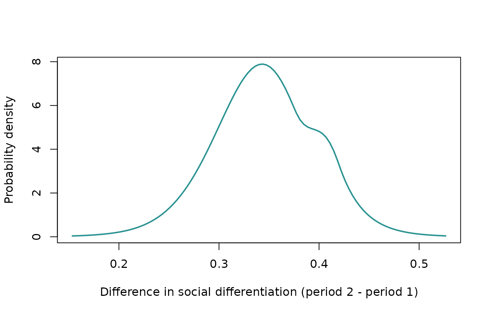
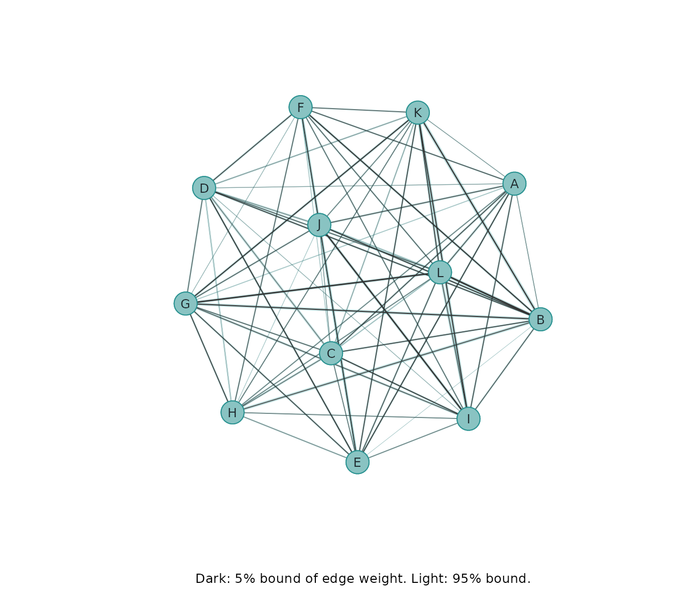
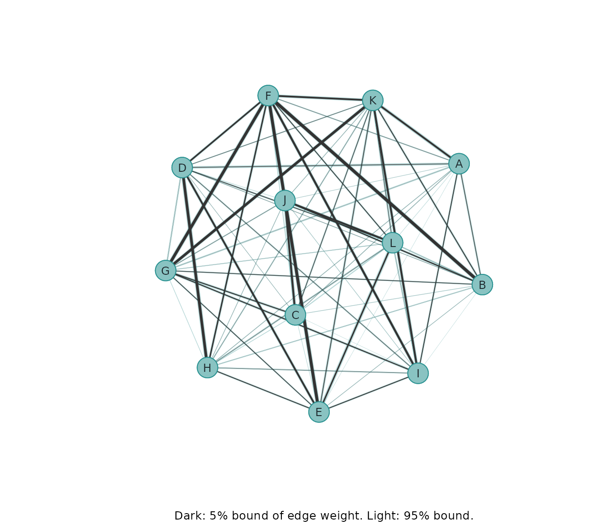

# Comparing networks

This article shows how to compare two or more networks, such as networks
from two seasons, two study periods or two groups. Each network is
estimated with its own edge model, and the comparison uses samples
(posterior draws) from those models, so the uncertainty in each network
is carried into the comparison.

It assumes familiarity with fitting edge models
([`vignette("getting_started")`](https://bisonr.org/articles/getting_started.md)),
network metrics
([`vignette("network_metrics")`](https://bisonr.org/articles/network_metrics.md))
and [`bison_brm()`](https://bisonr.org/reference/bison_brm.md)
([`vignette("bison_brms")`](https://bisonr.org/articles/bison_brms.md)).

``` r

library(bisonR)
```

## Simulated data

We simulate observations of the same 12 individuals in two periods. In
each period, the edge weight of each dyad is drawn on the logit
(log-odds) scale from a normal distribution with mean -1.5. The standard
deviation is 0.5 in the first period and 1.5 in the second, so
relationships vary more in strength in the second period (higher social
differentiation). Each dyad is observed for between 10 and 40 sampling
periods, and the data are aggregated to one row per dyad.

``` r

simulate_period <- function(edge_sd, num_nodes = 12) {
  nodes <- LETTERS[1:num_nodes]
  dyads <- t(combn(num_nodes, 2))
  logit_weight <- rnorm(nrow(dyads), mean = -1.5, sd = edge_sd)
  effort <- sample(10:40, nrow(dyads), replace = TRUE)
  data.frame(
    node_1_id = factor(nodes[dyads[, 1]], levels = nodes),
    node_2_id = factor(nodes[dyads[, 2]], levels = nodes),
    event = rbinom(nrow(dyads), effort, plogis(logit_weight)),
    effort = effort
  )
}

df_1 <- simulate_period(edge_sd = 0.5)
df_2 <- simulate_period(edge_sd = 1.5)
head(df_1)
#>   node_1_id node_2_id event effort
#> 1         A         B     4     35
#> 2         A         C     6     24
#> 3         A         D     3     35
#> 4         A         E    10     38
#> 5         A         F     7     33
#> 6         A         G     1     19
```

## Fitting the edge models

An edge model is fitted to each dataset separately. There are no
observation-level effects, so the conjugate binary model can be used.
Conjugate models calculate the posterior directly, which is fast, but
they cannot include extra effects:

``` r

priors <- get_default_priors("binary_conjugate")

fit_1 <- bison_model(
  (event | effort) ~ dyad(node_1_id, node_2_id),
  data = df_1,
  model_type = "binary_conjugate",
  priors = priors
)
fit_2 <- bison_model(
  (event | effort) ~ dyad(node_1_id, node_2_id),
  data = df_2,
  model_type = "binary_conjugate",
  priors = priors
)
```

The models should be checked in the usual way before they are compared
(see
[`vignette("getting_started")`](https://bisonr.org/articles/getting_started.md)).

## Comparing global metrics directly

The simplest comparison is to calculate the posterior distribution of a
metric for each network and compare the two. Here we use the coefficient
of variation of edge weights (`global_cv`), a measure of social
differentiation:

``` r

cv_1 <- extract_metric(fit_1, "global_cv")
cv_2 <- extract_metric(fit_2, "global_cv")

rbind(
  period_1 = quantile(cv_1, probs = c(0.05, 0.5, 0.95)),
  period_2 = quantile(cv_2, probs = c(0.05, 0.5, 0.95))
)
#>                 5%       50%       95%
#> period_1 0.4668075 0.5293978 0.5944681
#> period_2 0.8158850 0.8761570 0.9335595
```

``` r

dens_1 <- density(cv_1)
dens_2 <- density(cv_2)
plot(
  dens_1, xlim = range(dens_1$x, dens_2$x), ylim = c(0, max(dens_1$y, dens_2$y)),
  main = "", xlab = "Social differentiation (CV)", lwd = 2
)
lines(dens_2, lwd = 2, lty = 2)
legend("topright", legend = c("Period 1", "Period 2"), lty = c(1, 2), lwd = 2, bty = "n")
```


Subtracting one set of samples from the other, draw by draw, gives the
posterior distribution of the difference. The two edge models were
fitted to independent data, so their posterior draws are independent and
can be paired in any order:

``` r

cv_diff <- cv_2 - cv_1
quantile(cv_diff, probs = c(0.05, 0.5, 0.95))
#>        5%       50%       95% 
#> 0.2593564 0.3463130 0.4344508
mean(cv_diff > 0)
#> [1] 1
plot_metric(cv_diff, "Difference in social differentiation (period 2 - period 1)")
```



`mean(cv_diff > 0)` is the posterior probability that social
differentiation is higher in the second period. Here all draws of the
difference are positive, consistent with the simulation.

Pairing draws in any order is only valid for independent models. For two
quantities from the *same* network, such as the strength of two nodes,
both should be calculated from the same matrix returned by a single call
to [`extract_metric()`](https://bisonr.org/reference/extract_metric.md),
because each call samples a new set of posterior draws (see
[`vignette("posterior_networks")`](https://bisonr.org/articles/posterior_networks.md)).

## Global regression

The same comparison can be made with a global regression in
[`bison_brm()`](https://bisonr.org/reference/bison_brm.md). This needs a
list of edge models and a data frame with one row per network, in the
same order as the list. The `bison_network` column identifies each
network:

``` r

df_global <- data.frame(
  bison_network = factor(1:2),
  period = c("first", "second")
)

fit_global <- bison_brm(
  bison(global_cv(bison_network)) ~ period,
  list(fit_1, fit_2),
  df_global,
  num_draws = 5, # Small for demonstration; use 100 or more in practice
  refresh = 0,
  silent = 2
)
#> Warning: 20 of 2000 (1.0%) transitions ended with a divergence.
#> See https://mc-stan.org/misc/warnings for details.
#> Warning: 231 of 2000 (12.0%) transitions ended with a divergence.
#> See https://mc-stan.org/misc/warnings for details.
#> Warning: 28 of 2000 (1.0%) transitions ended with a divergence.
#> See https://mc-stan.org/misc/warnings for details.
#> Warning: 25 of 2000 (1.0%) transitions ended with a divergence.
#> See https://mc-stan.org/misc/warnings for details.
#> Warning: 90 of 2000 (4.0%) transitions ended with a divergence.
#> See https://mc-stan.org/misc/warnings for details.
summary(fit_global)
#> Warning: There were 394 divergent transitions after warmup. Increasing
#> adapt_delta above 0.8 may help. See
#> http://mc-stan.org/misc/warnings.html#divergent-transitions-after-warmup
#>  Family: gaussian 
#>   Links: mu = identity 
#> Formula: bison_global_cv ~ period 
#>    Data: structure(list(data = structure(list(bison_network (Number of observations: 2) 
#>   Draws: 10 chains, each with iter = 2000; warmup = 1000; thin = 1;
#>          total post-warmup draws = 10000
#> 
#> Regression Coefficients:
#>              Estimate Est.Error l-95% CI u-95% CI
#> Intercept        0.45      2.52    -4.91     5.61
#> periodsecond     0.46      4.29    -8.04     9.61
#> 
#> Further Distributional Parameters:
#>       Estimate Est.Error l-95% CI u-95% CI
#> sigma     2.26      2.06     0.27     7.52
#> 
#> Draws were sampled using sample(hmc). Overall Rhat and ESS estimates
#> are not informative for brm_multiple models and are hence not displayed.
#> Please see ?brm_multiple for how to assess convergence of such models.
```

With two networks the regression has only two observations, which is too
few to estimate an intercept, a coefficient and a residual standard
deviation reliably. This shows in the very wide credible interval (the
range that contains the coefficient with high posterior probability) for
`periodsecond`, which is much wider than the interval for the difference
calculated directly above, and in the divergent transition warnings.
Global regressions are more useful when there are many networks, for
example one per group or one per time window, and other variables to
include. With only two or three networks, the direct comparison of
posterior distributions is usually more informative.

## Comparing edges present in both networks

Edge weights can be compared across networks with a dyadic regression. A
list of edge models is given with a matching list of data frames, one
row per dyad. Each data frame can only contain dyads that are in its
edge model, so to compare the edges present in both networks, both data
frames should contain only those dyads. Here the same individuals were
observed in both periods, so every dyad appears in both. The
`(1 | mm(node_1_id, node_2_id))` term is a multi-membership random
effect, which estimates an effect for each node that applies to every
dyad the node is part of, because edges that share a node are not
independent:

``` r

df_dyadic_1 <- df_1[, c("node_1_id", "node_2_id")]
df_dyadic_2 <- df_2[, c("node_1_id", "node_2_id")]

fit_edges <- bison_brm(
  bison(edge_weight(node_1_id, node_2_id)) ~ bison_network + (1 | mm(node_1_id, node_2_id)),
  list(fit_1, fit_2),
  list(df_dyadic_1, df_dyadic_2),
  num_draws = 5, # Small for demonstration; use 100 or more in practice
  refresh = 0,
  silent = 2
)
#> Warning: 3 of 2000 (0.0%) transitions ended with a divergence.
#> See https://mc-stan.org/misc/warnings for details.
#> Warning: 1 of 2000 (0.0%) transitions ended with a divergence.
#> See https://mc-stan.org/misc/warnings for details.
#> 
#> Warning: 1 of 2000 (0.0%) transitions ended with a divergence.
#> See https://mc-stan.org/misc/warnings for details.
summary(fit_edges)
#> Warning: There were 5 divergent transitions after warmup. Increasing
#> adapt_delta above 0.8 may help. See
#> http://mc-stan.org/misc/warnings.html#divergent-transitions-after-warmup
#>  Family: gaussian 
#>   Links: mu = identity 
#> Formula: bison_edge_weight ~ bison_network + (1 | mm(node_1_id, node_2_id)) 
#>    Data: structure(list(data = structure(list(node_1_id = s (Number of observations: 132) 
#>   Draws: 10 chains, each with iter = 2000; warmup = 1000; thin = 1;
#>          total post-warmup draws = 10000
#> 
#> Multilevel Hyperparameters:
#> ~mmnode_1_idnode_2_id (Number of levels: 12) 
#>               Estimate Est.Error l-95% CI u-95% CI
#> sd(Intercept)     0.49      0.29     0.04     1.12
#> 
#> Regression Coefficients:
#>                Estimate Est.Error l-95% CI u-95% CI
#> Intercept         -1.42      0.24    -1.92    -0.94
#> bison_network2    -0.09      0.24    -0.57     0.38
#> 
#> Further Distributional Parameters:
#>       Estimate Est.Error l-95% CI u-95% CI
#> sigma     1.31      0.12     1.08     1.55
#> 
#> Draws were sampled using sample(hmc). Overall Rhat and ESS estimates
#> are not informative for brm_multiple models and are hence not displayed.
#> Please see ?brm_multiple for how to assess convergence of such models.
```

Edge weights in
[`bison_brm()`](https://bisonr.org/reference/bison_brm.md) are on the
logit scale for binary models. The `bison_network2` coefficient is the
difference in mean logit edge weight between the second network and the
first. Its credible interval includes zero, which is consistent with the
simulation: the mean edge weight on the logit scale was the same in both
periods, and only the spread differed. Comparing means does not detect a
difference in spread, so the metric or model should be chosen to match
the question.

If the edge weights of the same dyad are expected to be correlated
across networks, a dyad-level random effect (which estimates a separate
effect for each dyad, shared across networks) can also be added, using a
column that identifies each dyad.

## Plotting networks with the same layout

[`plot_network()`](https://bisonr.org/reference/plot_network.md) chooses
a new layout each time it is called, which makes networks hard to
compare visually. It returns the layout it used, which can be passed to
later plots:

``` r

layout <- plot_network(fit_1, lwd = 5)
```



``` r

plot_network(fit_2, lwd = 5, layout = layout)
```



The layout is a matrix of node coordinates in the order of the nodes in
the model, so this only works when the networks contain the same nodes
in the same order. Here both datasets use the same factor levels for the
node columns. For networks with different individuals, give both
datasets the same set of factor levels before fitting the edge models.
