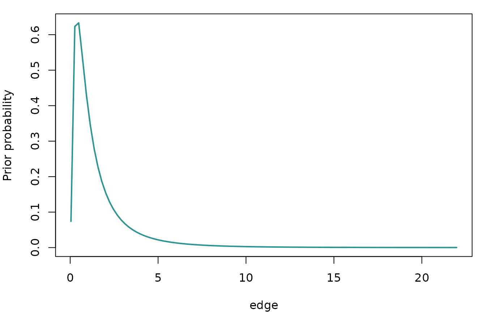
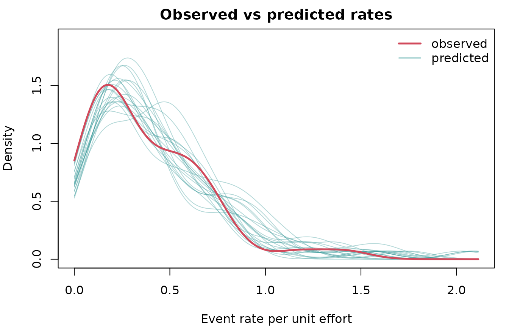
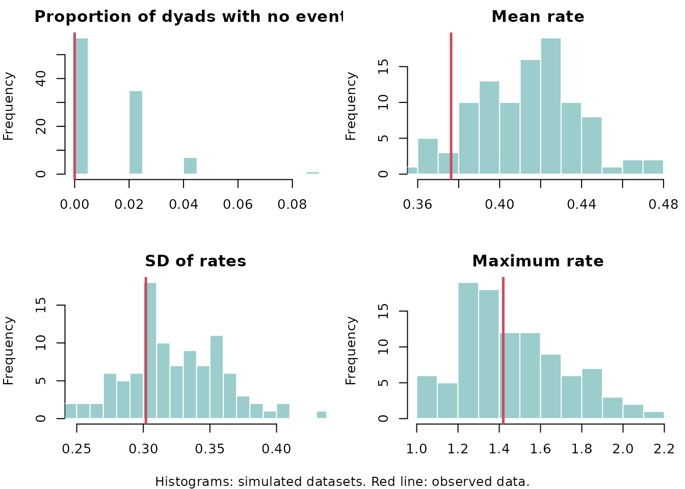
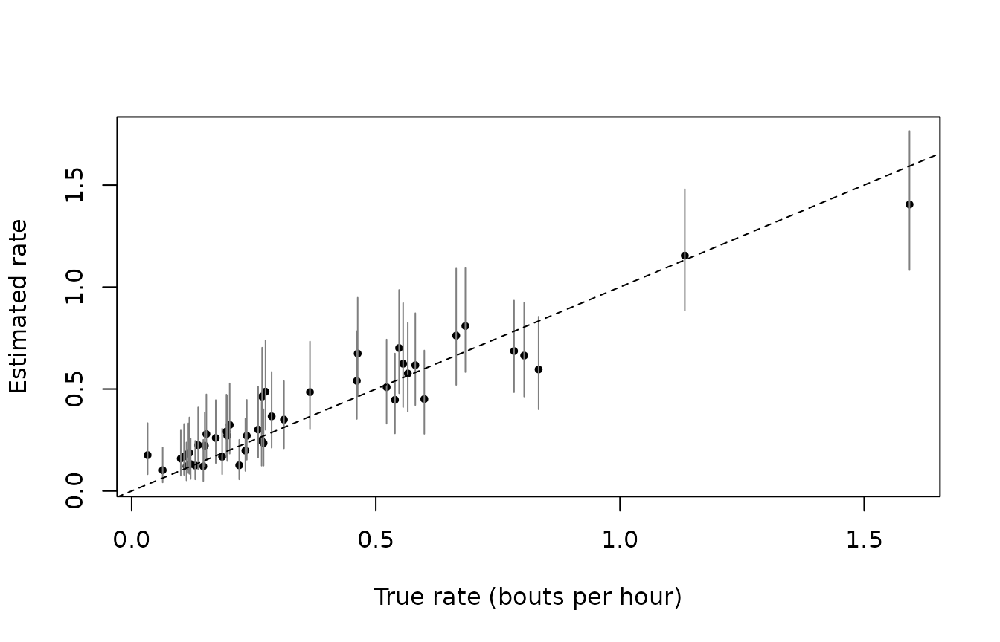
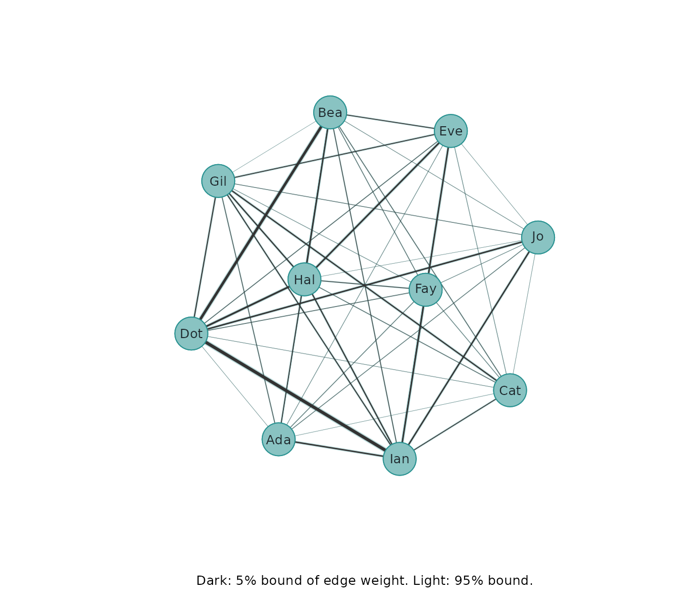

# Count data and continuous observation effort

``` r

library(bisonR)
```

This article analyses count data, in which the number of interactions
between each pair is recorded over a known amount of observation time.
The example is grooming bouts recorded during focal follows, with
observation time in hours as the effort. See
[`vignette("preparing_data")`](https://bisonr.org/articles/preparing_data.md)
for the general data format and the choice between binary and count
data.

## Simulating focal follow data

We simulate focal follows of 10 individuals. Each individual is followed
several times, and each follow lasts a different length of time. During
a follow, every grooming bout between the focal individual and each
other individual is counted. Each pair has a true rate of grooming bouts
per hour, and the number of bouts seen in a follow is drawn from a
Poisson distribution with mean equal to the rate multiplied by the
length of the follow.

``` r

nodes <- c("Ada", "Bea", "Cat", "Dot", "Eve", "Fay", "Gil", "Hal", "Ian", "Jo")
n <- length(nodes)
sociality <- setNames(rnorm(n, 0, 0.5), nodes)

# True rate of grooming bouts per hour for each pair
dyads <- t(combn(nodes, 2))
true_rate <- exp(-1.5 + sociality[dyads[, 1]] + sociality[dyads[, 2]] + rnorm(nrow(dyads), 0, 0.8))
true_rates <- data.frame(node_1 = dyads[, 1], node_2 = dyads[, 2], true_rate = true_rate)

# Each individual is followed 8 times, for between 0.5 and 3 hours
follows <- data.frame(
  follow_id = seq_len(n * 8),
  focal = rep(nodes, each = 8),
  hours = round(runif(n * 8, 0.5, 3), 2)
)

# One row per follow and partner
df <- merge(follows, data.frame(partner = nodes))
df <- df[df$focal != df$partner, ]
df <- df[order(df$follow_id, df$partner), ]
rownames(df) <- NULL

# Look up the true rate of each focal-partner pair (in either order)
key <- function(a, b) paste(pmin(a, b), pmax(a, b))
df$true_rate <- true_rates$true_rate[match(key(df$focal, df$partner), key(true_rates$node_1, true_rates$node_2))]
df$bouts <- rpois(nrow(df), df$true_rate * df$hours)
head(df[, c("follow_id", "focal", "partner", "hours", "bouts")])
#>   follow_id focal partner hours bouts
#> 1         1   Ada     Bea  2.94     2
#> 2         1   Ada     Cat  2.94     0
#> 3         1   Ada     Dot  2.94     0
#> 4         1   Ada     Eve  2.94     1
#> 5         1   Ada     Fay  2.94     0
#> 6         1   Ada     Gil  2.94     1
nrow(df)
#> [1] 720
```

Each row records the number of grooming bouts between the focal
individual and one partner during one follow. The effort, `hours`, is
not a whole number. Rows with no bouts are kept, because they show that
the pair were observed and did not groom.

The network is undirected, so a follow of Ada contributes to the Ada-Bea
edge in the same way as a follow of Bea.

## Aggregating per dyad

With no follow-level predictors, the rows can be aggregated to one row
per dyad by summing the bouts and the hours. The order of the two
individuals doesn’t matter in an undirected network, but putting them in
a consistent order means that
[`aggregate()`](https://rdrr.io/r/stats/aggregate.html) combines the
rows for Ada-Bea and Bea-Ada:

``` r

df$node_1 <- pmin(df$focal, df$partner)
df$node_2 <- pmax(df$focal, df$partner)
df_agg <- aggregate(cbind(bouts, hours) ~ node_1 + node_2, data = df, FUN = sum)
nrow(df_agg)
#> [1] 45
head(df_agg)
#>   node_1 node_2 bouts hours
#> 1    Ada    Bea    12 27.79
#> 2    Ada    Cat     1 23.88
#> 3    Bea    Cat     7 26.29
#> 4    Ada    Dot     2 30.17
#> 5    Bea    Dot    38 32.58
#> 6    Cat    Dot     3 28.67
```

For count models, the edge weight estimates only depend on the total
number of events and the total effort of each dyad, so the aggregated
data give the same edge weights as the disaggregated data and are faster
to fit. Follow-level predictors, such as time of day, need the
disaggregated data.

## Edge weights are rates

In a count model, the number of events in each row is modelled with a
Poisson distribution:

\\\text{events} \sim \text{Poisson}(\lambda\_{ij} \times
\text{effort}),\\

where \\\lambda\_{ij}\\ is the edge weight of dyad (i, j): the expected
number of events per unit of effort. Here it is the rate of grooming
bouts per hour. Edge weights are estimated on the log scale (a log
link), so that the rate is always positive.

The rate depends on the units of the effort. If effort were recorded in
minutes, the edge weights would be rates per minute, 60 times smaller
than rates per hour, and the priors would need to change accordingly.

## Priors

The default priors for the count model are:

``` r

priors <- get_default_priors("count")
priors
#> $edge
#> [1] "normal(0, 1)"
#> 
#> $fixed
#> [1] "normal(0, 2.5)"
#> 
#> $random_std
#> [1] "half-normal(1)"
#> 
#> $zero_prob
#> [1] "beta(1, 1)"
```

The edge prior `normal(0, 1)` is on the log scale.
[`prior_check()`](https://bisonr.org/reference/prior_check.md) shows the
distribution it implies for the rate:

``` r

prior_check(priors["edge"], "count")
```



With effort in hours, this prior has a median of 1 bout per hour, and
95% of its probability lies between about 0.14 and 7.1 bouts per hour:

``` r

exp(qnorm(c(0.025, 0.5, 0.975), mean = 0, sd = 1))
#> [1] 0.1408635 1.0000000 7.0990714
```

Check this against rates that are plausible for the study system and the
units of effort. Here the true rates are mostly below 1 bout per hour:

``` r

quantile(true_rates$true_rate, probs = c(0, 0.25, 0.5, 0.75, 1))
#>         0%        25%        50%        75%       100% 
#> 0.03270482 0.14977804 0.26619761 0.54770148 1.59289223
```

The default prior is kept in this example. A prior with a lower mean,
such as `normal(-1, 1)`, could be used if lower rates were expected.

## Fitting the models

The Stan model, which samples from the posterior distribution (the
plausible values of each edge weight given the data and the prior) by
Markov chain Monte Carlo (MCMC), uses the edge prior described above
(normal on the log scale, so log-normal on the rate):

``` r

fit_count <- bison_model(
  (bouts | hours) ~ dyad(node_1, node_2),
  data = df_agg,
  model_type = "count",
  priors = priors,
  seed = 1
)
#> Running MCMC with 4 parallel chains...
#> 
#> Chain 1 finished in 0.2 seconds.
#> Chain 2 finished in 0.2 seconds.
#> Chain 3 finished in 0.2 seconds.
#> Chain 4 finished in 0.3 seconds.
#> 
#> All 4 chains finished successfully.
#> Mean chain execution time: 0.2 seconds.
#> Total execution time: 0.5 seconds.
```

The conjugate count model calculates the posterior distribution exactly,
with a gamma prior directly on the rate:

``` r

get_default_priors("count_conjugate")
#> $edge
#> [1] "gamma(1, 1)"

fit_count_conj <- bison_model(
  (bouts | hours) ~ dyad(node_1, node_2),
  data = df_agg,
  model_type = "count_conjugate",
  priors = get_default_priors("count_conjugate")
)
```

The two models use different priors, so their estimates differ slightly.
The differences are largest for dyads with few events, such as Ada-Cat
(1 bout), where the prior has more influence:

``` r

head(get_edgelist(fit_count))
#>   node_1 node_2 median    5%   95%
#> 1    Ada    Bea  0.451 0.280 0.689
#> 2    Ada    Cat  0.121 0.049 0.251
#> 3    Bea    Cat  0.301 0.163 0.512
#> 4    Ada    Dot  0.126 0.057 0.251
#> 5    Bea    Dot  1.154 0.885 1.480
#> 6    Cat    Dot  0.159 0.075 0.297
head(get_edgelist(fit_count_conj))
#>   node_1 node_2 median    5%   95%
#> 1    Ada    Bea  0.439 0.264 0.678
#> 2    Ada    Cat  0.068 0.014 0.192
#> 3    Bea    Cat  0.280 0.146 0.478
#> 4    Ada    Dot  0.087 0.027 0.205
#> 5    Bea    Dot  1.161 0.877 1.494
#> 6    Cat    Dot  0.124 0.046 0.260
```

The conjugate model is enough when only the edge weights are needed. The
Stan model is needed for other effects in the formula, such as fixed or
random effects of follow-level variables.

## Checking the model

[`plot_predictions()`](https://bisonr.org/reference/plot_predictions.md)
compares the observed data with data simulated from the fitted model.
For count models, the rates compared are the number of events per unit
of effort for each dyad:

``` r

plot_predictions(fit_count, num_draws = 20, type = "density")
```



With `type = "stats"`, summary statistics of the observed rates (red
lines) are compared with the same statistics in simulated datasets
(histograms):

``` r

plot_predictions(fit_count, num_draws = 100, type = "stats")
```



For all four statistics, the observed value is within the range of the
simulated values. The observed mean rate is towards the lower end of the
simulated values.

## The estimated network

[`get_edgelist()`](https://bisonr.org/reference/get_edgelist.md) gives
the posterior median and 90% credible interval of each rate, in bouts
per hour. A 90% credible interval is the range that contains the rate
with 90% probability:

``` r

edgelist <- get_edgelist(fit_count)
head(edgelist)
#>   node_1 node_2 median    5%   95%
#> 1    Ada    Bea  0.451 0.280 0.689
#> 2    Ada    Cat  0.121 0.049 0.251
#> 3    Bea    Cat  0.301 0.163 0.512
#> 4    Ada    Dot  0.126 0.057 0.251
#> 5    Bea    Dot  1.154 0.885 1.480
#> 6    Cat    Dot  0.159 0.075 0.297
```

Because the data were simulated, the estimates can be compared with the
true rates:

``` r

idx <- match(paste(edgelist$node_1, edgelist$node_2), paste(true_rates$node_1, true_rates$node_2))
plot(true_rates$true_rate[idx], edgelist$median, pch = 19, cex = 0.6,
     ylim = range(edgelist[, 4:5]),
     xlab = "True rate (bouts per hour)", ylab = "Estimated rate")
segments(true_rates$true_rate[idx], edgelist[, 4], true_rates$true_rate[idx], edgelist[, 5], col = "grey50")
abline(0, 1, lty = 2)
```



The estimates are close to the true rates. For dyads with the lowest
true rates, the estimates are mostly higher than the true values,
because they are pulled towards the prior.

Rates are not bounded above by 1, so
[`plot_network()`](https://bisonr.org/reference/plot_network.md)
rescales the edge widths for count models: the widest upper bound is
drawn with width `lwd`, and other edges are drawn in proportion. Widths
can be compared within a plot, but not between plots of different
models:

``` r

plot_network(fit_count, lwd = 5)
```



The fitted model can be used with
[`extract_metric()`](https://bisonr.org/reference/extract_metric.md) and
[`bison_brm()`](https://bisonr.org/reference/bison_brm.md) in the same
way as a binary model. Metrics such as `node_strength` are then sums of
rates, and in [`bison_brm()`](https://bisonr.org/reference/bison_brm.md)
the edge weights are on the log scale. See
[`vignette("network_metrics")`](https://bisonr.org/articles/network_metrics.md)
and
[`vignette("bison_brms")`](https://bisonr.org/articles/bison_brms.md).

## When to use binary data instead

Count models assume that events are counted as separate occurrences and,
given the edge weight, occur independently at a constant rate during
observation. Binary data may be more appropriate when:

- the data record whether a behaviour occurred in each sampling period
  (for example, scan samples) rather than how many times;
- interactions are long and continuous, so that a single bout covers
  much of the observation time and bouts are difficult to count.

If the data are durations, such as the number of minutes a pair spent
grooming,
[`convert_duration_to_binary()`](https://bisonr.org/reference/convert_duration_to_binary.md)
converts them to binary data. It divides the duration of the behaviour
and the observation time by a fixed period length and rounds the
results, giving the number of periods with the behaviour and the number
of periods observed:

``` r

df_duration <- data.frame(
  node_1 = c("Ada", "Ada", "Bea"),
  node_2 = c("Bea", "Cat", "Cat"),
  minutes_grooming = c(42, 0, 15),
  minutes_observed = c(180, 120, 150)
)
convert_duration_to_binary(df_duration, "minutes_grooming", "minutes_observed", max_event_length = 5)
#>   node_1 node_2 minutes_grooming minutes_observed
#> 1    Ada    Bea                8               36
#> 2    Ada    Cat                0               24
#> 3    Bea    Cat                3               30
```

The result can be fitted with a binary model, where the edge weight is
the probability that the pair groomed in a 5-minute period. This
conversion is an approximation, and the results depend on the period
length chosen.
