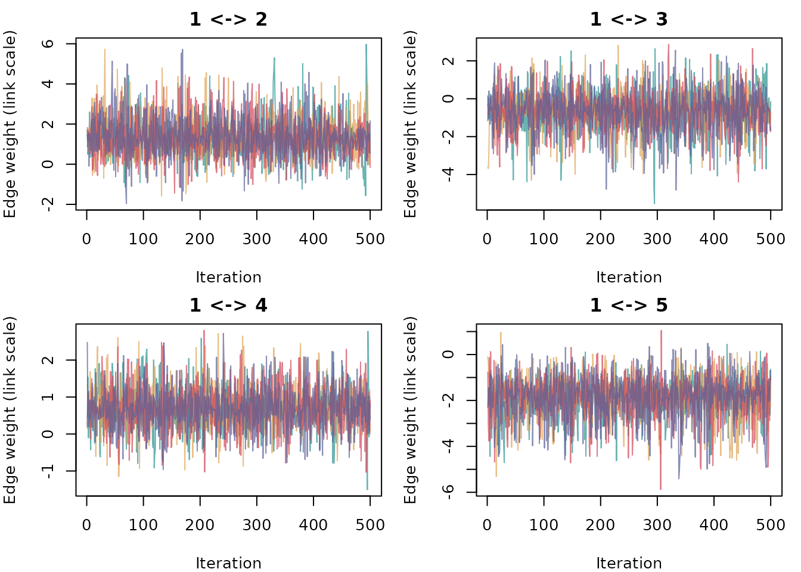
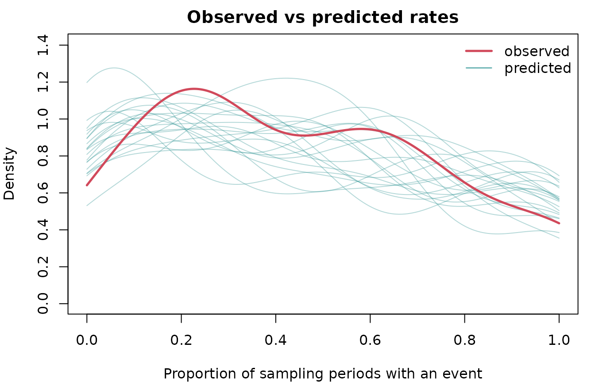
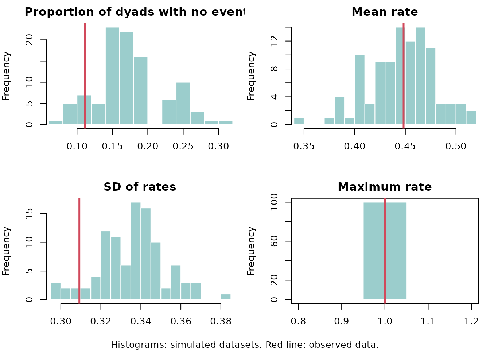
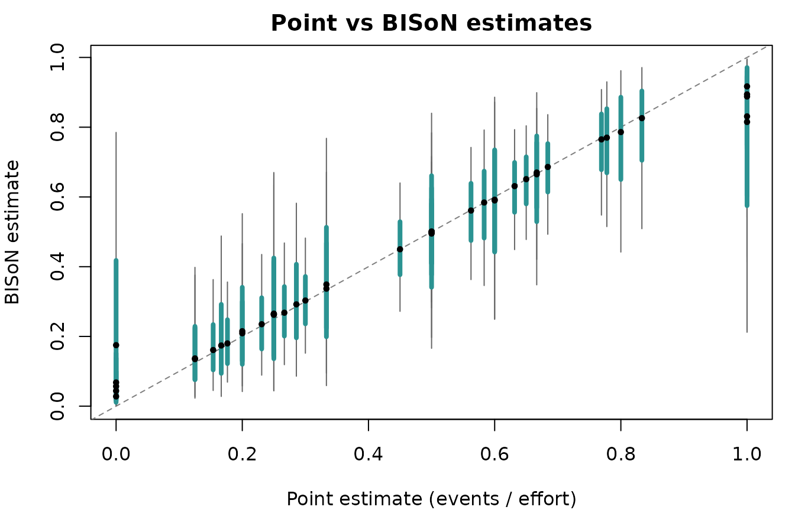
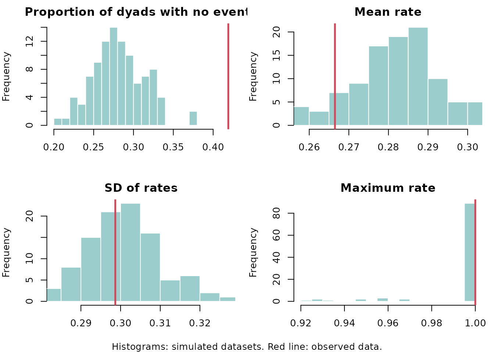
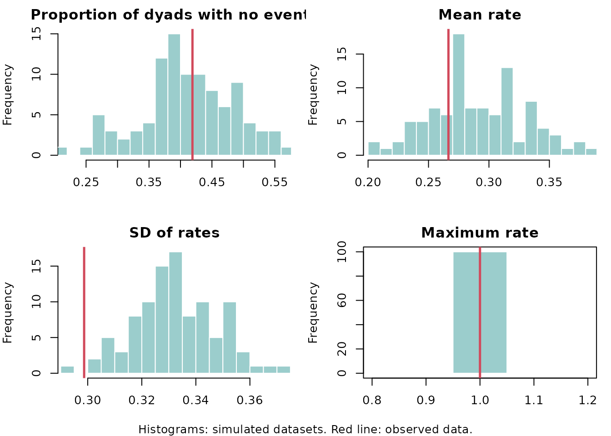

# Model diagnostics

``` r

library(bisonR)
```

This article describes how to check a fitted edge weight model. There
are two kinds of check. MCMC diagnostics check whether the sampler
(Stan’s Markov chain Monte Carlo algorithm) has given a reliable sample
from the posterior, the distribution of plausible parameter values given
the data and priors. Posterior predictive checks compare data simulated
from the fitted model with the observed data, to find ways in which the
model does not describe the data. The last section works through an
example in which a posterior predictive check shows a problem with the
model. A basic analysis is described in
[`vignette("getting_started")`](https://bisonr.org/articles/getting_started.md).

## An example model

The examples use simulated aggregated data, with one row per dyad:

``` r

sim_data <- simulate_bison_model("binary", aggregated = TRUE, max_obs = 20)
df <- sim_data$df_sim

fit_edge <- bison_model(
  (event | effort) ~ dyad(node_1_id, node_2_id),
  data = df,
  model_type = "binary",
  priors = get_default_priors("binary"),
  iter_sampling = 500,
  seed = 1,
  show_messages = FALSE
)
```

`seed` and `show_messages` are passed on to Stan’s sampler: `seed` makes
the results reproducible and `show_messages = FALSE` hides the progress
messages.

## MCMC diagnostics

Binary and count models are fitted with Stan’s MCMC sampler. Conjugate
models calculate the posterior exactly, without MCMC, so they do not
need these checks.

### Stan warnings

After sampling, cmdstanr warns about any problems it has detected, such
as divergent transitions or iterations that reached the maximum tree
depth (a limit on how far the sampler moves in each step). Divergent
transitions mean that the sampler could not explore part of the
posterior, and the results may be biased. These warnings should not be
ignored. Possible responses include increasing `adapt_delta` (for
example `adapt_delta = 0.95`, passed to
[`bison_model()`](https://bisonr.org/reference/bison_model.md)),
changing the priors, or simplifying the model.

The fitted cmdstanr object is stored in `fit_edge$fit` (it is `NULL` for
conjugate models). Its `diagnostic_summary()` method gives, for each
chain (an independent run of the sampler), the number of divergent
transitions, the number of iterations at the maximum tree depth, and the
E-BFMI, a measure of how efficiently the sampler moved through the
posterior:

``` r

fit_edge$fit$diagnostic_summary()
#> $num_divergent
#> [1] 0 0 0 0
#> 
#> $num_max_treedepth
#> [1] 0 0 0 0
#> 
#> $ebfmi
#> [1] 0.9548598 0.9456337 0.9817843 0.9982068
```

Here there are no divergent transitions and no iterations at the maximum
tree depth. E-BFMI values below about 0.3 indicate that the sampler
explored the posterior inefficiently. All four values are well above
this.

### Trace plots

[`plot_trace()`](https://bisonr.org/reference/plot_trace.md) shows the
chains for some of the edge weights, on the link scale. The chains
should overlap and show no trends or long excursions:

``` r

plot_trace(fit_edge, par_ids = 1:4)
```



Only a few parameters can be inspected with trace plots. Some problems,
such as a chain that stays stuck in one region, are easier to detect
with numerical summaries.

### R-hat and effective sample size

`fit_edge$fit$summary()` gives posterior summaries together with R-hat
and effective sample sizes (ESS) for any parameter in the model:

``` r

edge_summary <- fit_edge$fit$summary("edge_weight")
head(edge_summary)
#> # A tibble: 6 × 10
#>   variable         mean median    sd   mad     q5    q95  rhat ess_bulk ess_tail
#>   <chr>           <dbl>  <dbl> <dbl> <dbl>  <dbl>  <dbl> <dbl>    <dbl>    <dbl>
#> 1 edge_weight[1]  1.38   1.30  1.10  1.06  -0.231  3.24   1.00    3509.    1314.
#> 2 edge_weight[2] -0.686 -0.622 1.18  1.07  -2.77   1.20   1.01    3222.    1528.
#> 3 edge_weight[3]  0.715  0.707 0.638 0.633 -0.317  1.76   1.00    3097.    1509.
#> 4 edge_weight[4] -1.92  -1.84  0.990 0.926 -3.75  -0.416  1.01    2774.    1209.
#> 5 edge_weight[5] -1.23  -1.18  0.637 0.600 -2.32  -0.263  1.00    2817.    1447.
#> 6 edge_weight[6]  0.387  0.374 0.941 0.924 -1.10   1.92   1.00    2619.    1421.
```

R-hat compares the variation within and between chains, and should be
close to 1. A common threshold is 1.01. `ess_bulk` and `ess_tail`
estimate how many independent draws the sample is equivalent to, for the
centre and the tails of the distribution respectively. Several hundred
is usually enough for posterior medians and 90% intervals. With many
edges it is easier to look at the extremes than at every row:

``` r

max(edge_summary$rhat)
#> [1] 1.011915
min(edge_summary$ess_bulk)
#> [1] 2164.591
min(edge_summary$ess_tail)
#> [1] 912.965
```

In this model the largest R-hat is below 1.01, and the smallest bulk and
tail ESS are above 900.

These diagnostics can show that the sampler has not converged, but
cannot show that it has. They also say nothing about whether the model
is appropriate for the data. That is the purpose of posterior predictive
checks.

## Posterior predictive checks

A posterior predictive check simulates new datasets from the fitted
model, using draws from the posterior, and compares them with the
observed data. If the model describes the data well, the observed data
should look like a typical simulated dataset.
[`plot_predictions()`](https://bisonr.org/reference/plot_predictions.md)
provides three plots, chosen with `type`.

### Density of event rates

With `type = "density"`, the plot shows the distribution of event rates
across dyads (events divided by effort, summed over the rows for each
dyad) in the observed data (red) and in `num_draws` simulated datasets
(teal):

``` r

plot_predictions(fit_edge, num_draws = 20, type = "density")
```



Here the observed curve lies mostly within the range of the simulated
curves.

This check can detect a model whose predicted rates are concentrated in
the wrong part of the range. Because each dyad has its own edge weight,
the model can usually reproduce the overall distribution of rates, so
passing this check is weak evidence that the model is appropriate. The
rates are summed over the rows for each dyad, so the check does not show
problems at the level of individual observations.

### Summary statistics

With `type = "stats"`, the plot shows four statistics of the per-dyad
rates: the proportion of dyads with no events, and the mean, standard
deviation and maximum rate. The histograms show the values in the
simulated datasets and the red line shows the observed value:

``` r

plot_predictions(fit_edge, num_draws = 100, type = "stats")
```



Here the observed mean is near the centre of the simulated values. The
observed proportion of dyads with no events and the observed standard
deviation are towards the lower end of the simulated values, but within
their range. Every simulated dataset, and the observed data, contain at
least one dyad with a rate of 1, so the maximum rate histogram is a
single bar. A statistic that has the same value in every simulated
dataset gives no information.

An observed value in the tail of a histogram, or outside it, shows a
feature of the data that the model does not reproduce. The proportion of
dyads with no events can show excess zeros, and the standard deviation
can show more or less variation between dyads than the model predicts.
These statistics only cover four features of the data, so a model can
pass all four and still be inappropriate in other respects.

### Comparison with point estimates

With `type = "point"`, the plot shows the posterior median and credible
intervals (ranges that contain the edge weight with a given probability)
of each edge weight against the simple point estimate (events divided by
effort):

``` r

plot_predictions(fit_edge, type = "point")
```



This is not a predictive check. It shows how far the estimates have been
pulled away from the point estimates by the prior. Here most estimates
are close to the dashed line. Dyads with point estimates of 0 or 1 have
estimates pulled towards the centre, with wide intervals. So do dyads
with few observations, whose estimates are pulled towards the centre of
the prior. If many estimates are far from the dashed line, the prior may
be stronger than intended (see
[`vignette("priors")`](https://bisonr.org/articles/priors.md)). The plot
cannot show whether the point estimates or the model estimates are
closer to the truth.

## Worked example: excess zeros

In some studies, some pairs of individuals can never be seen together,
for example because they belong to groups that do not meet. These dyads
have zero events regardless of how much they were observed. A standard
edge model assumes that every dyad has some chance of being seen
together, so it may predict fewer dyads with no events than are
observed.

The following code simulates data of this kind. There are 15 individuals
and 105 dyads. Each dyad is observed in between 10 and 30 sampling
periods. Each dyad has a 40% chance of being one that is never seen
together. The other dyads are seen together with a probability drawn
from a logit-normal distribution (a normal distribution on the logit
scale).

``` r

num_nodes <- 15
dyads <- t(combn(num_nodes, 2))
num_dyads <- nrow(dyads)

effort <- sample(10:30, num_dyads, replace = TRUE)
never_together <- rbinom(num_dyads, 1, 0.4)
p_together <- plogis(rnorm(num_dyads, 0, 1))
event <- ifelse(never_together == 1, 0, rbinom(num_dyads, effort, p_together))

df_zero <- data.frame(
  node_1 = dyads[, 1],
  node_2 = dyads[, 2],
  event = event,
  effort = effort
)
head(df_zero)
#>   node_1 node_2 event effort
#> 1      1      2    24     25
#> 2      1      3     0     17
#> 3      1      4     0     29
#> 4      1      5     8     13
#> 5      1      6     0     18
#> 6      1      7    17     25
```

The proportion of dyads with no events, and the proportion that were
simulated as never together, are:

``` r

mean(df_zero$event == 0)
#> [1] 0.4190476
mean(never_together)
#> [1] 0.4190476
```

A standard binary model is fitted first:

``` r

fit_standard <- bison_model(
  (event | effort) ~ dyad(node_1, node_2),
  data = df_zero,
  model_type = "binary",
  priors = get_default_priors("binary"),
  iter_sampling = 500,
  seed = 1,
  show_messages = FALSE
)
fit_standard$fit$diagnostic_summary()
#> $num_divergent
#> [1] 0 0 0 0
#> 
#> $num_max_treedepth
#> [1] 0 0 0 0
#> 
#> $ebfmi
#> [1] 1.1389362 0.9082373 1.0832481 1.1046439
```

There are no divergent transitions or iterations at the maximum tree
depth, so the MCMC diagnostics do not indicate a problem with sampling.
The posterior predictive check:

``` r

plot_predictions(fit_standard, num_draws = 100, type = "stats")
```



The observed proportion of dyads with no events (the red line) is higher
than in any of the simulated datasets: the model predicts too few dyads
with no events. The other three statistics are within the range of the
simulated values. This problem is not visible in the MCMC diagnostics,
which only concern the sampler.

A zero-inflated model (`zero_inflated = TRUE`) adds a parameter,
`zero_prob`, the probability that an observation is a structural zero: a
row that has no events regardless of the edge weight. Zero inflation
applies to rows of the data. Here there is one row per dyad, so a
structural zero is a dyad that is never seen together. With
disaggregated data it would be a single sampling period or observation
session. For binary data with one sampling period per row, a structural
zero can’t be distinguished from a lower edge weight, so zero inflation
should only be used with aggregated binary data, and
[`bison_model()`](https://bisonr.org/reference/bison_model.md) gives a
warning otherwise. The prior for `zero_prob` is set by the `zero_prob`
entry of the priors (`beta(1, 1)` by default).

``` r

fit_zero <- bison_model(
  (event | effort) ~ dyad(node_1, node_2),
  data = df_zero,
  model_type = "binary",
  priors = get_default_priors("binary"),
  zero_inflated = TRUE,
  iter_sampling = 500,
  seed = 1,
  show_messages = FALSE
)
fit_zero$fit$diagnostic_summary()
#> $num_divergent
#> [1] 0 0 0 0
#> 
#> $num_max_treedepth
#> [1] 0 0 0 0
#> 
#> $ebfmi
#> [1] 1.025877 1.043004 1.047918 1.144320
fit_zero$fit$summary("zero_prob")
#> # A tibble: 1 × 10
#>   variable      mean median     sd    mad    q5   q95  rhat ess_bulk ess_tail
#>   <chr>        <dbl>  <dbl>  <dbl>  <dbl> <dbl> <dbl> <dbl>    <dbl>    <dbl>
#> 1 zero_prob[1] 0.351  0.351 0.0527 0.0555 0.266 0.438  1.00    4101.    1350.
```

The posterior median of `zero_prob` is 0.35, with a 90% credible
interval from 0.27 to 0.44. The proportion of dyads simulated as never
together, 0.42, is within this interval.

``` r

plot_predictions(fit_zero, num_draws = 100, type = "stats")
```



The observed proportion of dyads with no events is now near the centre
of the simulated values. However, the observed standard deviation of
rates is now in the lower tail of the simulated values: the
zero-inflated model predicts more variation between dyads than is
observed. A likely reason is that, under this model, a dyad with no
events gives little information about its own edge weight, so these edge
weights are drawn mostly from the wide default prior. Changing one part
of a model can change how well it fits other features of the data, so
all of the checks should be repeated after a change.

The two models can also be compared with
[`model_comparison()`](https://bisonr.org/reference/model_comparison.md),
which uses leave-one-out cross-validation (LOO). LOO estimates how well
each model predicts data that were left out of the fit:

``` r

model_comparison(list(standard = fit_standard, zero_inflated = fit_zero))
#> Warning: Some Pareto k diagnostic values are too high. See help('pareto-k-diagnostic') for details.
#> Warning: Some Pareto k diagnostic values are too high. See help('pareto-k-diagnostic') for details.
#> Method: stacking
#> ------
#>               weight
#> standard      0.890 
#> zero_inflated 0.110
```

The stacking weights (weights chosen so that the combined models give
the best predictions) favour the standard model (0.82) over the
zero-inflated model (0.18). However, the comparison warns that some
Pareto k values are too high. Pareto k is a diagnostic for the
approximation used to calculate LOO. High values mean that the
approximation is unreliable for some rows of the data, so the weights
are unreliable too. The Pareto k values for a model can be seen with the
`loo` package. They may differ slightly from those used by
[`model_comparison()`](https://bisonr.org/reference/model_comparison.md),
which also accounts for autocorrelation in the MCMC chains:

``` r

loo::loo(fit_standard$log_lik)
#> Warning: Some Pareto k diagnostic values are too high. See help('pareto-k-diagnostic') for details.
#> 
#> Computed from 2000 by 105 log-likelihood matrix.
#> 
#>          Estimate   SE
#> elpd_loo   -212.6  7.4
#> p_loo        76.9  1.5
#> looic       425.2 14.8
#> ------
#> MCSE of elpd_loo is NA.
#> MCSE and ESS estimates assume independent draws (r_eff=1).
#> 
#> Pareto k diagnostic values:
#>                          Count Pct.    Min. ESS
#> (-Inf, 0.7]   (good)     25    23.8%   118     
#>    (0.7, 1]   (bad)      68    64.8%   <NA>    
#>    (1, Inf)   (very bad) 12    11.4%   <NA>    
#> See help('pareto-k-diagnostic') for details.
```

For the standard model, 83 of the 105 rows have Pareto k values above
0.7. In these data each row contains all of the observations of one
dyad, and each dyad has its own edge weight, so leaving out a row leaves
no data on that edge weight. With disaggregated data each dyad usually
has several rows, and leaving one out removes only part of the
information about its edge weight.

In this example the posterior predictive check gives clearer evidence
about the excess zeros than the model comparison. Neither model
reproduces every feature of the data. The choice between them should
also take into account what is known about the study system, for example
whether some pairs could not have been seen together.

## Summary

- Check Stan’s warnings, `diagnostic_summary()`, trace plots, R-hat and
  ESS before interpreting a model fitted with MCMC. These checks show
  whether the sample is reliable, not whether the model is appropriate.
- [`plot_predictions()`](https://bisonr.org/reference/plot_predictions.md)
  with `type = "density"` and `type = "stats"` compares the observed
  data with data simulated from the model. A clear mismatch indicates a
  problem with the model. Passing the checks does not show that the
  model is correct.
- `type = "point"` shows how much the estimates depend on the prior.
- A check that targets a specific feature of the data, such as the
  proportion of dyads with no events, can detect problems that the
  overall distribution of rates does not show.
