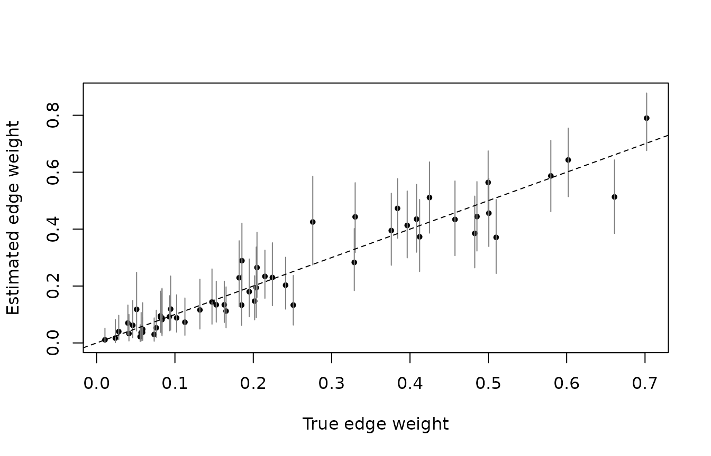
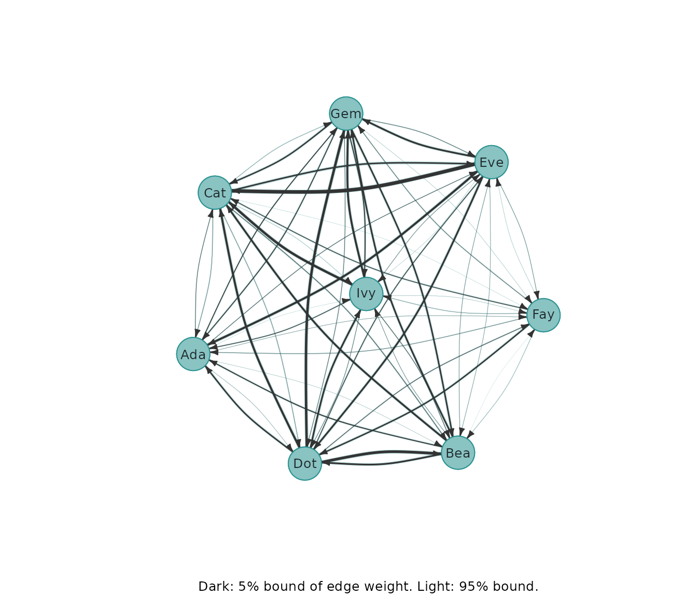
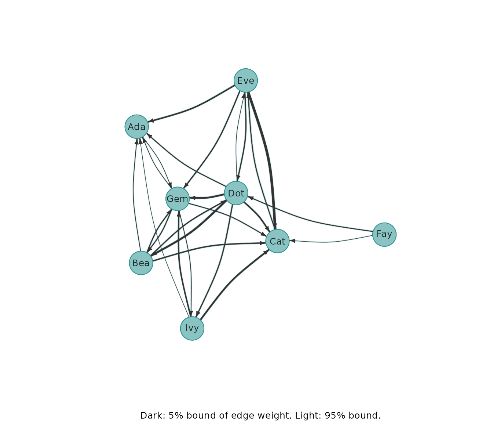

# Directed networks

``` r

library(bisonR)
```

This article analyses a directed network, using simulated grooming data.
In a directed network, the edge from A to B (A grooms B) is separate
from the edge from B to A (B grooms A), and the two can have different
weights.
[`vignette("preparing_data")`](https://bisonr.org/articles/preparing_data.md)
introduces the data format for directed networks; this article covers
fitting, plotting, network metrics and regression.

## Simulating directed data

We simulate grooming among 8 individuals. Each individual has a tendency
to give grooming and a tendency to receive grooming, and each ordered
pair (i, j) has its own deviation from what these tendencies predict. On
the logit (log-odds) scale, the true edge weight of i → j is

\\\text{logit}(p\_{ij}) = \beta_0 + g_i + r_j + \beta\_\text{kin} \\
\text{kin}\_{ij} + \epsilon\_{ij},\\

where \\g_i\\ is the giving tendency of i, \\r_j\\ the receiving
tendency of j, \\\text{kin}\_{ij}\\ indicates whether i and j are
related, and \\\epsilon\_{ij}\\ is specific to the ordered pair, so
\\p\_{ij}\\ and \\p\_{ji}\\ differ.

``` r

nodes <- c("Ada", "Bea", "Cat", "Dot", "Eve", "Fay", "Gem", "Ivy")
n <- length(nodes)
give <- setNames(rnorm(n, 0, 0.8), nodes)
receive <- setNames(rnorm(n, 0, 0.8), nodes)

# Relatedness is symmetric: if i is related to j, j is related to i
kin_matrix <- matrix(0, n, n, dimnames = list(nodes, nodes))
kin_matrix[upper.tri(kin_matrix)] <- rbinom(n * (n - 1) / 2, 1, 0.3)
kin_matrix <- kin_matrix + t(kin_matrix)

# One row for each ordered pair i -> j with i != j
df <- expand.grid(actor = nodes, receiver = nodes, stringsAsFactors = FALSE)
df <- df[df$actor != df$receiver, ]
df$kin <- kin_matrix[cbind(df$actor, df$receiver)]
df$true_logit <- -2 + give[df$actor] + receive[df$receiver] + 1 * df$kin + rnorm(nrow(df), 0, 0.5)
df$true_weight <- plogis(df$true_logit)
```

The data are scan samples of focal individuals. In each scan of a focal
individual i, we record whether i was grooming each other individual j.
Effort for i → j is the number of scans of i, which differs between
individuals, so the same pair can have different effort in each
direction. Events are the number of those scans in which i was grooming
j:

``` r

scans <- setNames(sample(20:60, n, replace = TRUE), nodes)
df$scans <- scans[df$actor]
df$groom <- rbinom(nrow(df), df$scans, df$true_weight)
rownames(df) <- NULL
head(df[, c("actor", "receiver", "kin", "scans", "groom")])
#>   actor receiver kin scans groom
#> 1   Bea      Ada   0    46    13
#> 2   Cat      Ada   0    26     3
#> 3   Dot      Ada   0    39    15
#> 4   Eve      Ada   1    43    22
#> 5   Fay      Ada   1    35     4
#> 6   Gem      Ada   0    38    10
```

The data are aggregated, with one row per direction. Every direction
that could have been observed has a row, including those with no
grooming, because
[`bison_model()`](https://bisonr.org/reference/bison_model.md) only
estimates edges for the directions that appear in the data.

``` r

sum(df$groom == 0)
#> [1] 2
```

## Fitting the edge model

Setting `directed = TRUE` makes `node_1` the actor and `node_2` the
receiver. The conjugate model is enough to estimate the edge weights. It
calculates the posterior distribution of each edge weight (its plausible
values given the data and the prior) exactly, without sampling:

``` r

fit_conj <- bison_model(
  (groom | scans) ~ dyad(actor, receiver),
  data = df,
  directed = TRUE,
  model_type = "binary_conjugate",
  priors = get_default_priors("binary_conjugate")
)
```

The same edges can be estimated with the Stan model, which samples from
the posterior by Markov chain Monte Carlo (MCMC). It allows other
effects to be added to the formula and uses the logit-scale priors from
`get_default_priors("binary")`:

``` r

fit_edge <- bison_model(
  (groom | scans) ~ dyad(actor, receiver),
  data = df,
  directed = TRUE,
  model_type = "binary",
  priors = get_default_priors("binary"),
  seed = 1
)
#> Running MCMC with 4 parallel chains...
#> 
#> Chain 1 finished in 0.3 seconds.
#> Chain 3 finished in 0.3 seconds.
#> Chain 2 finished in 0.4 seconds.
#> Chain 4 finished in 0.4 seconds.
#> 
#> All 4 chains finished successfully.
#> Mean chain execution time: 0.3 seconds.
#> Total execution time: 0.5 seconds.
```

The two models use different priors (`beta(1, 1)` on the probability
scale and `normal(0, 2.5)` on the logit scale), so their estimates
differ slightly:

``` r

head(get_edgelist(fit_conj), 3)
#>   node_1 node_2 median    5%   95%
#> 1    Bea    Ada  0.288 0.190 0.407
#> 2    Cat    Ada  0.133 0.051 0.264
#> 3    Dot    Ada  0.385 0.270 0.518
head(get_edgelist(fit_edge), 3)
#>   node_1 node_2 median    5%   95%
#> 1    Bea    Ada  0.283 0.184 0.402
#> 2    Cat    Ada  0.119 0.045 0.235
#> 3    Dot    Ada  0.385 0.264 0.516
```

The rest of this article uses the Stan model.

## Separate edges for each direction

There are 56 edges, one for each ordered pair.
[`summary()`](https://rdrr.io/r/base/summary.html) labels them with
`->`:

``` r

summary(fit_edge)
#> === Fitted BISoN edge model ===
#> Data type: binary
#> Formula: (groom | scans) ~ dyad(actor, receiver)
#> Number of nodes: 8
#> Number of dyads: 56
#> Directed: TRUE
#> === Edge list summary ===
#>            median    5%   95%
#> Bea -> Ada  0.283 0.184 0.402
#> Cat -> Ada  0.119 0.045 0.235
#> Dot -> Ada  0.385 0.264 0.516
#> Eve -> Ada  0.511 0.386 0.636
#> Fay -> Ada  0.116 0.049 0.224
#> Gem -> Ada  0.265 0.160 0.389
#> Ivy -> Ada  0.203 0.119 0.301
#> Ada -> Bea  0.037 0.011 0.089
#> Cat -> Bea  0.194 0.089 0.337
#> Dot -> Bea  0.643 0.514 0.755
#> Eve -> Bea  0.073 0.027 0.158
#> Fay -> Bea  0.062 0.018 0.149
#> Gem -> Bea  0.395 0.273 0.526
#> Ivy -> Bea  0.147 0.081 0.236
#> Ada -> Cat  0.134 0.072 0.217
#> Bea -> Cat  0.456 0.339 0.578
#> Dot -> Cat  0.513 0.385 0.643
#> Eve -> Cat  0.790 0.676 0.878
#> Fay -> Cat  0.229 0.128 0.359
#> Gem -> Cat  0.371 0.244 0.504
#> Ivy -> Cat  0.564 0.449 0.675
#> Ada -> Dot  0.053 0.020 0.115
#> Bea -> Dot  0.435 0.319 0.557
#> Cat -> Dot  0.118 0.042 0.248
#> Eve -> Dot  0.443 0.318 0.563
#> Fay -> Dot  0.373 0.251 0.504
#> Gem -> Dot  0.133 0.062 0.239
#> Ivy -> Dot  0.112 0.053 0.197
#> Ada -> Eve  0.134 0.073 0.217
#> Bea -> Eve  0.089 0.037 0.174
#> Cat -> Eve  0.425 0.274 0.586
#> Dot -> Eve  0.230 0.131 0.352
#> Fay -> Eve  0.036 0.007 0.107
#> Gem -> Eve  0.133 0.063 0.237
#> Ivy -> Eve  0.092 0.043 0.166
#> Ada -> Fay  0.070 0.029 0.133
#> Bea -> Fay  0.011 0.001 0.052
#> Cat -> Fay  0.017 0.001 0.082
#> Dot -> Fay  0.180 0.092 0.295
#> Eve -> Fay  0.095 0.039 0.182
#> Gem -> Fay  0.033 0.007 0.100
#> Ivy -> Fay  0.040 0.012 0.097
#> Ada -> Gem  0.234 0.157 0.326
#> Bea -> Gem  0.413 0.299 0.534
#> Cat -> Gem  0.082 0.025 0.192
#> Dot -> Gem  0.587 0.461 0.712
#> Eve -> Gem  0.444 0.323 0.567
#> Fay -> Gem  0.144 0.066 0.260
#> Ivy -> Gem  0.473 0.368 0.577
#> Ada -> Ivy  0.022 0.005 0.064
#> Bea -> Ivy  0.088 0.038 0.169
#> Cat -> Ivy  0.048 0.009 0.141
#> Dot -> Ivy  0.434 0.307 0.569
#> Eve -> Ivy  0.030 0.006 0.088
#> Fay -> Ivy  0.088 0.031 0.189
#> Gem -> Ivy  0.289 0.182 0.421
```

[`get_edgelist()`](https://bisonr.org/reference/get_edgelist.md) returns
the same estimates as a data frame. The rows for Ada → Bea and Bea → Ada
are separate edges:

``` r

edgelist <- get_edgelist(fit_edge)
edgelist[edgelist$node_1 %in% c("Ada", "Bea") & edgelist$node_2 %in% c("Ada", "Bea"), ]
#>   node_1 node_2 median    5%   95%
#> 1    Bea    Ada  0.283 0.184 0.402
#> 8    Ada    Bea  0.037 0.011 0.089
df[df$actor %in% c("Ada", "Bea") & df$receiver %in% c("Ada", "Bea"),
   c("actor", "receiver", "scans", "groom", "true_weight")]
#>   actor receiver scans groom true_weight
#> 1   Bea      Ada    46    13  0.32890969
#> 8   Ada      Bea    60     2  0.05868297
```

Each estimate is based only on the observations in its own direction.

Because the data were simulated, the estimates can be compared with the
true edge weights. Each vertical line is a 90% credible interval, the
range that contains the edge weight with 90% probability:

``` r

idx <- match(paste(edgelist$node_1, edgelist$node_2), paste(df$actor, df$receiver))
plot(df$true_weight[idx], edgelist$median, pch = 19, cex = 0.6,
     ylim = range(edgelist[, 4:5]),
     xlab = "True edge weight", ylab = "Estimated edge weight")
segments(df$true_weight[idx], edgelist[, 4], df$true_weight[idx], edgelist[, 5], col = "grey50")
abline(0, 1, lty = 2)
```



The estimates lie close to the dashed line, where estimated and true
weights are equal.

## Plotting the network

For directed models,
[`plot_network()`](https://bisonr.org/reference/plot_network.md) draws
curved edges with arrows, so that A → B and B → A can be told apart. As
for undirected networks, the width of the dark line shows the lower
bound of the credible interval, and the width of the light band shows
the upper bound. The arrowheads are drawn on the dark lines:

``` r

plot_network(fit_edge, lwd = 5)
```



With many edges, `threshold` shows only the stronger ones. Here only
edges with a median weight of at least 0.2 are drawn:

``` r

plot_network(fit_edge, lwd = 5, threshold = 0.2)
```



## Node metrics

[`extract_metric()`](https://bisonr.org/reference/extract_metric.md)
uses igraph to calculate node metrics on each posterior network (a
network whose edge weights are one draw from the posterior). For
directed networks it uses igraph’s default settings, which affect how
the metrics are defined:

- `node_strength` is calculated with
  [`igraph::strength()`](https://r.igraph.org/reference/strength.html),
  whose default is `mode = "all"`. It is the sum of the weights of all
  edges into and out of a node, that is, in-strength plus out-strength.
- `node_degree[t]` is calculated in the same way, with edge weights
  replaced by 0 or 1, so it counts both incoming and outgoing edges with
  weight at or above `t`.
- `node_betweenness` uses directed shortest paths, with 1/weight as the
  distance.
- `node_closeness` uses
  [`igraph::closeness()`](https://r.igraph.org/reference/closeness.html),
  whose default is `mode = "out"`, so it is based on paths leaving the
  node.
- `node_eigen` uses
  [`igraph::eigen_centrality()`](https://r.igraph.org/reference/eigen_centrality.html),
  whose default is `directed = FALSE`, so edge directions are ignored.

See
[`vignette("network_metrics")`](https://bisonr.org/articles/network_metrics.md)
for the definitions of the metrics.

``` r

strength <- extract_metric(fit_edge, "node_strength")
apply(strength, 2, quantile, probs = c(0.05, 0.5, 0.95))
#>          Ada      Bea      Cat      Dot      Eve      Fay      Gem      Ivy
#> 5%  2.287657 3.033405 3.724489 4.246570 3.201729 1.294251 3.633255 2.378962
#> 50% 2.622079 3.376081 4.095482 4.684636 3.557665 1.572130 4.052157 2.697402
#> 95% 2.959062 3.757984 4.532454 5.093121 3.915298 1.856863 4.440583 3.014823
```

To calculate the grooming given (out-strength) and received
(in-strength) separately,
[`bison_to_igraph()`](https://bisonr.org/reference/bison_to_igraph.md)
returns a list of posterior networks, and
[`igraph::strength()`](https://r.igraph.org/reference/strength.html) is
called on each with `mode = "out"` or `mode = "in"`. Each network
contains all nodes, in the same order as in the model, so the columns
can be named with the node names:

``` r

nets <- bison_to_igraph(fit_edge, num_draws = 1000)
out_strength <- t(sapply(nets, igraph::strength, mode = "out"))
in_strength <- t(sapply(nets, igraph::strength, mode = "in"))
colnames(out_strength) <- colnames(in_strength) <- colnames(strength)
```

In each posterior network, in-strength plus out-strength equals the
strength calculated with igraph’s default `mode = "all"`, which is what
[`extract_metric()`](https://bisonr.org/reference/extract_metric.md)
uses. For the first posterior network:

``` r

round(rbind(
  in_plus_out = in_strength[1, ] + out_strength[1, ],
  strength_all = igraph::strength(nets[[1]])
), 3)
#>                Ada   Bea   Cat   Dot   Eve   Fay   Gem   Ivy
#> in_plus_out  2.512 2.997 4.014 4.486 3.217 1.757 3.875 2.643
#> strength_all 2.512 2.997 4.014 4.486 3.217 1.757 3.875 2.643
```

The posterior medians of out-strength and in-strength can be compared
with the simulated giving and receiving tendencies:

``` r

round(data.frame(
  give = give,
  out_strength = apply(out_strength, 2, median),
  receive = receive,
  in_strength = apply(in_strength, 2, median)
), 2)
#>      give out_strength receive in_strength
#> Ada -0.50         0.72    0.46        1.91
#> Bea  0.15         1.79   -0.24        1.57
#> Cat -0.67         1.05    1.21        3.06
#> Dot  1.28         3.00    0.31        1.69
#> Eve  0.26         2.40   -0.50        1.17
#> Fay -0.66         1.09   -1.77        0.49
#> Gem  0.39         1.64    0.90        2.40
#> Ivy  0.59         1.64   -0.04        1.04
```

``` r

par(mfrow = c(1, 2))
plot(give, apply(out_strength, 2, median), pch = 19,
     xlab = "Simulated giving tendency", ylab = "Out-strength (median)")
plot(receive, apply(in_strength, 2, median), pch = 19,
     xlab = "Simulated receiving tendency", ylab = "In-strength (median)")
```


Individuals with higher simulated giving tendencies tend to have higher
out-strength, and individuals with higher receiving tendencies tend to
have higher in-strength. The relationships are not exact, because edge
weights also depend on kinship and on the pair-specific deviations.

The posterior draws of in- and out-strength can be used in further
analyses in the same way as other metrics. For example, the difference
between out-strength and in-strength of each individual in each draw
gives the posterior distribution of how much more grooming it gives than
it receives:

``` r

balance <- out_strength - in_strength
round(apply(balance, 2, quantile, probs = c(0.05, 0.5, 0.95)), 2)
#>       Ada   Bea   Cat  Dot  Eve  Fay   Gem  Ivy
#> 5%  -1.54 -0.12 -2.40 0.87 0.85 0.32 -1.13 0.30
#> 50% -1.19  0.21 -2.00 1.30 1.24 0.60 -0.77 0.61
#> 95% -0.86  0.60 -1.59 1.70 1.59 0.90 -0.39 0.94
```

## Regression on directed edge weights

Dyadic regressions on directed edges use one row per ordered pair, with
the actor and receiver in the same order as in the edge model. Here we
test whether kinship predicts grooming:

``` r

df_dyadic <- df[, c("actor", "receiver", "kin")]
head(df_dyadic)
#>   actor receiver kin
#> 1   Bea      Ada   0
#> 2   Cat      Ada   0
#> 3   Dot      Ada   0
#> 4   Eve      Ada   1
#> 5   Fay      Ada   1
#> 6   Gem      Ada   0
```

Edges that share an individual are not independent. As for undirected
networks, a multi-membership random effect `(1 | mm(actor, receiver))`
accounts for this. It gives each individual one effect that applies to
all its edges, as actor or as receiver.
[`bison_brm()`](https://bisonr.org/reference/bison_brm.md) matches each
row to the edge in the direction given, so the row for Ada → Bea uses
the edge weight of Ada → Bea:

``` r

fit_kin <- bison_brm(
  bison(edge_weight(actor, receiver)) ~ kin + (1 | mm(actor, receiver)),
  fit_edge,
  df_dyadic,
  num_draws = 5, # Small for demonstration; use 100 or more in practice
  refresh = 0,
  silent = 2
)
#> Warning: 2 of 2000 (0.0%) transitions ended with a divergence.
#> See https://mc-stan.org/misc/warnings for details.
#> Warning: 1 of 2000 (0.0%) transitions ended with a divergence.
#> See https://mc-stan.org/misc/warnings for details.
#> 
#> Warning: 1 of 2000 (0.0%) transitions ended with a divergence.
#> See https://mc-stan.org/misc/warnings for details.
summary(fit_kin)
#> Warning: There were 4 divergent transitions after warmup. Increasing
#> adapt_delta above 0.8 may help. See
#> http://mc-stan.org/misc/warnings.html#divergent-transitions-after-warmup
#>  Family: gaussian 
#>   Links: mu = identity 
#> Formula: bison_edge_weight ~ kin + (1 | mm(actor, receiver)) 
#>    Data: structure(list(data = structure(list(actor = c("Be (Number of observations: 56) 
#>   Draws: 10 chains, each with iter = 2000; warmup = 1000; thin = 1;
#>          total post-warmup draws = 10000
#> 
#> Multilevel Hyperparameters:
#> ~mmactorreceiver (Number of levels: 8) 
#>               Estimate Est.Error l-95% CI u-95% CI
#> sd(Intercept)     1.14      0.51     0.33     2.28
#> 
#> Regression Coefficients:
#>           Estimate Est.Error l-95% CI u-95% CI
#> Intercept    -1.86      0.47    -2.83    -0.93
#> kin           1.12      0.40     0.34     1.91
#> 
#> Further Distributional Parameters:
#>       Estimate Est.Error l-95% CI u-95% CI
#> sigma     1.17      0.14     0.94     1.47
#> 
#> Draws were sampled using sample(hmc). Overall Rhat and ESS estimates
#> are not informative for brm_multiple models and are hence not displayed.
#> Please see ?brm_multiple for how to assess convergence of such models.
```

Edge weights in
[`bison_brm()`](https://bisonr.org/reference/bison_brm.md) are on the
logit scale, so the coefficient of `kin` is on the log-odds scale. The
data were simulated with an effect of 1, which is inside the 95%
interval.

The multi-membership term treats the actor and receiver in the same way,
so it does not separate giving and receiving tendencies. Separate random
effects for actors and receivers, `(1 | actor) + (1 | receiver)`, can be
added if the variation between actors and between receivers is of
interest.

[`bison_brm()`](https://bisonr.org/reference/bison_brm.md) fits a model
to each of the `num_draws` posterior networks and combines the results,
as in multiple imputation. brms may therefore give convergence warnings
for the combined fit. See
[`vignette("bison_brms")`](https://bisonr.org/articles/bison_brms.md)
for more on regressions.
