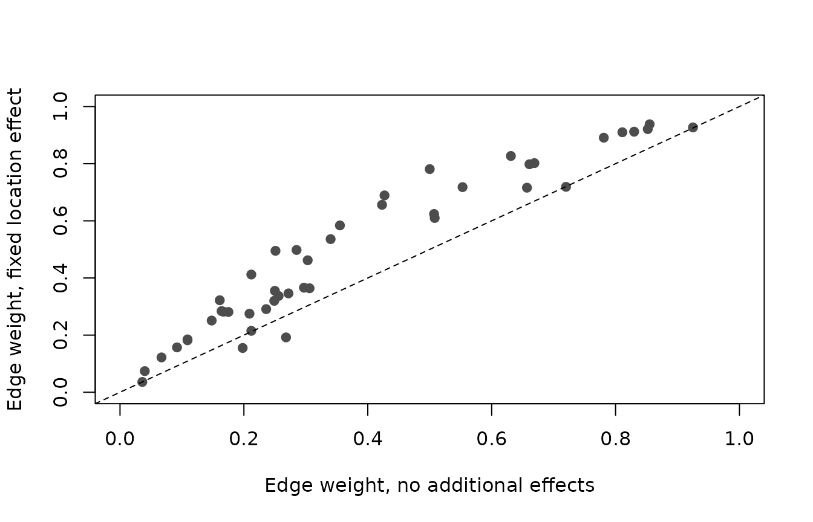
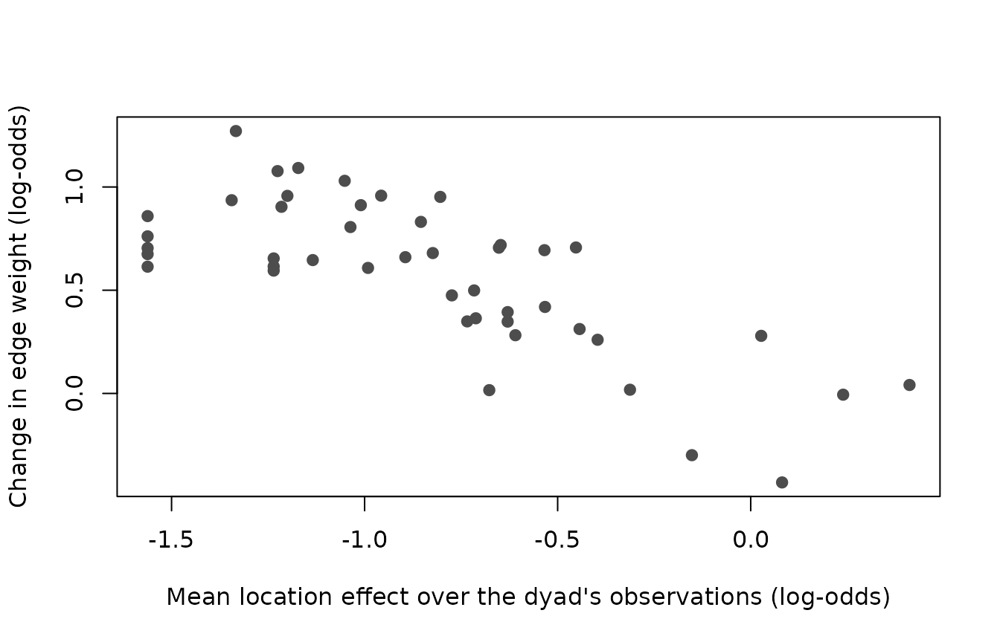

# Edge models with additional effects

``` r

library(bisonR)
```

The probability of seeing a social event often depends on the conditions
of observation as well as on the relationship between the individuals.
For example, pairs may be seen together more often at a feeding site
than elsewhere, or one observer may record more interactions than
another. Binary and count edge models can include such factors as fixed
or random effects, so that the edge weights are estimated after
accounting for them. This article describes the terms that can be added
to the edge model formula, how to inspect the fitted effects, and how
the effects change the interpretation of the edge weights. A basic
analysis is described in
[`vignette("getting_started")`](https://bisonr.org/articles/getting_started.md).

Conjugate models (`model_type = "binary_conjugate"` or
`"count_conjugate"`), which calculate the results exactly without
sampling, only support `dyad()` terms. The models in this article are
therefore fitted with `model_type = "binary"`.

## The data

Additional effects are estimated from variation between observations, so
they need disaggregated data, with one row per sampling period or
observation session.
[`simulate_bison_model()`](https://bisonr.org/reference/simulate_bison_model.md)
simulates binary data in which the probability that a pair is seen
together depends on the dyad, on the age difference between the two
individuals, and on the location (one of five) where the observation was
made:

``` r

sim_data <- simulate_bison_model("binary", aggregated = FALSE, max_obs = 15)
df <- sim_data$df_sim
head(df)
#>   node_1_id node_2_id event effort   age_diff   age_1    age_2 location
#> 1         1         2     1      1 -1.9874477 18.1389 20.12635        5
#> 2         1         2     0      1 -1.9874477 18.1389 20.12635        4
#> 3         1         2     1      1 -1.9874477 18.1389 20.12635        4
#> 4         1         2     1      1 -1.9874477 18.1389 20.12635        4
#> 5         1         2     1      1 -1.9874477 18.1389 20.12635        2
#> 6         1         3     0      1  0.8716649 18.1389 17.26724        1
#>   duration
#> 1        1
#> 2        1
#> 3        1
#> 4        1
#> 5        1
#> 6        1
table(df$location)
#> 
#>  1  2  3  4  5 
#> 74 69 54 68 78
```

`location` is stored as an integer from 1 to 5. Integer and numeric
columns are treated as continuous predictors, with a single parameter
for the slope. Location is a category, so it is converted to a factor
first:

``` r

df$location <- factor(df$location)
```

## A model without additional effects

For comparison, a model with only edge weights is fitted first. In the
fits below, `seed` makes the results reproducible, and
`show_messages = FALSE` and `show_exceptions = FALSE` hide Stan’s
progress and informational messages.

``` r

priors <- get_default_priors("binary")

fit_dyad <- bison_model(
  (event | effort) ~ dyad(node_1_id, node_2_id),
  data = df,
  model_type = "binary",
  priors = priors,
  iter_sampling = 500,
  seed = 1,
  show_messages = FALSE,
  show_exceptions = FALSE
)
```

## Fixed effects

A fixed effect is added with `+` followed by a column name:

``` r

fit_fixed <- bison_model(
  (event | effort) ~ dyad(node_1_id, node_2_id) + location,
  data = df,
  model_type = "binary",
  priors = priors,
  iter_sampling = 500,
  seed = 1,
  show_messages = FALSE,
  show_exceptions = FALSE
)
```

A factor fixed effect gets one parameter per level. There is no
reference level, unlike in [`lm()`](https://rdrr.io/r/stats/lm.html). A
numeric column gets a single parameter.
[`get_effects()`](https://bisonr.org/reference/get_effects.md) gives the
estimates, labelled by level (they are also shown by
[`summary()`](https://rdrr.io/r/base/summary.html)):

``` r

get_effects(fit_fixed)
#>         effect  type median     5%    95%
#> 1 location = 1 fixed -1.562 -2.434 -0.778
#> 2 location = 2 fixed -1.445 -2.235 -0.620
#> 3 location = 3 fixed  1.398  0.534  2.295
#> 4 location = 4 fixed -0.639 -1.438  0.128
#> 5 location = 5 fixed -0.909 -1.666 -0.122
```

The parameters are on the link scale, the scale on which effects are
added together (log-odds for binary models). Each has the `fixed` prior
(the distribution assumed for it before seeing the data),
`normal(0, 2.5)` by default. The table gives the median of each
parameter’s posterior distribution, which describes its plausible values
given the data and the priors, and a 90% credible interval, the range
that contains the parameter with 90% probability. Here location 3 has a
positive effect (posterior median 1.39), and the other four locations
have negative medians, between -1.57 and -0.65. These values are not
relative to a reference location. Their overall level is shared with the
edge weights, as described below.

## Intercepts

Edge models have no global intercept by default. `1` in the formula adds
one, and `0` excludes it explicitly. In a model with a `dyad()` term an
intercept is usually not needed, because the edge weights already
include the overall rate of events. An intercept is used in models
without a `dyad()` term, such as the null model `(event | effort) ~ 1`
in
[`vignette("getting_started")`](https://bisonr.org/articles/getting_started.md),
in which every dyad has the same rate.

## Random effects

A random intercept is added with `(1 | g)`:

``` r

fit_random <- bison_model(
  (event | effort) ~ dyad(node_1_id, node_2_id) + (1 | location),
  data = df,
  model_type = "binary",
  priors = priors,
  iter_sampling = 500,
  seed = 1,
  show_messages = FALSE,
  show_exceptions = FALSE
)
```

As with fixed effects, there is one parameter for each level. The
difference is that the levels are drawn from a common normal
distribution with mean 0 and a standard deviation that is estimated from
the data, with the `random_std` prior. Because the levels are centred on
0, the overall rate of events is described by the edge weights, and the
random effects describe how each location differs from it.

In a model without a `dyad()` term or factor fixed effect, an intercept
is needed to set the overall rate, for example
`(event | effort) ~ 1 + (1 | location)`.
[`bison_model()`](https://bisonr.org/reference/bison_model.md) gives a
warning if it is missing.

``` r

get_effects(fit_random)
#>         effect      type median     5%    95%
#> 1 location = 1    random -1.226 -1.987 -0.490
#> 2 location = 2    random -1.106 -1.898 -0.406
#> 3 location = 3    random  1.396  0.710  2.179
#> 4 location = 4    random -0.394 -1.150  0.273
#> 5 location = 5    random -0.621 -1.407  0.018
#> 6 sd(location) random sd  1.110  0.655  1.915
```

The location effects are similar to those of the fixed effect model:
their medians range from -1.24 to 1.42, compared with -1.57 to 1.39. The
median of the standard deviation between locations, `sd(location)`, is
1.12. The prior centres the random effects on 0, but with only five
levels their estimates need not average 0. Here the medians average
about -0.4.

Because the levels share a common distribution, levels with few
observations are pulled towards the mean of the other levels. Random
effects are therefore suited to factors with many levels, or with some
levels that are rarely observed, such as observers or observation days.
With few levels, as here, the standard deviation between levels
(`random_group_sigma`) is estimated from only a few values and depends
more on its prior. Choose between a fixed and a random effect based on
the study design, not on which gives the preferred result.

A model can contain several fixed and random effects, for example
`+ location + (1 | observer)`. Each random effect term has its own
standard deviation (`random_group_sigma`).

## How effects change the edge weights

With additional effects, the expected value for an observation is the
sum of the edge weight and the effects, on the link scale. For a binary
model, the probability that dyad *ij* is seen together in a sampling
period at location *k* is `plogis(edge_ij + beta_k)`. The edge weight is
therefore the dyad’s tendency to be seen together after accounting for
location, rather than the overall proportion of sampling periods in
which the pair were seen together.

The edge weights with and without the location effect can be compared:

``` r

edges_dyad <- get_edgelist(fit_dyad)
edges_fixed <- get_edgelist(fit_fixed)
edges_random <- get_edgelist(fit_random)
comparison <- data.frame(
  node_1 = edges_dyad$node_1,
  node_2 = edges_dyad$node_2,
  no_effects = edges_dyad$median,
  fixed_location = edges_fixed$median,
  random_location = edges_random$median
)
head(comparison, 10)
#>    node_1 node_2 no_effects fixed_location random_location
#> 1       1      2      0.781          0.891           0.864
#> 2       1      3      0.355          0.584           0.535
#> 3       1      4      0.631          0.827           0.786
#> 4       1      5      0.040          0.074           0.073
#> 5       1      6      0.285          0.498           0.434
#> 6       1      7      0.830          0.912           0.893
#> 7       1      8      0.067          0.122           0.104
#> 8       1      9      0.109          0.185           0.161
#> 9       1     10      0.209          0.275           0.242
#> 10      2      3      0.855          0.938           0.921
```

``` r

plot(comparison$no_effects, comparison$fixed_location,
     xlim = c(0, 1), ylim = c(0, 1), pch = 19, col = "grey30",
     xlab = "Edge weight, no additional effects",
     ylab = "Edge weight, fixed location effect")
abline(a = 0, b = 1, lty = 2)
```



Almost all edge weights are higher in the models with a location effect.
The random effect model gives edge weights between the other two,
slightly lower than the fixed effect model, because its location effects
are centred on 0. The order of the dyads is mostly, but not entirely,
the same in the two models.

Two separate things change when the location effect is added.

The first is the relative position of dyads. A dyad that was mostly
observed at locations with a high rate of events would otherwise appear
to have a strong edge, partly because of where it was observed. The plot
below compares the change in each edge weight (on the link scale) with
the mean fitted location effect across that dyad’s observations:

``` r

fixed_effects <- get_effects(fit_fixed)
beta_location <- fixed_effects$median[fixed_effects$type == "fixed"]
dyad_ids <- fit_fixed$model_info$row_dyad_ids
mean_location_effect <- tapply(beta_location[as.integer(df$location)], dyad_ids, mean)

edges_dyad_logit <- get_edgelist(fit_dyad, transform = FALSE)
edges_fixed_logit <- get_edgelist(fit_fixed, transform = FALSE)
change <- edges_fixed_logit$median - edges_dyad_logit$median

plot(mean_location_effect, change, pch = 19, col = "grey30",
     xlab = "Mean location effect over the dyad's observations (log-odds)",
     ylab = "Change in edge weight (log-odds)")
```



Dyads observed mostly at locations with low fitted effects have the
largest increases. Dyads observed mostly at location 3, which has the
highest fitted effect, change little or have lower edge weights. The
relationship is not exact, because the change also depends on how many
observations each dyad has and on the prior.

The second is the overall level of the edge weights. In a model with a
`dyad()` term and a factor fixed effect, adding the same constant to
every edge weight and subtracting it from every location parameter gives
the same predictions. The data cannot separate the two, so the overall
level of the edge weights is determined partly by the priors. This can
be seen in the posterior correlation between the mean edge weight and
the mean location effect:

``` r

draws <- fit_fixed$fit$draws(c("edge_weight", "beta_fixed"), format = "matrix")
mean_edge <- rowMeans(draws[, grep("^edge_weight", colnames(draws))])
mean_location <- rowMeans(draws[, grep("^beta_fixed", colnames(draws))])
cor(mean_edge, mean_location)
#> [1] -0.8502353
```

The correlation is strongly negative: in posterior draws (samples from
the posterior distribution) in which the location effects are higher,
the edge weights are lower. The general increase in the edge weights in
the first plot is partly a shift of this kind. The location effects are
mostly negative, and the edge weights are higher to compensate.

The same applies to an intercept added with `1`. Random effects are less
affected because they are centred on 0, but with few levels their
estimated values need not average 0 (as in the example above), so some
trade-off remains. As a result, interpret the absolute values of the
edge weights in models with factor fixed effects or an intercept with
care. The reported probability `plogis(edge_ij)` corresponds to an
observation with all effects equal to 0, which may not correspond to any
real observation. Differences between dyads, and analyses that depend on
them, are better determined by the data.

### Dyad-level predictors

A predictor that has the same value in every observation of a dyad, such
as the age difference between the two individuals, cannot be separated
from the edge weight of that dyad, because each dyad already has its own
parameter. If it were included in the edge model, its parameter could
trade off against the edge weights, and only the `edge` prior would
separate the two. Instead, estimate the effect of dyad-level predictors
on edge weights in a downstream regression (a second model fitted to the
estimated edge weights) with
[`bison_brm()`](https://bisonr.org/reference/bison_brm.md), as described
in
[`vignette("getting_started")`](https://bisonr.org/articles/getting_started.md)
and
[`vignette("bison_brms")`](https://bisonr.org/articles/bison_brms.md).
Fixed and random effects in the edge model are for factors that vary
between observations of the same dyad.

## Partial pooling

By default each edge weight has an independent prior, the `edge` prior.
With `partial_pooling = TRUE`, the edge weights are instead drawn from a
normal distribution whose standard deviation, `edge_sigma`, is estimated
from the data. The mean of this distribution is the mean of the `edge`
prior, and the second value of the `edge` prior becomes the scale of a
half-normal prior on `edge_sigma`. Edges with few observations are then
pulled towards the mean by an amount that depends on how much edge
weights vary in the rest of the network.

``` r

fit_pooled <- bison_model(
  (event | effort) ~ dyad(node_1_id, node_2_id) + location,
  data = df,
  model_type = "binary",
  priors = priors,
  partial_pooling = TRUE,
  iter_sampling = 500,
  seed = 1,
  show_messages = FALSE,
  show_exceptions = FALSE
)
get_effects(fit_pooled)
#>             effect       type median     5%    95%
#> 1     location = 1      fixed -1.385 -1.985 -0.786
#> 2     location = 2      fixed -1.283 -1.913 -0.707
#> 3     location = 3      fixed  1.163  0.539  1.854
#> 4     location = 4      fixed -0.579 -1.180  0.006
#> 5     location = 5      fixed -0.764 -1.332 -0.242
#> 6 sd(edge weights) pooling sd  1.169  0.812  1.616
```

The median of the standard deviation of the edge weights,
`sd(edge weights)`, is 1.17, with a 90% credible interval from 0.82 to
1.64, so the edge weights are estimated to vary less than the default
`edge` prior (standard deviation 2.5) allows. The location effects are
similar to those of the model without pooling, with narrower intervals.

The effect of partial pooling on individual edges can be seen by
comparing the credible intervals of the two models:

``` r

edges_pooled <- get_edgelist(fit_pooled)
width_fixed <- edges_fixed[, 5] - edges_fixed[, 4]
width_pooled <- edges_pooled[, 5] - edges_pooled[, 4]
summary(width_fixed)
#>    Min. 1st Qu.  Median    Mean 3rd Qu.    Max. 
#>  0.1640  0.4650  0.5650  0.5665  0.7190  0.8850
summary(width_pooled)
#>    Min. 1st Qu.  Median    Mean 3rd Qu.    Max. 
#>  0.2240  0.4330  0.4870  0.5046  0.6010  0.7190
```

With partial pooling the median width of the 90% intervals is smaller
(0.49 rather than 0.58) and the widest interval is narrower (0.73 rather
than 0.89). The narrowest interval is wider (0.22 rather than 0.16).

Partial pooling assumes that the edge weights in the network come from a
single normal distribution on the link scale. This is not appropriate
for every network, for example one with a small number of strong
relationships among many weak ones.
[`vignette("mixture_models")`](https://bisonr.org/articles/mixture_models.md)
describes how to look for different types of relationship.

## Summary

- Fixed effects (`+ x`) and random effects (`+ (1 | g)`) account for
  factors that vary between observations of the same dyad. They need
  disaggregated data and binary or count models.
- Factor fixed effects get one parameter per level. Integer columns are
  treated as numeric unless they are converted to factors.
- [`get_effects()`](https://bisonr.org/reference/get_effects.md) gives
  the estimates of the fixed effects, random effects and their standard
  deviations, and [`summary()`](https://rdrr.io/r/base/summary.html)
  shows them after the edge weights.
- With additional effects, edge weights describe each dyad’s tendency to
  interact after accounting for those effects. Their overall level is
  shared with the effects and depends partly on the priors.
- Dyad-level predictors belong in downstream regressions with
  [`bison_brm()`](https://bisonr.org/reference/bison_brm.md), not in the
  edge model.
- `partial_pooling = TRUE` estimates the spread of edge weights from the
  data, around a mean fixed by the `edge` prior.
