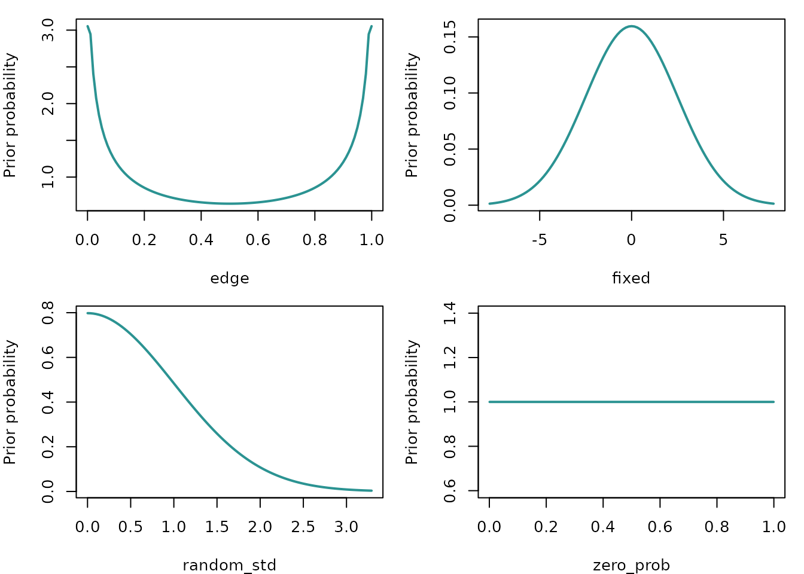
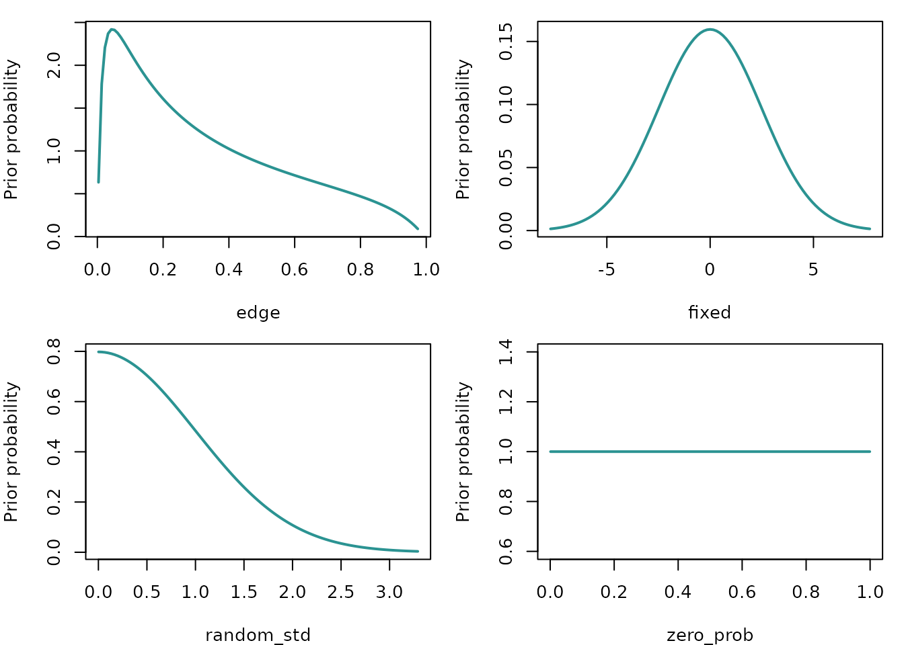
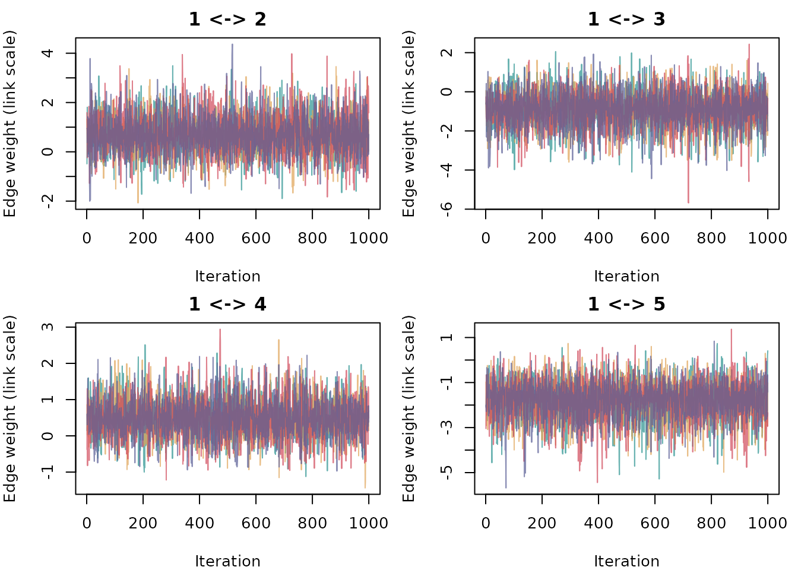
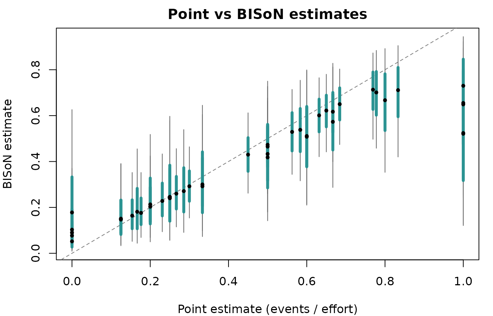
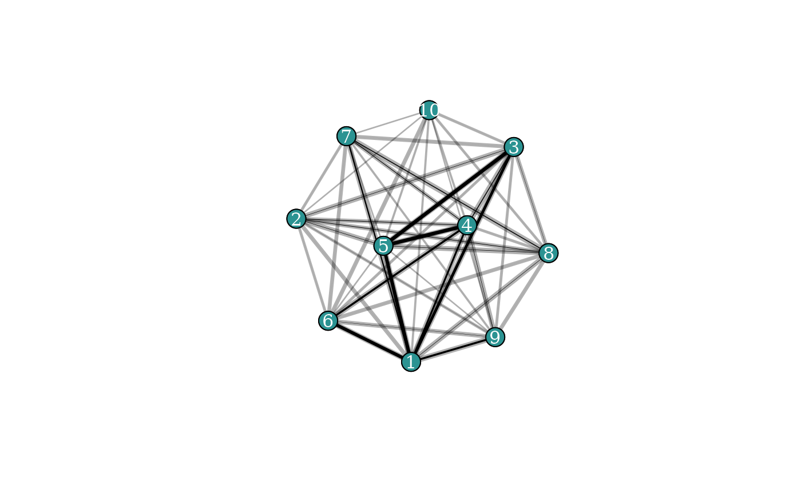
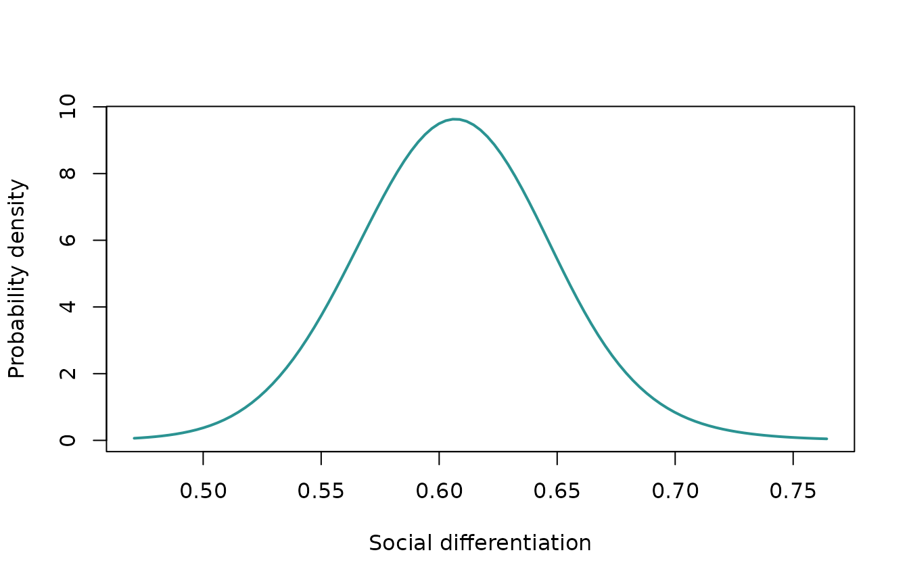

# Getting started

This article goes through a basic BISoN analysis: fitting an edge weight
model, checking it, and using the fitted network in regressions and
network metrics.

## What BISoN does

Social network analyses often start by calculating an edge weight for
each pair of individuals (a *dyad*), such as the proportion of sampling
periods in which they were seen together, and then treat these values as
known. An edge weight calculated from 2 observations is much less
certain than one calculated from 200, and not accounting for this can
lead to overconfident conclusions.

BISoN works in two stages:

1.  An **edge weight model** estimates the edge weight of each dyad from
    the observation data, giving a posterior distribution for each edge:
    the range of plausible edge weights and how probable each one is.
    Dyads that were observed less have wider posteriors.
2.  **Downstream analyses** (regressions, network metrics, comparisons
    between networks) use posterior draws (values sampled from these
    distributions), so the uncertainty in the edge weights is included
    in the results.

The edge weight model is used to estimate the network, not to test
hypotheses about it. Hypotheses are tested in the second stage.

## Setting up

``` r

library(bisonR)
library(dplyr)
#> 
#> Attaching package: 'dplyr'
#> The following objects are masked from 'package:stats':
#> 
#>     filter, lag
#> The following objects are masked from 'package:base':
#> 
#>     intersect, setdiff, setequal, union
```

If you haven’t installed bisonR yet, see the [installation
instructions](https://bisonr.org/#installation).

## The data

bisonR works with *observation data* in a format similar to an edge
list: each row describes observations of one dyad. The columns you need
are:

- **two node columns** naming the individuals in the dyad (here
  `node_1_id` and `node_2_id`);
- an **event** column: the number of social events seen. For binary data
  this is 1 if the dyad was seen together (or interacting) in a sampling
  period and 0 otherwise. For count data it is the number of
  interactions;
- an **effort** column: how much the dyad was observed, such as the
  number of sampling periods or the number of hours of observation.

The rows can be *disaggregated* (one row per sampling period or
observation session) or *aggregated* (one row per dyad, with events and
effort summed). Any other columns, such as location or individual
traits, can be included and used as predictors. See
[`vignette("preparing_data")`](https://bisonr.org/articles/preparing_data.md)
for converting your own data into this format.

This article uses simulated data from
[`simulate_bison_model()`](https://bisonr.org/reference/simulate_bison_model.md):

``` r

sim_data <- simulate_bison_model("binary", aggregated = FALSE, max_obs = 20)
df <- sim_data$df_sim
head(df)
#>   node_1_id node_2_id event effort   age_diff   age_1    age_2 location
#> 1         1         2     1      1 -1.9874477 18.1389 20.12635        5
#> 2         1         2     0      1 -1.9874477 18.1389 20.12635        4
#> 3         1         2     1      1 -1.9874477 18.1389 20.12635        4
#> 4         1         2     1      1 -1.9874477 18.1389 20.12635        4
#> 5         1         2     1      1 -1.9874477 18.1389 20.12635        2
#> 6         1         3     0      1  0.8716649 18.1389 17.26724        1
#>   duration
#> 1        1
#> 2        1
#> 3        1
#> 4        1
#> 5        1
#> 6        1
```

Each row is one sampling period for one dyad: `event` is 1 if the pair
were seen together, and `effort` is the observation effort for that row
(one sampling period). The `duration` column is a copy of `effort`, kept
so that older code still works.

## Fitting the edge weight model

### Choosing the model type

The type of edge model depends on the type of data:

| Data | `model_type` | Edge weight means |
|----|----|----|
| Seen together / not seen together in each sampling period | `"binary"` | Probability of being seen together in a sampling period |
| Number of interactions in a period of observation | `"count"` | Rate of interactions per unit of effort |
| As above, but only edge weights are needed (no other effects) | `"binary_conjugate"`, `"count_conjugate"` | As above, calculated exactly and almost instantly |

### Priors

BISoN is a Bayesian framework, so each model needs priors: distributions
that describe what is believed about the parameters before seeing the
data.
[`get_default_priors()`](https://bisonr.org/reference/get_default_priors.md)
gives a starting point:

``` r

priors <- get_default_priors("binary")
priors
#> $edge
#> [1] "normal(0, 2.5)"
#> 
#> $fixed
#> [1] "normal(0, 2.5)"
#> 
#> $random_std
#> [1] "half-normal(1)"
#> 
#> $zero_prob
#> [1] "beta(1, 1)"
```

Edge weights in binary models are estimated on the logit scale, as
log-odds, where 0 corresponds to a probability of 0.5. So
`normal(0, 2.5)` is a distribution over log-odds.
[`prior_check()`](https://bisonr.org/reference/prior_check.md) shows
what the priors imply on the natural scale (probabilities):

``` r

prior_check(priors, "binary")
```



The default edge prior puts a lot of weight near 0 and 1. If most dyads
are expected to associate rarely, a prior with more weight on lower
probabilities may be more appropriate:

``` r

priors$edge <- "normal(-1, 1.5)"
prior_check(priors, "binary")
```



Priors should be chosen for the study system, and the defaults checked
before use.

### The formula

Edge models are specified with a formula, like those used by
[`lm()`](https://rdrr.io/r/stats/lm.html) and `brms`:

``` r

(event | effort) ~ dyad(node_1_id, node_2_id)
```

- The left-hand side, `(event | effort)`, gives the event and effort
  columns.
- The right-hand side gives the terms in the model.
  `dyad(node_1_id, node_2_id)` estimates an edge weight for each dyad.

Other effects can be added to the right-hand side to account for factors
that affect how often social events are observed. For example,
`+ location` adds a fixed effect (a separate estimate for each location)
and `+ (1 | location)` adds a random effect (location estimates drawn
from a shared distribution). With these effects included, the edge
weights represent each dyad’s tendency to associate after controlling
for them.

Fit the model with
[`bison_model()`](https://bisonr.org/reference/bison_model.md):

``` r

fit_edge <- bison_model(
  (event | effort) ~ dyad(node_1_id, node_2_id),
  data = df,
  model_type = "binary",
  priors = priors
)
#> Running MCMC with 4 parallel chains...
#> 
#> Chain 1 finished in 1.3 seconds.
#> Chain 2 finished in 1.2 seconds.
#> Chain 4 finished in 1.2 seconds.
#> Chain 3 finished in 1.3 seconds.
#> 
#> All 4 chains finished successfully.
#> Mean chain execution time: 1.3 seconds.
#> Total execution time: 1.5 seconds.
```

Fitting time depends on the size of the dataset. The Stan models are
compiled the first time they are used and then cached. If there are no
observation-level effects, aggregating the data to one row per dyad is
faster and gives the same edge weights. A conjugate model is faster
still. It uses a different prior, but gives similar edge weights.

## Checking the model

### MCMC diagnostics

[`bison_model()`](https://bisonr.org/reference/bison_model.md) fits
models with Stan’s MCMC (Markov chain Monte Carlo) sampler, an algorithm
that draws samples from the posterior. Stan gives warnings for problems
such as divergent transitions, but the trace plots should also be
checked. Each line is one chain (an independent run of the sampler). The
chains should overlap and show no trends:

``` r

plot_trace(fit_edge, par_ids = 1:4)
```



### Posterior predictive checks

Posterior predictive checks compare data simulated from the fitted model
with the observed data. With `type = "density"`,
[`plot_predictions()`](https://bisonr.org/reference/plot_predictions.md)
shows the distribution of observed event rates across dyads (red) and
the same distribution in 20 simulated datasets (teal):

``` r

plot_predictions(fit_edge, num_draws = 20, type = "density")
```


The observed distribution should fall within the range of the simulated
ones. `type = "stats"` compares summary statistics of the observed and
simulated data. For example, if the observed proportion of dyads with no
events is much higher than in the simulated data, a zero-inflated model
(`zero_inflated = TRUE`) may be more appropriate:

``` r

plot_predictions(fit_edge, num_draws = 100, type = "stats")
```


Passing these checks does not guarantee that the model is appropriate,
but failing them indicates a problem.

### Comparing with simple estimates

`type = "point"` plots the BISoN estimates against simple point
estimates (events divided by effort):

``` r

plot_predictions(fit_edge, type = "point")
```



Each vertical line is the 90% credible interval for a dyad (the range
that contains the edge weight with 90% probability), and the thicker
section is the 50% interval. The estimates should roughly follow the
dashed line. For dyads with few observations, the estimates are pulled
towards the prior and are less extreme than the point estimates. For
example, a dyad seen together in 1 out of 1 sampling periods has a point
estimate of 1, but there is little evidence that they are always
together.

## Looking at the network

[`summary()`](https://rdrr.io/r/base/summary.html) shows the estimated
edge weight of each dyad:

``` r

summary(fit_edge)
#> === Fitted BISoN edge model ===
#> Data type: binary
#> Formula: (event | effort) ~ dyad(node_1_id, node_2_id)
#> Number of nodes: 10
#> Number of dyads: 45
#> Directed: FALSE
#> === Edge list summary ===
#>          median    5%   95%
#> 1 <-> 2   0.667 0.353 0.892
#> 1 <-> 3   0.292 0.073 0.645
#> 1 <-> 4   0.617 0.399 0.812
#> 1 <-> 5   0.147 0.033 0.391
#> 1 <-> 6   0.228 0.094 0.433
#> 1 <-> 7   0.508 0.210 0.796
#> 1 <-> 8   0.271 0.091 0.539
#> 1 <-> 9   0.260 0.115 0.456
#> 1 <-> 10  0.077 0.013 0.272
#> 2 <-> 3   0.711 0.420 0.905
#> 2 <-> 4   0.418 0.142 0.750
#> 2 <-> 5   0.538 0.316 0.754
#> 2 <-> 6   0.176 0.069 0.352
#> 2 <-> 7   0.292 0.154 0.464
#> 2 <-> 8   0.213 0.050 0.518
#> 2 <-> 9   0.529 0.344 0.714
#> 2 <-> 10  0.240 0.057 0.579
#> 3 <-> 4   0.473 0.291 0.665
#> 3 <-> 5   0.430 0.262 0.612
#> 3 <-> 6   0.433 0.180 0.727
#> 3 <-> 7   0.649 0.242 0.923
#> 3 <-> 8   0.300 0.098 0.605
#> 3 <-> 9   0.622 0.442 0.780
#> 3 <-> 10  0.245 0.062 0.575
#> 4 <-> 5   0.601 0.421 0.765
#> 4 <-> 6   0.151 0.037 0.389
#> 4 <-> 7   0.178 0.023 0.626
#> 4 <-> 8   0.090 0.016 0.324
#> 4 <-> 9   0.103 0.016 0.370
#> 4 <-> 10  0.573 0.287 0.828
#> 5 <-> 6   0.511 0.214 0.799
#> 5 <-> 7   0.052 0.009 0.178
#> 5 <-> 8   0.164 0.052 0.352
#> 5 <-> 9   0.241 0.059 0.581
#> 5 <-> 10  0.465 0.260 0.677
#> 6 <-> 7   0.655 0.253 0.923
#> 6 <-> 8   0.701 0.458 0.884
#> 6 <-> 9   0.650 0.474 0.803
#> 6 <-> 10  0.713 0.497 0.873
#> 7 <-> 8   0.524 0.126 0.894
#> 7 <-> 9   0.730 0.350 0.944
#> 7 <-> 10  0.203 0.069 0.424
#> 8 <-> 9   0.521 0.121 0.898
#> 8 <-> 10  0.181 0.044 0.455
#> 9 <-> 10  0.246 0.057 0.597
```

For each dyad, `median` is the posterior median of the edge weight
(here, the probability that the pair are seen together in a sampling
period), and `5%` and `95%` are the bounds of the 90% credible interval.
[`get_edgelist()`](https://bisonr.org/reference/get_edgelist.md) returns
the same information as a data frame. The width of the interval can be
changed with `ci`, for example `ci = 0.95`.

[`plot_network()`](https://bisonr.org/reference/plot_network.md) draws
the network with its uncertainty:

``` r

plot_network(fit_edge, lwd = 5)
```



Each edge is drawn twice. The width of the dark line is the lower bound
(5%) of the edge weight, and the width of the light band is the upper
bound (95%). Edges with a large difference between the two are more
uncertain. Edges can be hidden with `threshold`, for example
`threshold = 0.2` only shows edges with a median weight of at least 0.2.

## Is the network non-random?

To test for non-random association, compare the edge model with a null
model in which every dyad has the same rate (`~ 1`):

``` r

fit_null <- bison_model(
  (event | effort) ~ 1,
  data = df,
  model_type = "binary",
  priors = priors
)
#> Running MCMC with 4 parallel chains...
#> 
#> Chain 1 finished in 0.8 seconds.
#> Chain 2 finished in 0.8 seconds.
#> Chain 3 finished in 0.8 seconds.
#> Chain 4 finished in 0.8 seconds.
#> 
#> All 4 chains finished successfully.
#> Mean chain execution time: 0.8 seconds.
#> Total execution time: 1.0 seconds.

model_comparison(list(non_random_model = fit_edge, random_model = fit_null))
#> Method: stacking
#> ------
#>                  weight
#> non_random_model 0.789 
#> random_model     0.211
```

The weights are based on leave-one-out cross-validation, which estimates
how well each model predicts data it was not fitted to. They sum to 1. A
weight close to 1 for the non-random model suggests that dyads differ in
how often they associate. With few observations per dyad the comparison
may be inconclusive, or may favour the null model, because there is not
enough information to distinguish between dyads.

## Regressions

Regressions are fitted with
[`bison_brm()`](https://bisonr.org/reference/bison_brm.md), which uses
the `brms` package. Network variables are specified with `bison()` in
the model formula.

### Dyadic regression

This example tests whether age difference predicts edge weight. The
regression needs a data frame with one row per dyad:

``` r

df_dyadic <- df %>%
  distinct(node_1_id, node_2_id, age_diff)
head(df_dyadic)
#>   node_1_id node_2_id   age_diff
#> 1         1         2 -1.9874477
#> 2         1         3  0.8716649
#> 3         1         4 -2.3351863
#> 4         1         5  0.1026539
#> 5         1         6 -7.1629618
#> 6         1         7 -4.0112225
```

Edges that share a node are not independent. A multi-membership random
effect, `(1 | mm(node_1_id, node_2_id))`, gives each dyad a combined
effect of its two members. It accounts for this non-independence and
should usually be included in dyadic regressions:

``` r

fit_dyadic <- bison_brm(
  bison(edge_weight(node_1_id, node_2_id)) ~ age_diff + (1 | mm(node_1_id, node_2_id)),
  fit_edge,
  df_dyadic,
  num_draws = 5, # Small for demonstration; use 100 or more in practice
  refresh = 0,
  silent = 2
)
#> Warning: 2 of 2000 (0.0%) transitions ended with a divergence.
#> See https://mc-stan.org/misc/warnings for details.
#> Warning: 1 of 2000 (0.0%) transitions ended with a divergence.
#> See https://mc-stan.org/misc/warnings for details.
summary(fit_dyadic)
#> Warning: There were 3 divergent transitions after warmup. Increasing
#> adapt_delta above 0.8 may help. See
#> http://mc-stan.org/misc/warnings.html#divergent-transitions-after-warmup
#>  Family: gaussian 
#>   Links: mu = identity 
#> Formula: bison_edge_weight ~ age_diff + (1 | mm(node_1_id, node_2_id)) 
#>    Data: structure(list(data = structure(list(node_1_id = s (Number of observations: 45) 
#>   Draws: 10 chains, each with iter = 2000; warmup = 1000; thin = 1;
#>          total post-warmup draws = 10000
#> 
#> Multilevel Hyperparameters:
#> ~mmnode_1_idnode_2_id (Number of levels: 10) 
#>               Estimate Est.Error l-95% CI u-95% CI
#> sd(Intercept)     0.42      0.34     0.02     1.26
#> 
#> Regression Coefficients:
#>           Estimate Est.Error l-95% CI u-95% CI
#> Intercept    -0.21      0.30    -0.78     0.40
#> age_diff      0.15      0.06     0.02     0.28
#> 
#> Further Distributional Parameters:
#>       Estimate Est.Error l-95% CI u-95% CI
#> sigma     1.27      0.21     0.89     1.72
#> 
#> Draws were sampled using sample(hmc). Overall Rhat and ESS estimates
#> are not informative for brm_multiple models and are hence not displayed.
#> Please see ?brm_multiple for how to assess convergence of such models.
```

In [`bison_brm()`](https://bisonr.org/reference/bison_brm.md), edge
weights are on the logit scale for binary models and the log scale for
count models. A model is fitted to each of `num_draws` networks drawn
from the posterior, and the results are combined, as in multiple
imputation. Because of this, brms may give convergence warnings for the
combined fit, and doesn’t report R-hat values (a convergence
diagnostic). See
[`vignette("bison_brms")`](https://bisonr.org/articles/bison_brms.md)
for other types of regression.

## Network metrics

Posterior distributions of network metrics can be calculated with
[`extract_metric()`](https://bisonr.org/reference/extract_metric.md).
For example, the coefficient of variation of edge weights (social
differentiation):

``` r

cv_samples <- extract_metric(fit_edge, "global_cv")
quantile(cv_samples, probs = c(0.05, 0.5, 0.95))
#>        5%       50%       95% 
#> 0.5363388 0.6064157 0.6772147
plot_metric(cv_samples, "Social differentiation")
```



Node-level metrics return one column per individual:

``` r

strength <- extract_metric(fit_edge, "node_strength", num_draws = 1000)
head(strength[, 1:5])
#>             1        2        3        4        5
#> [1,] 2.809894 3.835981 3.997909 3.551164 3.175747
#> [2,] 2.515065 5.038261 3.683923 2.969983 3.136046
#> [3,] 3.251071 4.708750 3.959189 3.132340 3.696384
#> [4,] 2.422419 3.743923 4.515736 3.727881 3.108168
#> [5,] 3.217601 3.689660 3.977704 3.197678 2.670254
#> [6,] 3.853166 3.292933 4.081171 3.461256 2.917773
```

See
[`vignette("network_metrics")`](https://bisonr.org/articles/network_metrics.md)
for the full list of metrics and how they’re defined.

## Next steps

- [`vignette("preparing_data")`](https://bisonr.org/articles/preparing_data.md):
  converting your own data, directed networks, group-based observations.
- [`vignette("bison_brms")`](https://bisonr.org/articles/bison_brms.md):
  more types of regression, including comparing networks.
- [`vignette("network_metrics")`](https://bisonr.org/articles/network_metrics.md):
  definitions of the available metrics.
- [`vignette("mixture_models")`](https://bisonr.org/articles/mixture_models.md):
  looking for different types of social relationship.

Questions can be asked in
[Discussions](https://github.com/JHart96/bisonR/discussions), and bugs
reported in [Issues](https://github.com/JHart96/bisonR/issues).
