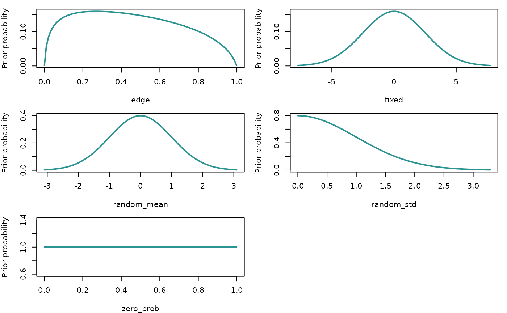
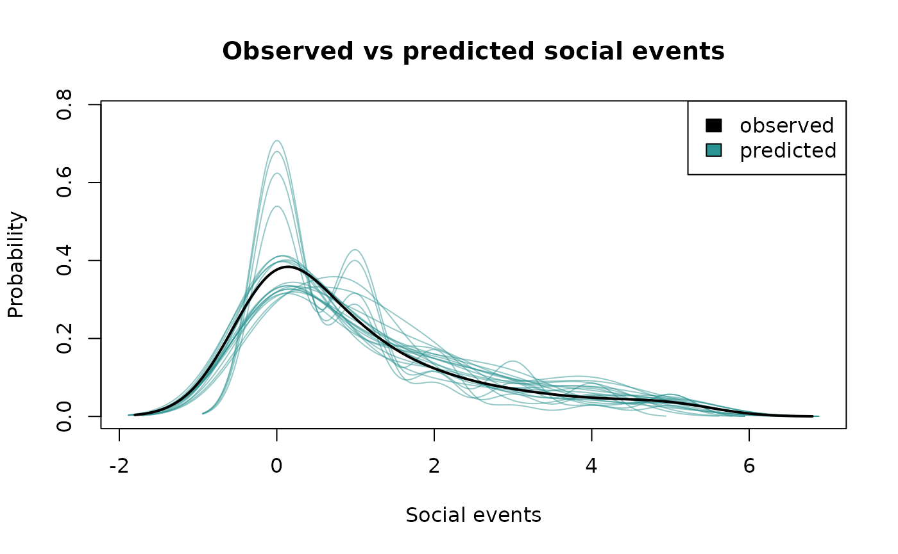

# Getting started

## Introduction

bisonR is an R package for running social network analyses in the BISoN
framework. BISoN models consist of two main stages: 1) fitting an edge
weight model, capturing uncertainty in social network edges; and 2)
propagating this uncertainty through subsequent analyses such as
regressions. In this short tutorial we’ll cover how to fit edge weight
models to a simulated dataset, and show how the fitted edge weight model
can be used to run dyadic and nodal regression analysis, as well as
non-random edge weight tests.

Before beginning, we’ll load in the `bisonR` package using
[`library(bisonR)`](https://bisonr.org), and we’ll also bring in `dplyr`
to help with data wrangling. If you don’t already have `bisonR`
installed, you can install it from Github using the following code:

``` r

remotes::install_github("JHart96/bisonR")
```

``` r

library(bisonR)
#> Loading required package: cmdstanr
#> This is cmdstanr version 0.9.0.9002
#> - CmdStanR documentation and vignettes: mc-stan.org/cmdstanr
#> - CmdStan path: /home/runner/.cmdstan/cmdstan-2.40.0
#> - CmdStan version: 2.40.0
library(dplyr)
#> 
#> Attaching package: 'dplyr'
#> The following objects are masked from 'package:stats':
#> 
#>     filter, lag
#> The following objects are masked from 'package:base':
#> 
#>     intersect, setdiff, setequal, union
```

We will use the
[`simulate_bison_model()`](https://bisonr.org/reference/simulate_bison_model.md)
function from `bisonR` to simulate some observation data. This dataframe
is an example of the format that bisonR uses. Each row corresponds to an
observation (such as an association within a sampling period of a dyad
or a count of interactions between a dyad). Additional
observation-level, dyad-level, or node-level factors can also be
included.

``` r

sim_data <- simulate_bison_model("binary", aggregated = FALSE)
df <- sim_data$df_sim
head(df)
#>   event node_1_id node_2_id age_diff    age_1    age_2 location duration
#> 1     0         1         2 1.194657 18.83836 17.64370        4        1
#> 2     1         1         3 2.008570 18.83836 16.82979        3        1
#> 3     1         1         3 2.008570 18.83836 16.82979        4        1
#> 4     1         1         3 2.008570 18.83836 16.82979        3        1
#> 5     1         1         4 1.224984 18.83836 17.61338        3        1
#> 6     1         1         4 1.224984 18.83836 17.61338        4        1
```

## Edge Models

Depending on the type of data being analysed, different edge models
should be used. See the `BISoN introduction` vignette for more details
on this. In this example we’re using binary data, where events can
either occur (1) or not occur (0) in a particular sampling period. In
our dataframe this corresponds to `event = 1` or `event = 0`.

The bisonR framework is fully Bayesian, and therefore specifying priors
is a key part of any analysis. Priors can be tricky to set, and
techniques for choosing good priors are outside the scope of this
tutorial. You can see which priors need to be set for a particular model
using the
[`get_default_priors()`](https://bisonr.org/reference/get_default_priors.md)
function. These are only defaults and should almost always be changed.

``` r

priors <- get_default_priors("binary")
priors
#> $edge
#> [1] "normal(0, 2.5)"
#> 
#> $fixed
#> [1] "normal(0, 2.5)"
#> 
#> $random_mean
#> [1] "normal(0, 1)"
#> 
#> $random_std
#> [1] "half-normal(1)"
#> 
#> $zero_prob
#> [1] "beta(1, 1)"
```

The priors object gives a list of priors on the parameters for the edge
model: the edge weights, additional fixed effects, and random effect
parameters. The
[`prior_check()`](https://bisonr.org/reference/prior_check.md) function
can be used to plot the prior distributions, and we’ll use this to check
that we’re happy with the priors:

``` r

prior_check(priors, "binary")
```


The priors should encode our prior beliefs about likely values of the
parameters. For demonstration purposes let’s say we expect edge weights
to be concentrated lower, towards zero. We can modify the priors on edge
weight like this:

``` r

priors$edge <- "normal(-1, 2.5)"
prior_check(priors, "binary")
```



Depending on the biology, this might be more like what we want to see.
Now we’ve set our priors and we’re happy with them, we can fit the edge
model using the
[`bison_model()`](https://bisonr.org/reference/bison_model.md) function.
This is one of the main functions of the `bisonR` package and has a lot
of functionality. The main thing to worry about is how to define the
edge weight model formula. The formula are designed to be familar to
those who have used `lm`, `lme4`, `brms`, and other regression packages.
The main difference here is that we need to include some measure of
observation effort to get accurate estimates of edge weight uncertainty.

In bisonR, the left hand side of the `~` describes the sampling data,
and uses the `(event | duration)` notation. In this notation, `event`
corresponds to the name of the column in the dataframe that represents
the measure of social events, such as 1 and 0 in the binary model, or
frequencies 0, 1, 2, … in the count model. If using an unaggregated
dataframe, the `duration` corresponds to the durations of each
observation. In our case this is fixed, but this will depend on the data
at hand.

The right hand side of the `~` describes the predictors that are
associated with social events. In the standard BISoN model this is
primarily the edge weight that we use to build the network, but this can
also include additional effects such as age, sex, or even
observation-level factors such as location, time of day, or weather, to
name a few. Including additional effects will change the interpretation
of edge weights, but could be useful if interested in the social network
once some factors have been controlled for. *Note* the edge weights
don’t need to be included, and you could use bisonR to estimate
generative effects in a network. In this example we’ll keep things
simple and just use edge weight as the only predictor. This is done
using the `dyad(node_1_id, node_2_id)` notation. `node_1_id` and
`node_2_id` represent the nodes corresponding to each individual in the
network, and need to be stored as factors in the dataframe. They don’t
need to be IDs, and could be individual names, as long as they’re stored
as factors. Now we understand the basics of the formula notation, we can
now fit the edge weight model:

``` r

fit_edge <- bison_model(
  (event | duration) ~ dyad(node_1_id, node_2_id), 
  data=df, 
  model_type="binary",
  priors=priors
)
#> Running MCMC with 4 parallel chains...
#> 
#> Chain 1 finished in 0.3 seconds.
#> Chain 2 finished in 0.3 seconds.
#> Chain 3 finished in 0.3 seconds.
#> Chain 4 finished in 0.4 seconds.
#> 
#> All 4 chains finished successfully.
#> Mean chain execution time: 0.3 seconds.
#> Total execution time: 0.6 seconds.
```

Depending on your dataset this can take anywhere between a few tenths of
a second and several hours. In particular if you have a large dataset
and no observation-level predictors, it’s probably a good idea to use
the aggregated version of the model where all observations per dyad are
collapsed to a single row. This will speed up model fitting
considerably.

Once the model has fitted, we need to check that the MCMC algorithm has
behaved correctly. Often if there’s a major problem, the
[`bison_model()`](https://bisonr.org/reference/bison_model.md) function
itself will have triggered warning messages above. But even if
everything is silent, it’s still worth checking the traceplots to check
the MCMC chains have converged. The chains should be well-mixed and look
something like a fuzzy caterpillar. We can check for this using the
[`plot_trace()`](https://bisonr.org/reference/plot_trace.md) function:

``` r

plot_trace(fit_edge, par_ids=2)
```


If we’re satisfied that the MCMC algorithm has done its job properly,
then it’s time to see if the same is true for the model. One way to do
this, among many others, is to check the predictions from the fitted
model against the real data. This can be done using the
[`plot_predictions()`](https://bisonr.org/reference/plot_predictions.md)
function. If the real data are within the ensemble of predictions from
the model, then we have a little more faith that the model is capturing
at least some important properties of the data. The statistical model
implies a range of predictions that we can extract over multiple draws,
the number of which can be set using the `num_draws` argument.

``` r

plot_predictions(fit_edge, num_draws=20, type="density")
```



The predictions from the model are shown in blue and the real data are
shown in black. Ideally the blue lines should be distributed around the
black line, indicating the real data are among the possible predictions
of the model. It’s usually a good idea to run multiple predictive checks
to ensure the model has captured various important characteristics of
the data. Another type of check supported by `bisonR` is a comparison
against point estimates of edge weights:

``` r

plot_predictions(fit_edge, num_draws=20, type="point")
```


This plot shows BISoN estimates denoted by an interval, where the 90%
probability interval is shown by the thin line, and the 50% probability
interval is shown by the thicker blue line. We should see a roughly
linear relationship between point estimates and BISoN estimates, though
at the extremes the BISoN estimates are likely to be less extreme unless
there are sufficient data. This is by design, as BISoN uses a full
probabilistic model of social events to generate its estimates, and will
be sceptical of extreme values without sufficient evidence.

Now we’ve conducted two basic diagnostic checks of the edge weight
model, we can start to trust what it’s telling us. To see a summary of
edge weights and their credible intervals, we can use the
[`summary()`](https://rdrr.io/r/base/summary.html) function:

``` r

summary(fit_edge)
#> === Fitted BISoN edge model ===
#> Data type: binary
#> Formula: (event | duration) ~ dyad(node_1_id, node_2_id)
#> Number of nodes: 10
#> Number of dyads: 45
#> Directed: FALSE
#> === Edge list summary ===
#>          median    5%   95%
#> 1 <-> 2   0.105 0.003 0.706
#> 1 <-> 3   0.883 0.484 0.992
#> 1 <-> 4   0.700 0.315 0.938
#> 1 <-> 5   0.907 0.591 0.992
#> 1 <-> 6   0.907 0.585 0.992
#> 1 <-> 7   0.565 0.232 0.856
#> 1 <-> 8   0.415 0.064 0.872
#> 1 <-> 9   0.843 0.345 0.990
#> 1 <-> 10  0.053 0.002 0.380
#> 2 <-> 3   0.430 0.068 0.874
#> 2 <-> 4   0.369 0.104 0.715
#> 2 <-> 5   0.429 0.070 0.866
#> 2 <-> 6   0.073 0.003 0.497
#> 2 <-> 7   0.077 0.003 0.500
#> 2 <-> 8   0.373 0.096 0.723
#> 2 <-> 9   0.181 0.030 0.516
#> 2 <-> 10  0.041 0.002 0.268
#> 3 <-> 4   0.733 0.145 0.985
#> 3 <-> 5   0.920 0.645 0.994
#> 3 <-> 6   0.074 0.003 0.490
#> 3 <-> 7   0.113 0.004 0.686
#> 3 <-> 8   0.293 0.045 0.727
#> 3 <-> 9   0.073 0.003 0.491
#> 3 <-> 10  0.076 0.003 0.502
#> 4 <-> 5   0.920 0.641 0.994
#> 4 <-> 6   0.839 0.339 0.989
#> 4 <-> 7   0.367 0.104 0.710
#> 4 <-> 8   0.071 0.002 0.489
#> 4 <-> 9   0.433 0.070 0.865
#> 4 <-> 10  0.056 0.002 0.376
#> 5 <-> 6   0.041 0.002 0.277
#> 5 <-> 7   0.041 0.002 0.272
#> 5 <-> 8   0.429 0.074 0.866
#> 5 <-> 9   0.040 0.002 0.267
#> 5 <-> 10  0.056 0.003 0.376
#> 6 <-> 7   0.109 0.004 0.673
#> 6 <-> 8   0.111 0.003 0.675
#> 6 <-> 9   0.295 0.046 0.746
#> 6 <-> 10  0.105 0.003 0.707
#> 7 <-> 8   0.734 0.148 0.984
#> 7 <-> 9   0.055 0.003 0.378
#> 7 <-> 10  0.037 0.002 0.270
#> 8 <-> 9   0.105 0.003 0.685
#> 8 <-> 10  0.069 0.003 0.471
#> 9 <-> 10  0.040 0.002 0.259
```

It can be hard to get an intuitive idea for what’s going on looking only
at a summary table, so this is where it can be useful to visualise the
network too. The
[`plot_network()`](https://bisonr.org/reference/plot_network.md)
function does this for BISoN edge weight models, where uncertainty is
shown on edge weights. Uncertainty is visualised by showing the lower
and upper bounds as overlapping edges in the network.

``` r

plot_network(fit_edge, lwd=5)
```


## Non-random Edge Weights

Now that we have a fitted edge weight model we’re happy with, we can
move to downstream analyses. The first of these we’ll consider is the
non-random edge weight analysis, which is a Bayesian version of the
Bejder et al. 1998 test for non-random association. In this analysis we
compare the fitted edge weight model to a null version of the model
where all edges have the same weight. We then use the `model_comparison`
function to estimate the relative probabilities of the full edge weight
model against the null model:

``` r

fit_null <- bison_model(
  (event | duration) ~ 1, 
  data=df, 
  model_type="binary",
  priors=priors
)
#> Running MCMC with 4 parallel chains...
#> 
#> Chain 1 finished in 0.2 seconds.
#> Chain 2 finished in 0.2 seconds.
#> Chain 3 finished in 0.2 seconds.
#> Chain 4 finished in 0.2 seconds.
#> 
#> All 4 chains finished successfully.
#> Mean chain execution time: 0.2 seconds.
#> Total execution time: 0.3 seconds.

model_comparison(list(non_random_model=fit_edge, random_model=fit_null))
#> Warning: Some Pareto k diagnostic values are too high. See help('pareto-k-diagnostic') for details.
#> Method: stacking
#> ------
#>                  weight
#> non_random_model 1.000 
#> random_model     0.000
```

This shows the relative probabilities of the models in the comparison.
In our case the results are conclusive, the network seems to be
non-random. It’s likely that this is the case in almost all networks,
but you might want to conduct this test anyway.

## Regression

One of the most common types of analysis is regression. To demonstrate
how regressions can be conducted in bisonR, we’ll first set up a
dataframe. For this example let’s use age difference as a predictor of
edge weight.

``` r

df_dyadic <- df %>%
  distinct(node_1_id, node_2_id, age_diff)

df_dyadic
#>    node_1_id node_2_id    age_diff
#> 1          1         2  1.19465724
#> 2          1         3  2.00856988
#> 3          1         4  1.22498356
#> 4          1         5  4.10718556
#> 5          1         6  0.90997296
#> 6          1         7  0.51398526
#> 7          1         8  0.44834925
#> 8          1         9 -1.84302212
#> 9          1        10 -4.09700549
#> 10         2         3  0.81391263
#> 11         2         4  0.03032632
#> 12         2         5  2.91252832
#> 13         2         6 -0.28468428
#> 14         2         7 -0.68067198
#> 15         2         8 -0.74630799
#> 16         2         9 -3.03767937
#> 17         2        10 -5.29166273
#> 18         3         4 -0.78358631
#> 19         3         5  2.09861568
#> 20         3         6 -1.09859691
#> 21         3         7 -1.49458462
#> 22         3         8 -1.56022062
#> 23         3         9 -3.85159200
#> 24         3        10 -6.10557536
#> 25         4         5  2.88220200
#> 26         4         6 -0.31501060
#> 27         4         7 -0.71099831
#> 28         4         8 -0.77663431
#> 29         4         9 -3.06800569
#> 30         4        10 -5.32198905
#> 31         5         6 -3.19721259
#> 32         5         7 -3.59320030
#> 33         5         8 -3.65883631
#> 34         5         9 -5.95020768
#> 35         5        10 -8.20419105
#> 36         6         7 -0.39598771
#> 37         6         8 -0.46162371
#> 38         6         9 -2.75299509
#> 39         6        10 -5.00697845
#> 40         7         8 -0.06563600
#> 41         7         9 -2.35700738
#> 42         7        10 -4.61099074
#> 43         8         9 -2.29137138
#> 44         8        10 -4.54535474
#> 45         9        10 -2.25398336
```

bisonR uses the popular Bayesian regression framework `brms` to run
regressions models inside a wrapper function
[`bison_brm()`](https://bisonr.org/reference/bison_brm.md). The core
syntax and arguments to
[`bison_brm()`](https://bisonr.org/reference/bison_brm.md) are the same
as `brm`, with a few key differences. The main difference in the formula
specification is that network variables are specified using the
`bison(...)` keyword. This tells brms to use the bison edge weight model
to maintain uncertainty in the analysis. In this analysis we want to use
age difference as a predictor of edge weight, so we can run:

``` r

fit_dyadic <- bison_brm (
  bison(edge_weight(node_1_id, node_2_id)) ~ age_diff,
  fit_edge,
  df_dyadic,
  num_draws=5, # Small sample size for demonstration purposes
  refresh=0
)
#> Warning: Number of logged events: 1
#> Compiling the C++ model
#> Running MCMC with 1 chain...
#> 
#> Chain 1 WARNING: No variance estimation is 
#> Chain 1          performed for num_warmup < 20 
#> Chain 1 finished in 0.0 seconds.
#> Warning: E-BFMI not computed because it is undefined for posterior chains of
#> length less than 3.
#> Running MCMC with 2 chains, at most 4 in parallel...
#> 
#> Chain 1 finished in 0.0 seconds.
#> Chain 2 finished in 0.0 seconds.
#> 
#> Both chains finished successfully.
#> Mean chain execution time: 0.0 seconds.
#> Total execution time: 0.2 seconds.
#> 
#> Running MCMC with 2 chains, at most 4 in parallel...
#> 
#> Chain 1 finished in 0.0 seconds.
#> Chain 2 finished in 0.0 seconds.
#> 
#> Both chains finished successfully.
#> Mean chain execution time: 0.0 seconds.
#> Total execution time: 0.2 seconds.
#> 
#> Running MCMC with 2 chains, at most 4 in parallel...
#> 
#> Chain 1 finished in 0.0 seconds.
#> Chain 2 finished in 0.0 seconds.
#> 
#> Both chains finished successfully.
#> Mean chain execution time: 0.0 seconds.
#> Total execution time: 0.2 seconds.
#> 
#> Running MCMC with 2 chains, at most 4 in parallel...
#> 
#> Chain 1 finished in 0.0 seconds.
#> Chain 2 finished in 0.0 seconds.
#> 
#> Both chains finished successfully.
#> Mean chain execution time: 0.0 seconds.
#> Total execution time: 0.2 seconds.
#> 
#> Running MCMC with 2 chains, at most 4 in parallel...
#> 
#> Chain 1 finished in 0.0 seconds.
#> Chain 2 finished in 0.0 seconds.
#> 
#> Both chains finished successfully.
#> Mean chain execution time: 0.0 seconds.
#> Total execution time: 0.2 seconds.
#> Fitting imputed model 1
#> Start sampling
#> Fitting imputed model 2
#> Start sampling
#> Fitting imputed model 3
#> Start sampling
#> Fitting imputed model 4
#> Start sampling
#> Fitting imputed model 5
#> Start sampling
```

The default output of
[`bison_brm()`](https://bisonr.org/reference/bison_brm.md) is a
`brmsfit_multiple` object that can be analysed in much the same way as
any other brms object. We can check the summary as follows:

``` r

summary(fit_dyadic)
#>  Family: gaussian 
#>   Links: mu = identity 
#> Formula: bison_edge_weight ~ age_diff 
#>    Data: mice_obj (Number of observations: 45) 
#>   Draws: 10 chains, each with iter = 2000; warmup = 1000; thin = 1;
#>          total post-warmup draws = 10000
#> 
#> Regression Coefficients:
#>           Estimate Est.Error l-95% CI u-95% CI
#> Intercept    -0.30      0.40    -1.10     0.49
#> age_diff      0.50      0.13     0.24     0.75
#> 
#> Further Distributional Parameters:
#>       Estimate Est.Error l-95% CI u-95% CI
#> sigma     2.07      0.27     1.64     2.68
#> 
#> Draws were sampled using sample(hmc). Overall Rhat and ESS estimates
#> are not informative for brm_multiple models and are hence not displayed.
#> Please see ?brm_multiple for how to assess convergence of such models.
```

## Network Metrics

As well as the types of statistical analysis we’ve already covered,
network metrics can also be extracted for use in other quantitative or
qualitative analyses. This can be done with the
`draw_network_metric_samples()` function for network-level metrics (also
known as global metrics) or `draw_node_metric_samples()` for node-level
metrics. Let’s try this out for the coefficient of variation (CV) in
edge weights, also known as social differentiation:

``` r

cv_samples <- extract_metric(fit_edge, "global_cv")
head(cv_samples)
#>           [,1]
#> [1,] 0.9488460
#> [2,] 0.8926184
#> [3,] 0.9364639
#> [4,] 0.9092763
#> [5,] 0.9280470
#> [6,] 0.9037567
```

We can visualise the posterior distribution of social differentiation by

``` r

plot(density(cv_samples))
```


The posterior samples can now be used descriptively, to compare
networks, or in other downstream analyses.

## Conclusion

This was a very brief introduction to the `bisonR` package, and we hope
it was useful. The R package has many more features than were shown
here, and the package is under constant development. We welcome any and
all feedback and criticism. We hope you find this package useful, happy
social network analysis!
