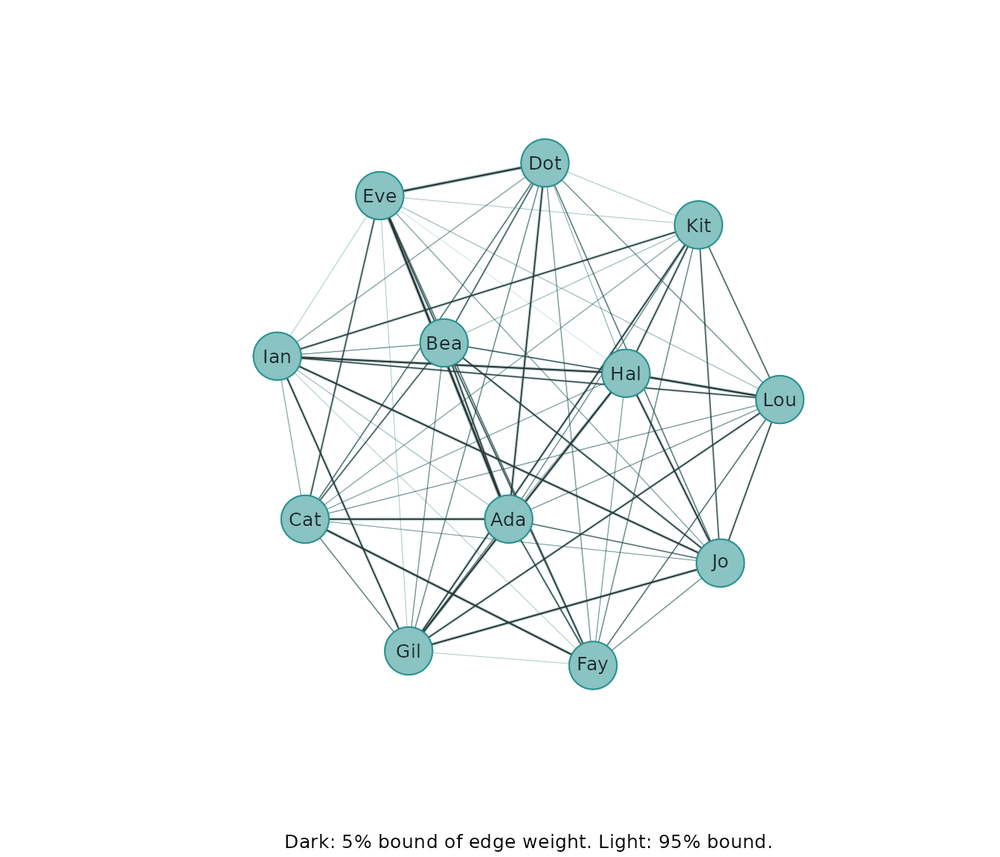
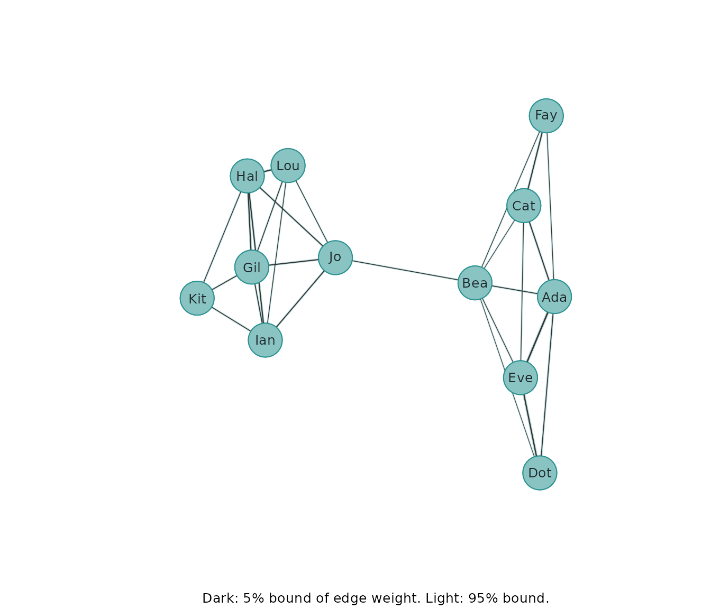
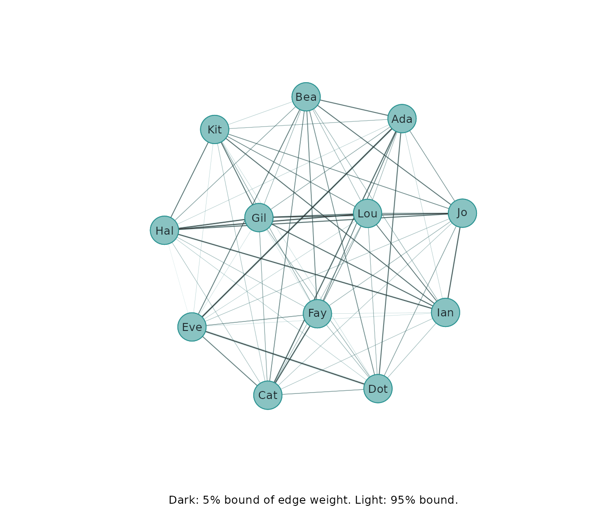
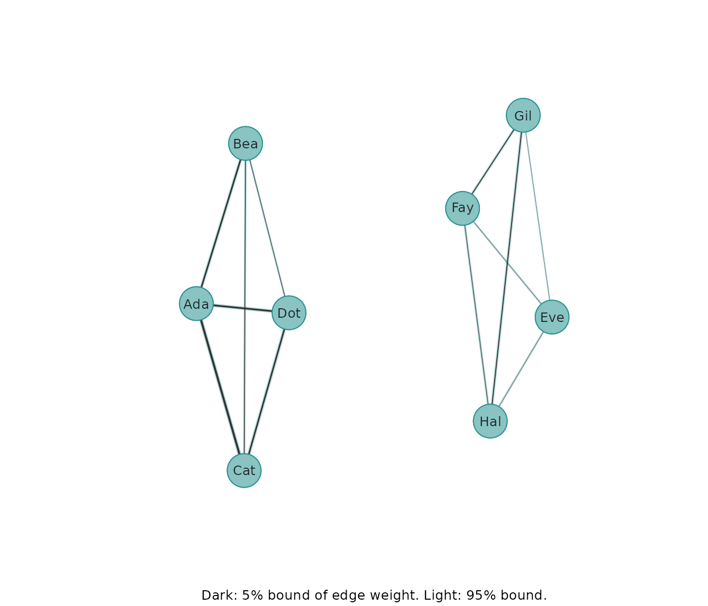

# Group-based observations

``` r

library(bisonR)
```

This article analyses group-based observations, in which individuals
seen in the same group are assumed to be associating (the gambit of the
group). Data of this type are often stored as a group-by-individual
(GBI) matrix.
[`vignette("preparing_data")`](https://bisonr.org/articles/preparing_data.md)
shows how to convert GBI matrices; this article covers a full analysis,
including group-level effects and constraints on which pairs could have
been seen together.

## Simulating a GBI matrix

A GBI matrix has one row per group (or sighting) and one column per
individual, with 1 if the individual was in the group and 0 otherwise.
We simulate sightings of 12 individuals that belong to two communities.
Each group is formed around one community: members of that community are
likely to be present, and members of the other community are rarely
present. Each group was seen in either the wet or the dry season, and
individuals are more likely to be in a group in the wet season.

``` r

community <- c(Ada = "A", Bea = "A", Cat = "A", Dot = "A", Eve = "A", Fay = "A",
               Gil = "B", Hal = "B", Ian = "B", Jo = "B", Kit = "B", Lou = "B")
num_groups <- 80

group_community <- sample(c("A", "B"), num_groups, replace = TRUE)
wet <- rbinom(num_groups, 1, 0.5) # 1 = wet season, 0 = dry season

gbi <- matrix(0, num_groups, length(community), dimnames = list(NULL, names(community)))
for (k in seq_len(num_groups)) {
  member <- community == group_community[k]
  logit_p <- ifelse(member, -0.5, -3) + 1 * wet[k]
  gbi[k, ] <- rbinom(length(community), 1, plogis(logit_p))
}

# Remove groups in which no individuals were seen
keep <- rowSums(gbi) > 0
gbi <- gbi[keep, ]
wet <- wet[keep]
dim(gbi)
#> [1] 79 12
head(gbi)
#>      Ada Bea Cat Dot Eve Fay Gil Hal Ian Jo Kit Lou
#> [1,]   0   1   0   1   1   0   0   0   0  0   0   0
#> [2,]   0   0   0   1   0   0   1   0   1  1   0   1
#> [3,]   1   0   1   1   1   0   0   0   0  0   0   0
#> [4,]   0   1   0   1   0   0   0   0   0  0   0   0
#> [5,]   0   0   1   0   0   1   0   1   0  0   0   1
#> [6,]   0   0   0   0   1   0   0   0   0  0   0   0
```

## Converting to bisonR format

[`convert_gbi_to_bison()`](https://bisonr.org/reference/convert_gbi_to_bison.md)
converts the GBI matrix to one row per pair of individuals per group.
For each pair (i, j), it adds a row for every group in which at least
one of i and j was present. `event` is 1 if both were present and 0 if
only one was. Groups in which neither was present are left out, because
they carry no information about whether the two associate. `group_id` is
the row of the GBI matrix that each row came from.

Group-level variables are passed with `group_properties`, a vector with
one value per row of the GBI matrix, and are added as the column
`group_property`:

``` r

df <- convert_gbi_to_bison(gbi, group_properties = wet)
names(df)[names(df) == "group_property"] <- "wet"
head(df)
#>   node_1 node_2 event group_id wet
#> 1    Ada    Bea     0        1   0
#> 2    Ada    Bea     0        3   0
#> 3    Ada    Bea     0        4   0
#> 4    Ada    Bea     0        7   1
#> 5    Ada    Bea     0       12   0
#> 6    Ada    Bea     0       13   1
nrow(df)
#> [1] 2443
```

For example, the rows for Ada and Bea correspond to the groups in which
Ada, Bea or both were present:

``` r

df_ab <- df[df$node_1 == "Ada" & df$node_2 == "Bea", ]
nrow(df_ab)
#> [1] 34
sum(gbi[, "Ada"] == 1 | gbi[, "Bea"] == 1)
#> [1] 34
sum(df_ab$event)
#> [1] 9
sum(gbi[, "Ada"] == 1 & gbi[, "Bea"] == 1)
#> [1] 9
```

Each row is one sampling period for the pair, so the effort is 1.
Individual traits, such as sex or age, can be added with
`individual_properties` (one value per column of the GBI matrix), which
adds the columns `node_1_property` and `node_2_property`.

## Fitting a conjugate model

With no other effects in the model, the edge weights can be estimated
with the conjugate binary model. It calculates the posterior
distribution of each edge weight (its plausible values given the data
and the prior) exactly, without sampling. The edge weight of a pair is
the probability that both are present in a group, given that at least
one of them is:

``` r

fit_conj <- bison_model(
  (event | 1) ~ dyad(node_1, node_2),
  data = df,
  model_type = "binary_conjugate",
  priors = get_default_priors("binary_conjugate")
)
head(get_edgelist(fit_conj))
#>   node_1 node_2 median    5%   95%
#> 1    Ada    Bea  0.273 0.163 0.408
#> 2    Ada    Cat  0.311 0.195 0.451
#> 3    Ada    Dot  0.284 0.169 0.432
#> 4    Ada    Eve  0.410 0.270 0.561
#> 5    Ada    Fay  0.226 0.124 0.349
#> 6    Ada    Gil  0.142 0.067 0.244
```

``` r

plot_network(fit_conj, lwd = 5)
```



All pairs were seen in at least one group, so every pair has an edge.
The posterior medians, arranged as a matrix, show the community
structure:

``` r

edgelist <- get_edgelist(fit_conj)
nodes <- names(community)
adj <- matrix(NA, length(nodes), length(nodes), dimnames = list(nodes, nodes))
adj[cbind(edgelist$node_1, edgelist$node_2)] <- edgelist$median
adj[cbind(edgelist$node_2, edgelist$node_1)] <- edgelist$median
round(adj, 2)
#>      Ada  Bea  Cat  Dot  Eve  Fay  Gil  Hal  Ian   Jo  Kit  Lou
#> Ada   NA 0.27 0.31 0.28 0.41 0.23 0.14 0.06 0.06 0.16 0.12 0.10
#> Bea 0.27   NA 0.20 0.20 0.23 0.22 0.11 0.14 0.11 0.25 0.06 0.10
#> Cat 0.31 0.20   NA 0.17 0.23 0.33 0.14 0.09 0.08 0.08 0.09 0.10
#> Dot 0.28 0.20 0.17   NA 0.39 0.11 0.13 0.07 0.10 0.16 0.05 0.12
#> Eve 0.41 0.23 0.23 0.39   NA 0.18 0.04 0.02 0.04 0.09 0.04 0.06
#> Fay 0.23 0.22 0.33 0.11 0.18   NA 0.04 0.10 0.04 0.12 0.13 0.16
#> Gil 0.14 0.11 0.14 0.13 0.04 0.04   NA 0.34 0.28 0.31 0.27 0.26
#> Hal 0.06 0.14 0.09 0.07 0.02 0.10 0.34   NA 0.33 0.30 0.25 0.34
#> Ian 0.06 0.11 0.08 0.10 0.04 0.04 0.28 0.33   NA 0.30 0.26 0.22
#> Jo  0.16 0.25 0.08 0.16 0.09 0.12 0.31 0.30 0.30   NA 0.20 0.22
#> Kit 0.12 0.06 0.09 0.05 0.04 0.13 0.27 0.25 0.26 0.20   NA 0.18
#> Lou 0.10 0.10 0.10 0.12 0.06 0.16 0.26 0.34 0.22 0.22 0.18   NA
```

Pairs in the same community (Ada to Fay, and Gil to Lou) mostly have
higher edge weights than pairs from different communities, although the
two ranges overlap. Plotting only the edges with a median weight of at
least 0.2 shows this more clearly:

``` r

plot_network(fit_conj, lwd = 5, threshold = 0.2)
```



## Group-level effects

Rows that come from the same group are not independent. In a group that
many individuals joined, all the pairs among them have `event = 1`, and
in the wet season all individuals are more likely to be in groups. A
Stan model can include a random effect of group, `(1 | group_id)`, which
estimates an effect for each group drawn from a shared distribution, and
fixed effects of group properties such as `wet`. Conjugate models only
allow `dyad()`, so this needs `model_type = "binary"`:

``` r

fit_group <- bison_model(
  (event | 1) ~ dyad(node_1, node_2) + wet + (1 | group_id),
  data = df,
  model_type = "binary",
  priors = get_default_priors("binary"),
  seed = 1,
  show_exceptions = FALSE
)
#> Running MCMC with 4 parallel chains...
#> 
#> Chain 3 finished in 17.2 seconds.
#> Chain 2 finished in 17.4 seconds.
#> Chain 1 finished in 18.2 seconds.
#> Chain 4 finished in 18.0 seconds.
#> 
#> All 4 chains finished successfully.
#> Mean chain execution time: 17.7 seconds.
#> Total execution time: 18.4 seconds.
```

The edge weights are now estimated after accounting for the season and
for differences between groups. The season and group effects are added
to the edge weights on the logit (log-odds) scale, so the edge weights
describe the probability of association in the dry season (`wet = 0`) in
a group with a random effect of 0. They are not on the same scale as
those of the conjugate model:

``` r

head(get_edgelist(fit_group))
#>   node_1 node_2 median    5%   95%
#> 1    Ada    Bea  0.197 0.109 0.320
#> 2    Ada    Cat  0.232 0.131 0.373
#> 3    Ada    Dot  0.205 0.111 0.327
#> 4    Ada    Eve  0.331 0.199 0.485
#> 5    Ada    Fay  0.160 0.081 0.269
#> 6    Ada    Gil  0.090 0.039 0.170
```

The estimates of the other effects are shown by
[`summary()`](https://rdrr.io/r/base/summary.html), and returned as a
data frame by
[`get_effects()`](https://bisonr.org/reference/get_effects.md). They are
on the log-odds scale. The table also has a random effect for each of
the 79 groups, so here only the effect of the wet season and the
standard deviation of the group effects are shown:

``` r

effects <- get_effects(fit_group)
effects[effects$type != "random", ]
#>          effect      type median    5%   95%
#> 1           wet     fixed  0.492 0.239 0.721
#> 81 sd(group_id) random sd  0.316 0.146 0.475
```

The effect of `wet` is positive (median 0.49 on the logit scale), so
pairs were more likely to be seen together in wet-season groups, and the
standard deviation of the group effects is about 0.32. The edge weights
describe a dry-season group (`wet = 0`) with a group effect of 0, so
they are lower than those of the conjugate model, which does not
separate the seasons. For example, the median edge weight of Ada and Bea
is 0.20 in this model and 0.27 in the conjugate model.

[`plot_network()`](https://bisonr.org/reference/plot_network.md) works
in the same way as for the conjugate model:

``` r

plot_network(fit_group, lwd = 5)
```



## Pairs that could not have been seen together

If some individuals could never have been in the same group, for example
because they were in the study area at different times, the rows for
these pairs contain only zeros. These zeros are not evidence that the
pair avoid each other, and they lead to low estimated edge weights.
`individual_constraints` gives each individual a value, and only pairs
with the same value are included.

As an example, we simulate a second data set from two study periods with
different individuals: Ada to Dot were only present in the first period,
and Eve to Hal only in the second.

``` r

period_individuals <- list(c("Ada", "Bea", "Cat", "Dot"), c("Eve", "Fay", "Gil", "Hal"))
gbi_periods <- matrix(0, 40, 8, dimnames = list(NULL, unlist(period_individuals)))
for (k in 1:40) {
  period <- if (k <= 20) 1 else 2
  gbi_periods[k, period_individuals[[period]]] <- rbinom(4, 1, 0.5)
}
gbi_periods <- gbi_periods[rowSums(gbi_periods) > 0, ]
```

Without constraints, all 28 pairs are included, including the 16 pairs
of individuals from different periods:

``` r

df_all <- convert_gbi_to_bison(gbi_periods)
nrow(unique(df_all[, c("node_1", "node_2")]))
#> [1] 28
```

In a model fitted to these data, the pairs from different periods have
edge weights close to 0, because the two individuals were never seen in
the same group:

``` r

fit_all <- bison_model(
  (event | 1) ~ dyad(node_1, node_2),
  data = df_all,
  model_type = "binary_conjugate",
  priors = get_default_priors("binary_conjugate")
)
edgelist_all <- get_edgelist(fit_all)
edgelist_all[edgelist_all$node_1 == "Ada", ]
#>   node_1 node_2 median    5%   95%
#> 1    Ada    Bea  0.474 0.298 0.657
#> 2    Ada    Cat  0.590 0.390 0.775
#> 3    Ada    Dot  0.536 0.329 0.721
#> 4    Ada    Eve  0.034 0.003 0.136
#> 5    Ada    Fay  0.031 0.002 0.132
#> 6    Ada    Gil  0.027 0.002 0.112
#> 7    Ada    Hal  0.033 0.002 0.132
```

With the study period as a constraint, only pairs from the same period
are included:

``` r

period <- c(1, 1, 1, 1, 2, 2, 2, 2)
df_constrained <- convert_gbi_to_bison(gbi_periods, individual_constraints = period)
nrow(unique(df_constrained[, c("node_1", "node_2")]))
#> [1] 12

fit_periods <- bison_model(
  (event | 1) ~ dyad(node_1, node_2),
  data = df_constrained,
  model_type = "binary_conjugate",
  priors = get_default_priors("binary_conjugate")
)
```

``` r

plot_network(fit_periods, lwd = 5)
```



Pairs from different periods have no edge in the model, so they are not
drawn. Network metrics calculated from this model treat these pairs as
having no edge, rather than an estimated weight.

## Further analyses

The fitted models can be used in the same way as any other edge model,
for example with
[`extract_metric()`](https://bisonr.org/reference/extract_metric.md) and
[`bison_brm()`](https://bisonr.org/reference/bison_brm.md). See
[`vignette("getting_started")`](https://bisonr.org/articles/getting_started.md),
[`vignette("network_metrics")`](https://bisonr.org/articles/network_metrics.md)
and
[`vignette("bison_brms")`](https://bisonr.org/articles/bison_brms.md).
