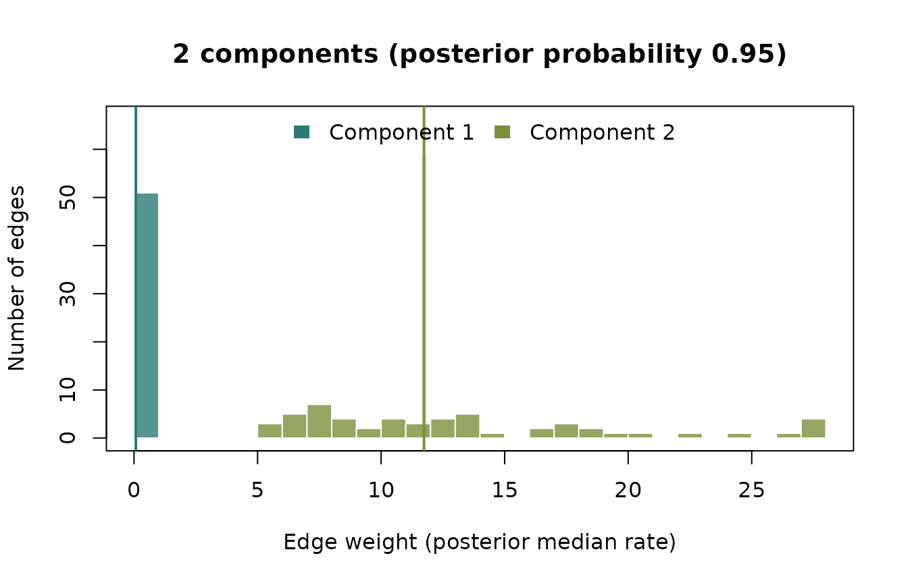

# Edge mixture models

Edge mixture models look for clusters in edge weights, which can be
interpreted as different types of social relationship (for example, weak
and strong associations). A Gaussian mixture model describes the edge
weights as a combination of several normal distributions, called
components.
[`bison_mixture()`](https://bisonr.org/reference/bison_mixture.md) fits
these models to the edge weights in many posterior draws of the network
(each draw is one possible network that is consistent with the data). It
gives two main results:

- the probability of each number of components (clusters), from 1 to a
  maximum \\K\\, for the whole network;
- for each dyad, the probability that its edge belongs to each
  component.

``` r

library(bisonR)
library(igraph)
#> 
#> Attaching package: 'igraph'
#> The following objects are masked from 'package:stats':
#> 
#>     decompose, spectrum
#> The following object is masked from 'package:base':
#> 
#>     union
```

## Simulated data

The data are simulated from a count edge model in which each dyad
belongs to one of two components with equal probability. The data are
aggregated, with one row per dyad:

``` r

sim_data <- simulate_bison_model_mixture("count", num_components = 2, component_weights = c(0.5, 0.5))
df <- sim_data$df_sim
head(df)
#>   node_1_id node_2_id event    effort  duration
#> 1         1         2   698  81.01022  81.01022
#> 2         1         3  1706 146.60679 146.60679
#> 3         1         4    21 170.27994 170.27994
#> 4         1         5     6 156.03195 156.03195
#> 5         1         6  1075  90.48502  90.48502
#> 6         1         7   650  46.09167  46.09167
```

There are no observation-level effects, so the conjugate count model can
be used. Conjugate models calculate the posterior directly, which is
fast, but they cannot include extra effects:

``` r

fit_edge <- bison_model(
  (event | effort) ~ dyad(node_1_id, node_2_id),
  data = df,
  model_type = "count_conjugate",
  priors = get_default_priors("count_conjugate")
)
```

In a real analysis the edge model should be checked before fitting a
mixture model (see
[`vignette("diagnostics")`](https://bisonr.org/articles/diagnostics.md)).

## Fitting the mixture model

`num_components` sets the largest number of components considered:

``` r

fit_mixture <- bison_mixture(fit_edge, num_components = 5, verbose = FALSE)
summary(fit_mixture)
#> === Fitted dyadic mixture model ===
#> Maximum number of components: 5
#> Most probable number of components: 2
#> Posterior probability: 95.1%
#> === Component probabilities ===
#>        1     2     3 4 5
#> P(K=k) 0 0.951 0.049 0 0
#> === Component means (K = 2) ===
#>            1      2
#> median 0.073 11.736
#> === Edge component probabilities (K = 2) ===
#>         1 2
#> 1 <-> 2 0 1
#> 1 <-> 3 0 1
#> 1 <-> 4 1 0
#> 1 <-> 5 1 0
#> 1 <-> 6 0 1
#> 1 <-> 7 0 1
#> ... (99 more rows; see get_edge_component_probabilities())
```

The summary shows the most probable number of components and the
probability of each number. For the most probable number, it also shows
the posterior median of each component’s mean edge weight and the
probability that each edge belongs to each component. Components are
numbered in order of their means, so component 1 is always the weakest
type of relationship.

The same results can be extracted for further analysis.
[`get_network_component_probabilities()`](https://bisonr.org/reference/get_network_component_probabilities.md)
gives the probability of each number of components:

``` r

get_network_component_probabilities(fit_mixture)
#>   num_components  probability
#> 1              1 4.538917e-29
#> 2              2 9.509335e-01
#> 3              3 4.906273e-02
#> 4              4 3.778354e-06
#> 5              5 2.880072e-08
```

[`get_edge_component_probabilities()`](https://bisonr.org/reference/get_edge_component_probabilities.md)
gives, for a chosen number of components, the probability that each edge
belongs to each component. Here two components are used, as in the
simulation:

``` r

head(get_edge_component_probabilities(fit_mixture, 2))
#>   node_1 node_2 P(component 1) P(component 2)
#> 1      1      2              0              1
#> 2      1      3              0              1
#> 3      1      4              1              0
#> 4      1      5              1              0
#> 5      1      6              0              1
#> 6      1      7              0              1
```

[`get_component_means()`](https://bisonr.org/reference/get_component_means.md)
gives the posterior median and credible interval of each component’s
mean edge weight:

``` r

get_component_means(fit_mixture, 2)
#>                     50%          5%         95%
#> Component 1  0.07343781  0.06479166  0.08056646
#> Component 2 11.73647180 11.60590011 11.84564248
```

[`plot_mixture()`](https://bisonr.org/reference/plot_mixture.md) shows
the distribution of posterior median edge weights, with each edge
coloured by its most probable component, and the posterior median and
90% interval of each component mean. By default it shows the most
probable number of components; here the two-component model is shown:

``` r

plot_mixture(fit_mixture, num_components = 2)
```



## Choosing the information criterion

The probability of each number of components is calculated from an
information criterion, set with `criterion`, in each posterior draw of
the network, and then averaged across draws. It is an approximation
rather than a full posterior probability. An information criterion
scores how well a model fits the data, with a penalty for each extra
component. The default, `"ICL"` (integrated completed likelihood), adds
a further penalty for components that overlap, so it favours fewer,
well-separated components. `"BIC"` (Bayesian information criterion) does
not include this extra penalty and can support more components when they
overlap. Because edge weights are estimated with uncertainty, components
often overlap, so the two criteria can give different results:

``` r

fit_mixture_bic <- bison_mixture(fit_edge, num_components = 5, criterion = "BIC", verbose = FALSE)
get_network_component_probabilities(fit_mixture)
#>   num_components  probability
#> 1              1 4.538917e-29
#> 2              2 9.509335e-01
#> 3              3 4.906273e-02
#> 4              4 3.778354e-06
#> 5              5 2.880072e-08
get_network_component_probabilities(fit_mixture_bic)
#>   num_components  probability
#> 1              1 4.293633e-29
#> 2              2 9.297643e-01
#> 3              3 4.552982e-02
#> 4              4 2.430812e-02
#> 5              5 3.977640e-04
```

In this example both criteria give the highest probability to two
components, the number used in the simulation. Where the two criteria
disagree, the number of components should be interpreted with caution.

## Using components in further analyses

Component membership can be used in other analyses. For example, the
question might be whether the total strength of an individual’s *strong*
relationships is related to a trait. For each posterior draw, edges
assigned to the weaker component are set to zero, and node strength is
calculated from the remaining edges. Both the edge weights and the
component assignments are uncertain, so both are taken from the same
posterior draw.

A data frame of node traits, simulated for this example:

``` r

df_nodal <- data.frame(node_id = levels(df$node_1_id), trait = rnorm(15))
head(df_nodal)
#>   node_id       trait
#> 1       1  1.01707313
#> 2       2  0.48666567
#> 3       3  0.26326237
#> 4       4 -1.30498601
#> 5       5  0.44131592
#> 6       6  0.04251927
```

`fit_mixture$draw_ids` records which posterior draws of the edge model
were used by the mixture model, so the component assignments in mixture
draw `i` can be matched to the edge weights of the same draw:

``` r

num_draws <- 5 # Use more (e.g. 100) in a real analysis
net <- bison_to_igraph(fit_edge, num_draws = 1)[[1]]

imputed_data <- lapply(seq_len(num_draws), function(i) {
  # Edge weights (rates) from the posterior draw used by mixture draw i
  edge_weights <- exp(fit_edge$edge_samples[fit_mixture$draw_ids[i], ])
  # Component assignments in the two-component model; component 2 is the stronger one
  strong <- fit_mixture$edge_component_samples[i, 2, ] == 2
  E(net)$weight <- edge_weights * strong
  data.frame(df_nodal, strong_strength = strength(net))
})
head(imputed_data[[1]])
#>   node_id       trait strong_strength
#> 1       1  1.01707313        90.69834
#> 2       2  0.48666567       113.74316
#> 3       3  0.26326237        74.35616
#> 4       4 -1.30498601        61.40979
#> 5       5  0.44131592        53.84517
#> 6       6  0.04251927        76.12181
```

Each data frame is one possible version of the data. As in multiple
imputation (a method for missing data), a regression can be fitted to
each version and the results pooled, here with
[`brms::brm_multiple()`](https://paulbuerkner.com/brms/reference/brm_multiple.html):

``` r

fit_brm <- brms::brm_multiple(
  trait ~ strong_strength, imputed_data,
  backend = "cmdstanr", silent = 2, refresh = 0
)
#> Warning: E-BFMI not computed because it is undefined for posterior chains of
#> length less than 3.
summary(fit_brm)
#>  Family: gaussian 
#>   Links: mu = identity 
#> Formula: trait ~ strong_strength 
#>    Data: imputed_data (Number of observations: 15) 
#>   Draws: 20 chains, each with iter = 2000; warmup = 1000; thin = 1;
#>          total post-warmup draws = 20000
#> 
#> Regression Coefficients:
#>                 Estimate Est.Error l-95% CI u-95% CI
#> Intercept           0.43      0.96    -1.46     2.33
#> strong_strength    -0.00      0.01    -0.02     0.01
#> 
#> Further Distributional Parameters:
#>       Estimate Est.Error l-95% CI u-95% CI
#> sigma     1.05      0.23     0.71     1.62
#> 
#> Draws were sampled using sample(hmc). Overall Rhat and ESS estimates
#> are not informative for brm_multiple models and are hence not displayed.
#> Please see ?brm_multiple for how to assess convergence of such models.
```

The trait was simulated independently of the network, so the coefficient
of `strong_strength` should be consistent with zero.
[`vignette("bison_brms")`](https://bisonr.org/articles/bison_brms.md)
describes [`bison_brm()`](https://bisonr.org/reference/bison_brm.md),
which carries out this kind of analysis for the standard network
metrics.
