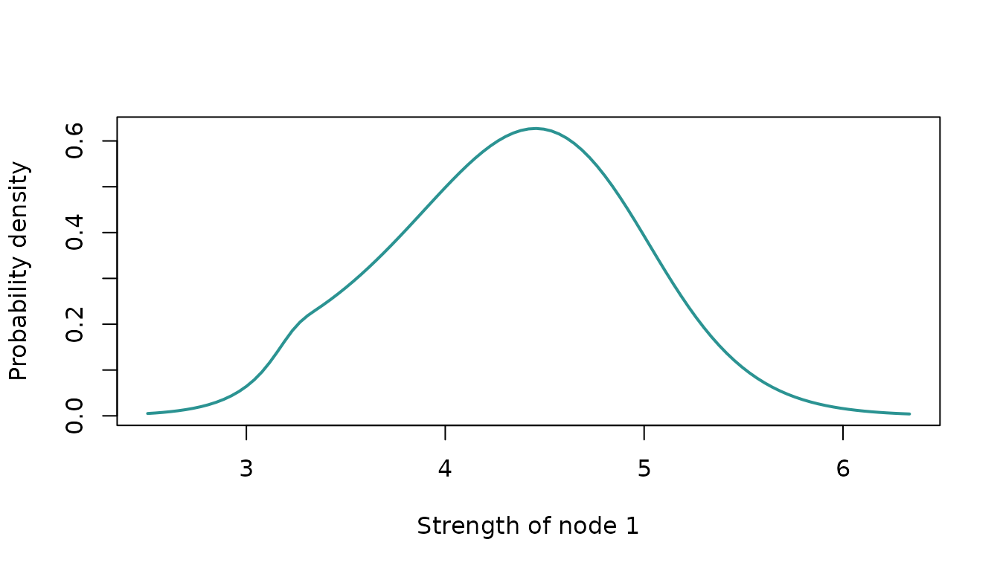
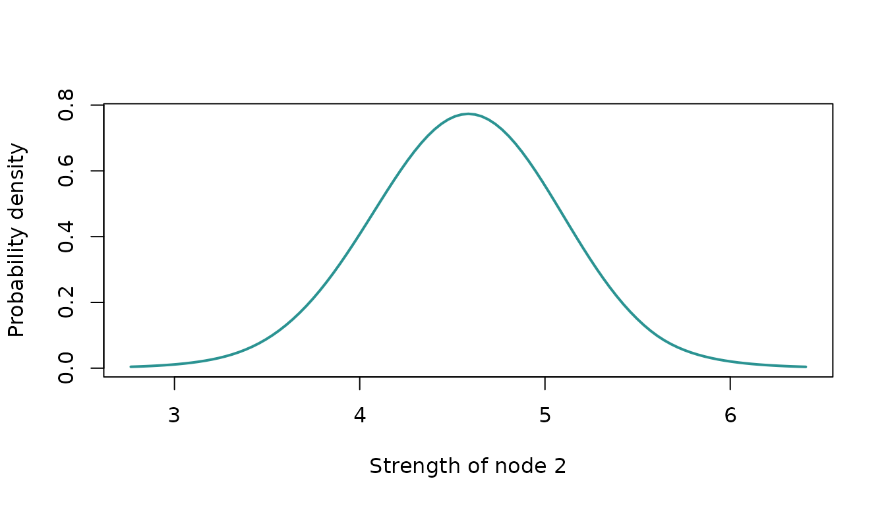
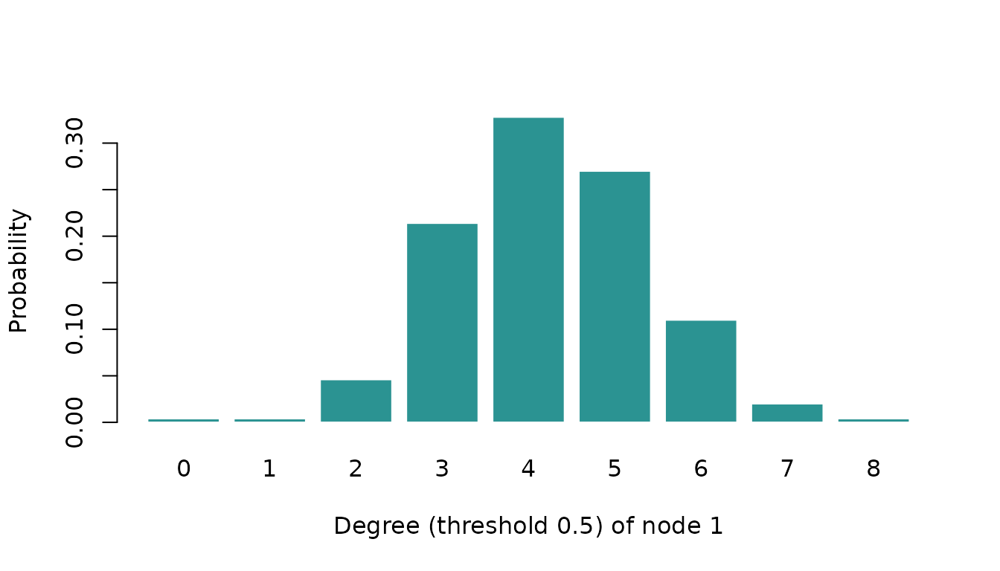
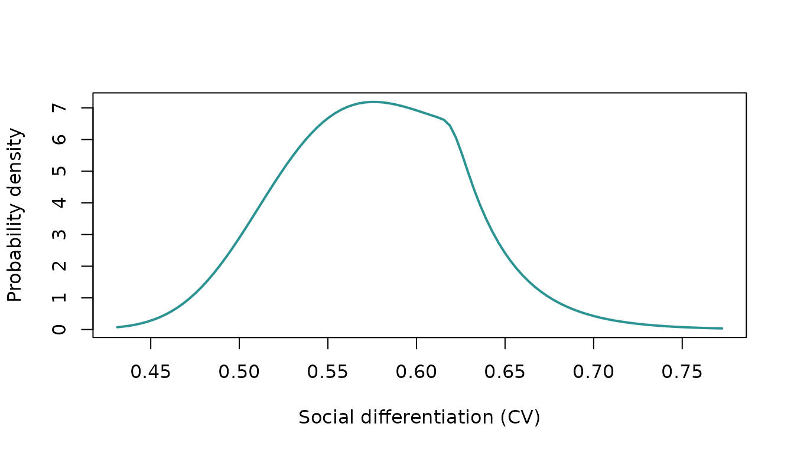

# Network metrics

Network metrics summarise the structure of a network, either for each
individual (node metrics) or for the whole network (global metrics). The
edge model gives a posterior distribution for each edge weight, and each
sample from it (a *posterior draw*) is one possible network that is
consistent with the data. bisonR calculates a metric for each posterior
draw, which gives a posterior distribution for the metric.

``` r

library(bisonR)

sim_data <- simulate_bison_model("binary", aggregated = TRUE)
fit_edge <- bison_model(
  (event | effort) ~ dyad(node_1_id, node_2_id),
  data = sim_data$df_sim,
  model_type = "binary_conjugate",
  priors = get_default_priors("binary_conjugate")
)
```

## Extracting metrics

Metrics are calculated with `extract_metric(fit, metric_name)`. The name
has two parts: the *target* (`edge`, `node` or `global`) and the
*metric*, joined by an underscore, such as `node_strength` or
`global_cv`.

``` r

strength <- extract_metric(fit_edge, "node_strength", num_draws = 1000)
dim(strength)
#> [1] 1000   10
```

The result has one row per posterior draw and one column per target: one
column per node for node metrics (named after the nodes, in the order of
the node levels), one per dyad for edge metrics, and a single column for
global metrics. The columns can be summarised in the same way as any
other posterior samples:

``` r

t(apply(strength, 2, quantile, probs = c(0.05, 0.5, 0.95)))
#>          5%      50%      95%
#> 1  3.251381 4.345390 5.363105
#> 2  3.676587 4.565101 5.447701
#> 3  3.343305 4.361036 5.367084
#> 4  3.584986 4.528936 5.450037
#> 5  2.909792 3.933265 4.889573
#> 6  2.602736 3.599878 4.664193
#> 7  3.773139 4.750287 5.680407
#> 8  2.389676 3.293668 4.268710
#> 9  3.266363 4.260105 5.171311
#> 10 2.928467 3.888107 4.977658
```

[`plot_metric()`](https://bisonr.org/reference/plot_metric.md) plots the
posterior distribution of a metric. Continuous metrics are shown as
densities, and discrete metrics, such as degree, as bar charts (see the
examples below):

``` r

plot_metric(strength[, 1:2], "Strength of node")
```



To use metrics in a regression, use
[`bison_brm()`](https://bisonr.org/reference/bison_brm.md) (see
[`vignette("bison_brms")`](https://bisonr.org/articles/bison_brms.md))
rather than summarising them first (for example as posterior means), so
that the uncertainty in the metric is included in the regression.

## Weighted and thresholded metrics

Unless stated otherwise, all metrics are calculated on the **weighted**
network, using edge weights on the natural scale (probabilities for
binary models, rates for count models). For example, `node_strength` is
the weighted version of degree.

Some metrics are only defined for networks where edges are either
present or absent. These take a **threshold** in square brackets, such
as `node_degree[0.2]`: in each posterior draw, edges with a weight at or
above the threshold count as present and the rest as absent. For an
unweighted version of a weighted metric (such as unweighted density),
threshold the network in the same way. Results can depend on the
threshold, so check whether conclusions change with different values.

## Available metrics

### Edge metrics

| Name | Definition |
|----|----|
| `edge_weight` | The edge weight of each dyad. On the natural scale by default; use `transform = FALSE` for the link scale (logit, or log-odds, for binary models and log for count models). |

### Node metrics

| Name | Definition |
|----|----|
| `node_strength` | Sum of the weights of the node’s edges. How much a node associates in total. |
| `node_degree[t]` | Number of edges with weight at or above `t`. |
| `node_eigen` | Eigenvector centrality: high when a node has strong edges to nodes that are themselves central. Scaled so the most central node has a value of 1. |
| `node_betweenness` | Betweenness: the number of shortest paths between other pairs of nodes that pass through the node, using 1/weight as the length of each edge (so strong edges are short). |
| `node_closeness` | Closeness: the inverse of the sum of shortest-path distances from the node to all other reachable nodes, using 1/weight as edge lengths. |
| `node_clustering[t]` | Local clustering coefficient of the network thresholded at `t`: the proportion of pairs of the node’s associates that are also associates of each other. Nodes with fewer than two associates get 0. |

### Global metrics

| Name | Definition |
|----|----|
| `global_density` | Mean edge weight across all dyads in the model (weighted density). |
| `global_cv` | Coefficient of variation (SD / mean) of edge weights, also called social differentiation. High values mean relationships vary a lot in strength. |
| `global_std` | Standard deviation of edge weights. |
| `global_diameter` | Length of the longest shortest path between any two nodes, using 1/weight as edge lengths. |
| `global_clustering[t]` | Global clustering coefficient (transitivity) of the network thresholded at `t`: the proportion of connected triples that are closed triangles. |

Global metrics are calculated only from the dyads in the model, so dyads
that do not appear in the data are not included.

## Examples

``` r

degree <- extract_metric(fit_edge, "node_degree[0.5]", num_draws = 500)
plot_metric(degree[, 1], "Degree (threshold 0.5) of node 1")
```



``` r


eigen <- extract_metric(fit_edge, "node_eigen", num_draws = 500)
round(apply(eigen, 2, median), 2)
#>    1    2    3    4    5    6    7    8    9   10 
#> 0.87 0.92 0.85 0.88 0.78 0.70 0.93 0.66 0.83 0.78

cv <- extract_metric(fit_edge, "global_cv", num_draws = 1000)
plot_metric(cv, "Social differentiation (CV)")
```



``` r


clustering <- extract_metric(fit_edge, "global_clustering[0.3]", num_draws = 500)
quantile(clustering, c(0.05, 0.5, 0.95))
#>        5%       50%       95% 
#> 0.5593220 0.6705882 0.7756352
```

## Using other network tools

For metrics that bisonR does not provide,
[`bison_to_igraph()`](https://bisonr.org/reference/bison_to_igraph.md)
returns a list of `igraph` networks, one per posterior draw, with edge
weights on the natural scale. Calculating a metric for each network
gives its posterior distribution. For example, the mean shortest path
length, using 1/weight as the length of each edge:

``` r

nets <- bison_to_igraph(fit_edge, num_draws = 200)
mean_path_length <- sapply(nets, function(net) {
  igraph::mean_distance(net, weights = 1 / igraph::E(net)$weight)
})
quantile(mean_path_length, c(0.05, 0.5, 0.95))
#>       5%      50%      95% 
#> 1.966829 2.161690 2.411309
```

Note that some igraph functions ignore edge weights (for example
[`igraph::assortativity()`](https://r.igraph.org/reference/assortativity.html)).
Every dyad in the model is an edge in every posterior network, so these
functions give the same value in every draw. Before applying a function
to posterior networks, check that it uses the `weight` edge attribute.
