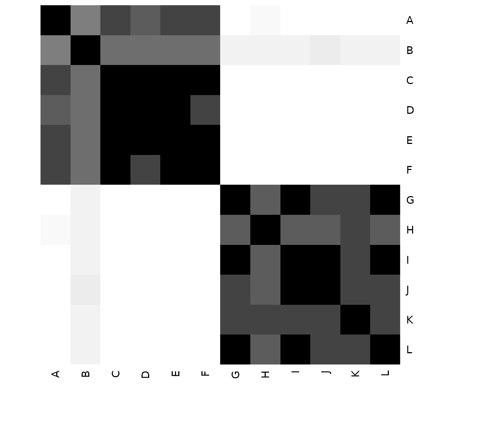

# Working with posterior networks

A fitted edge model contains samples from the posterior distribution of
every edge weight. Each sample (or *draw*) is one possible network that
is consistent with the data. Most functions in bisonR summarise these
draws, but they can also be used directly, for example to calculate
quantities that bisonR does not provide. Calculating a quantity
separately for each draw gives a posterior distribution for it, which
includes the uncertainty in the edge weights.

This article covers extracting the draws, converting them to `igraph`
networks, calculating new metrics and contrasts, and saving fitted
models.

``` r

library(bisonR)
```

## Simulated data

We simulate 12 individuals in two groups, `north` and `south`. Edge
weights on the logit (log-odds) scale are higher within groups (mean
-0.5) than between groups (mean -2.5). Each dyad is observed in between
3 and 20 sampling periods, so some edges are estimated more precisely
than others.

``` r

num_nodes <- 12
nodes <- LETTERS[1:num_nodes]
group <- rep(c("north", "south"), each = 6)

dyads <- t(combn(num_nodes, 2))
same_group <- group[dyads[, 1]] == group[dyads[, 2]]
logit_weight <- ifelse(same_group, -0.5, -2.5) + rnorm(nrow(dyads), 0, 0.5)
effort <- sample(3:20, nrow(dyads), replace = TRUE)

df <- data.frame(
  node_1_id = factor(nodes[dyads[, 1]], levels = nodes),
  node_2_id = factor(nodes[dyads[, 2]], levels = nodes),
  event = rbinom(nrow(dyads), effort, plogis(logit_weight)),
  effort = effort
)

fit_edge <- bison_model(
  (event | effort) ~ dyad(node_1_id, node_2_id),
  data = df,
  model_type = "binary_conjugate",
  priors = get_default_priors("binary_conjugate")
)
```

## Edge list samples

[`draw_edgelist_samples()`](https://bisonr.org/reference/draw_edgelist_samples.md)
returns an edge list with one column per posterior draw:

``` r

edge_draws <- draw_edgelist_samples(fit_edge, num_draws = 4, transform = TRUE)
head(edge_draws)
#>   node_1 node_2     draw.1    draw.2    draw.3    draw.4
#> 1      A      B 0.30139845 0.3284193 0.1774744 0.1092031
#> 2      A      C 0.42150282 0.4866997 0.5301535 0.2012906
#> 3      A      D 0.29216088 0.1921143 0.2499467 0.2233080
#> 4      A      E 0.63263122 0.6240880 0.5558653 0.6252474
#> 5      A      F 0.57280806 0.6233624 0.5138863 0.5705295
#> 6      A      G 0.07934855 0.2433655 0.2399075 0.2707410
```

With `transform = TRUE`, the edge weights are on the natural scale
(probabilities for binary models, rates for count models). The default,
`transform = FALSE`, gives them on the link scale (logit or log). This
format can be used with other software that expects an edge list, by
repeating the analysis for each draw.

## Converting to igraph

[`bison_to_igraph()`](https://bisonr.org/reference/bison_to_igraph.md)
returns a list of `igraph` networks, one per posterior draw. Every
network contains all of the nodes in the edge model, in the same order,
with edge weights on the natural scale in the `weight` edge attribute:

``` r

nets <- bison_to_igraph(fit_edge, num_draws = 500)
length(nets)
#> [1] 500
nets[[1]]
#> IGRAPH d5f0a6a UNW- 12 66 -- 
#> + attr: name (v/c), weight (e/n)
#> + edges from d5f0a6a (vertex names):
#>  [1] A--B A--C A--D A--E A--F A--G A--H A--I A--J A--K A--L B--C B--D B--E B--F
#> [16] B--G B--H B--I B--J B--K B--L C--D C--E C--F C--G C--H C--I C--J C--K C--L
#> [31] D--E D--F D--G D--H D--I D--J D--K D--L E--F E--G E--H E--I E--J E--K E--L
#> [46] F--G F--H F--I F--J F--K F--L G--H G--I G--J G--K G--L H--I H--J H--K H--L
#> [61] I--J I--K I--L J--K J--L K--L
```

### Assortment by a node attribute

Many functions in igraph ignore edge weights. In a bisonR network, every
dyad in the model has an edge in every draw, so an unweighted function
returns the same value in every draw. For example,
[`igraph::assortativity_nominal()`](https://r.igraph.org/reference/assortativity.html)
does not use weights:

``` r

group_id <- as.integer(factor(group))
assort_unweighted <- sapply(nets, igraph::assortativity_nominal, types = group_id, directed = FALSE)
unique(round(assort_unweighted, 6))
#> [1] -0.090909
```

Before using an igraph function, check that it uses the `weight`
attribute, or pass the weights explicitly. Weighted modularity measures
how much edge weight falls within the given groups, compared with what
would be expected from each node’s strength alone. Here it is calculated
for the division into the two groups:

``` r

modularity_group <- sapply(nets, function(net) {
  igraph::modularity(net, membership = group_id, weights = igraph::E(net)$weight)
})
quantile(modularity_group, probs = c(0.05, 0.5, 0.95))
#>        5%       50%       95% 
#> 0.1193811 0.1727293 0.2219346
```

The 90% credible interval (the range containing 90% of the posterior) is
above zero, so more edge weight falls within groups than expected,
consistent with the simulation. Whether a given value is large depends
on the network, and comparisons with null models or with other networks
may be needed to interpret it.

### Community detection

Community detection can also be applied to each draw. Here
[`igraph::cluster_louvain()`](https://r.igraph.org/reference/cluster_louvain.html),
which uses the `weight` attribute, is applied to each network:

``` r

memberships <- lapply(nets, function(net) igraph::membership(igraph::cluster_louvain(net)))
table(sapply(memberships, function(m) length(unique(m))))
#> 
#>   2   3   4 
#> 432  67   1
```

The table gives the number of draws in which each number of communities
was found. Community labels are arbitrary and change between draws, so
they cannot be compared directly. Instead, the uncertainty can be
summarised by how often each pair of nodes is placed in the same
community:

``` r

co_assignment <- matrix(0, num_nodes, num_nodes, dimnames = list(nodes, nodes))
for (m in memberships) {
  co_assignment <- co_assignment + outer(m, m, "==")
}
co_assignment <- co_assignment / length(memberships)
round(co_assignment, 2)
#>      A    B    C    D    E    F    G    H    I    J    K    L
#> A 1.00 0.78 0.93 0.90 0.93 0.93 0.02 0.09 0.02 0.02 0.04 0.01
#> B 0.78 1.00 0.82 0.81 0.82 0.83 0.12 0.15 0.13 0.16 0.14 0.13
#> C 0.93 0.82 1.00 0.97 1.00 0.98 0.01 0.02 0.00 0.01 0.00 0.00
#> D 0.90 0.81 0.97 1.00 0.97 0.95 0.02 0.02 0.02 0.02 0.01 0.02
#> E 0.93 0.82 1.00 0.97 1.00 0.98 0.01 0.01 0.00 0.01 0.00 0.00
#> F 0.93 0.83 0.98 0.95 0.98 1.00 0.01 0.03 0.01 0.02 0.01 0.01
#> G 0.02 0.12 0.01 0.02 0.01 0.01 1.00 0.88 0.96 0.93 0.93 0.98
#> H 0.09 0.15 0.02 0.02 0.01 0.03 0.88 1.00 0.87 0.89 0.94 0.87
#> I 0.02 0.13 0.00 0.02 0.00 0.01 0.96 0.87 1.00 0.95 0.92 0.98
#> J 0.02 0.16 0.01 0.02 0.01 0.02 0.93 0.89 0.95 1.00 0.93 0.94
#> K 0.04 0.14 0.00 0.01 0.00 0.01 0.93 0.94 0.92 0.93 1.00 0.92
#> L 0.01 0.13 0.00 0.02 0.00 0.01 0.98 0.87 0.98 0.94 0.92 1.00
```

Each value is the proportion of draws in which the two nodes were in the
same community. Nodes A to F (the `north` group) and G to L (the `south`
group) are usually assigned to the same community as other members of
their group. Node B is less consistently assigned than the other nodes:
it is in the same community as the other `north` nodes in about 80% of
draws, and with each `south` node in between 12% and 16% of draws.

The co-assignment matrix can be plotted as a heatmap:

``` r

heatmap(co_assignment, symm = TRUE, Rowv = NA, scale = "none",
        col = grey.colors(20, start = 1, end = 0))
```



## Standardised metrics

With `standardise = TRUE`,
[`extract_metric()`](https://bisonr.org/reference/extract_metric.md)
mean-centres a metric within each posterior draw, so each value is the
difference between a node and the mean of all nodes in that draw:

``` r

strength_std <- extract_metric(fit_edge, "node_strength", standardise = TRUE)
round(t(apply(strength_std, 2, quantile, probs = c(0.05, 0.5, 0.95))), 2)
#>      5%   50%   95%
#> A  0.00  0.58  1.22
#> B -0.75 -0.21  0.43
#> C -0.96 -0.49 -0.01
#> D -0.56 -0.04  0.57
#> E  0.10  0.66  1.23
#> F -0.25  0.25  0.77
#> G -0.78 -0.25  0.36
#> H -0.88 -0.28  0.33
#> I -0.44  0.12  0.71
#> J -0.96 -0.45  0.09
#> K -0.79 -0.25  0.36
#> L -0.35  0.24  0.85
```

This is useful when the overall level of the metric is uncertain but the
question is about the relative position of nodes. For example, the 90%
interval for node E is above zero, so E has a higher strength than the
average node in at least 95% of draws.

## Edge-level contrasts

Differences (contrasts) between edges can be calculated from the edge
weight samples. `extract_metric(fit, "edge_weight")` returns one column
per dyad, named after the dyad:

``` r

edge_weights <- extract_metric(fit_edge, "edge_weight")
colnames(edge_weights)[1:6]
#> [1] "A <-> B" "A <-> C" "A <-> D" "A <-> E" "A <-> F" "A <-> G"
```

The posterior probability that one edge is stronger than another is the
proportion of draws in which it is larger. For example, for the edges
between A and F and between A and B:

``` r

mean(edge_weights[, "A <-> F"] > edge_weights[, "A <-> B"])
#> [1] 0.984
quantile(edge_weights[, "A <-> F"] - edge_weights[, "A <-> B"], probs = c(0.05, 0.5, 0.95))
#>        5%       50%       95% 
#> 0.1041062 0.3861927 0.6565449
```

In this example, the edge between A and F is stronger than the edge
between A and B in about 98% of draws.

Both columns must come from the same matrix.
[`extract_metric()`](https://bisonr.org/reference/extract_metric.md) and
[`bison_to_igraph()`](https://bisonr.org/reference/bison_to_igraph.md)
choose posterior draws at random, so two separate calls return different
draws. Pairing columns from different calls would ignore the correlation
between quantities within a draw. In the same way, calculate any
quantity that combines several edges or nodes, such as the mean edge
weight within groups, row by row from a single matrix. Here the columns
are selected by dyad name:

``` r

dyad_names <- paste(df$node_1_id, df$node_2_id, sep = " <-> ")
within_names <- dyad_names[same_group]
between_names <- dyad_names[!same_group]

mean_within <- rowMeans(edge_weights[, within_names])
mean_between <- rowMeans(edge_weights[, between_names])
quantile(mean_within - mean_between, probs = c(0.05, 0.5, 0.95))
#>        5%       50%       95% 
#> 0.1600625 0.2091942 0.2560990
```

The 90% credible interval of the difference in mean edge weight between
within-group and between-group dyads is above zero.

## Saving and loading models

Models fitted with Stan (the software bisonR uses to sample from the
posterior) store their draws in temporary files, so a file saved with
[`saveRDS()`](https://rdrr.io/r/base/readRDS.html) alone may not load in
a new R session.
[`bison_save()`](https://bisonr.org/reference/bison_save.md) reads all
draws into memory before saving, and
[`bison_load()`](https://bisonr.org/reference/bison_load.md) loads the
model:

``` r

path <- tempfile(fileext = ".rds")
bison_save(fit_edge, path)
fit_loaded <- bison_load(path)

all.equal(get_edgelist(fit_edge), get_edgelist(fit_loaded))
#> [1] TRUE
```

The loaded model can be used in the same way as the original, for
example with
[`extract_metric()`](https://bisonr.org/reference/extract_metric.md),
[`bison_to_igraph()`](https://bisonr.org/reference/bison_to_igraph.md)
or [`bison_brm()`](https://bisonr.org/reference/bison_brm.md). In a real
analysis, save the model to a permanent location rather than a temporary
file.
