# Choosing and checking priors

``` r

library(bisonR)
```

Every BISoN edge model is Bayesian, so it needs priors: probability
distributions that describe which parameter values are plausible before
the data are seen. This article describes what each prior controls, the
scales on which the priors are defined, and two ways of checking them:
plotting the prior distributions with
[`prior_check()`](https://bisonr.org/reference/prior_check.md), and
simulating data from the priors with
[`prior_predictive_check()`](https://bisonr.org/reference/prior_predictive_check.md).
A basic analysis is described in
[`vignette("getting_started")`](https://bisonr.org/articles/getting_started.md).

There is no prior that is correct for every study. A prior describes
what is plausible for a particular system and sampling design, so it
should be chosen with knowledge of that system and then checked.

## The priors in each model

[`get_default_priors()`](https://bisonr.org/reference/get_default_priors.md)
returns a named list of priors for a model type. Priors are given as
strings, such as `"normal(0, 2.5)"`.

``` r

get_default_priors("binary")
#> $edge
#> [1] "normal(0, 2.5)"
#> 
#> $fixed
#> [1] "normal(0, 2.5)"
#> 
#> $random_std
#> [1] "half-normal(1)"
#> 
#> $zero_prob
#> [1] "beta(1, 1)"
get_default_priors("count")
#> $edge
#> [1] "normal(0, 1)"
#> 
#> $fixed
#> [1] "normal(0, 2.5)"
#> 
#> $random_std
#> [1] "half-normal(1)"
#> 
#> $zero_prob
#> [1] "beta(1, 1)"
```

Binary and count models have the same four priors:

| Prior | Parameter | Distribution |
|----|----|----|
| `edge` | Edge weight of each dyad, on the link scale | Normal |
| `fixed` | Each fixed effect parameter (`+ x` in the formula), on the link scale | Normal |
| `random_std` | Standard deviation of each group of random effects | Half-normal |
| `zero_prob` | Probability that an observation is a structural zero (a zero that occurs regardless of the edge weight), in zero-inflated models | Beta |

Priors for parameters that are not in the model are ignored. For
example, `random_std` only matters if the formula contains a random
effect, and `zero_prob` only matters if `zero_inflated = TRUE`. Random
effects are centred on 0, so they have no prior for their mean.

The default `edge` prior differs between the two model types:
`normal(0, 2.5)` for binary models and `normal(0, 1)` for count models.
The other defaults are the same.

With `partial_pooling = TRUE`, the `edge` prior is used differently. The
edge weights are given a shared normal distribution. Its mean is the
mean of the `edge` prior, and its standard deviation, `edge_sigma`, is
estimated from the data. The second value of the `edge` prior is then
the scale of a half-normal prior on `edge_sigma`.

Conjugate models calculate the posterior exactly, without sampling. They
only estimate edge weights, so they only have an `edge` prior. It is
defined on the natural scale rather than the link scale: a beta
distribution over the probability for `"binary_conjugate"`, and a gamma
distribution (shape and rate) over the rate for `"count_conjugate"`.

``` r

get_default_priors("binary_conjugate")
#> $edge
#> [1] "beta(1, 1)"
get_default_priors("count_conjugate")
#> $edge
#> [1] "gamma(1, 1)"
```

[`bison_model()`](https://bisonr.org/reference/bison_model.md) checks
the priors before fitting. Any prior that is missing from the list is
filled in from the defaults, and a prior with the wrong distribution
gives an error:

``` r

bison_model(
  (event | effort) ~ dyad(node_1_id, node_2_id),
  data = simulate_bison_model("binary", aggregated = TRUE)$df_sim,
  model_type = "binary_conjugate",
  priors = list(edge = "normal(0, 1)")
)
#> Error:
#> ! The `edge` prior for "binary_conjugate" models must be a beta distribution, e.g. "beta(1, 1)", but got "normal(0, 1)".
```

## Link scales

In binary and count models, the edge weights and other effects are
combined on a *link scale* and then transformed:

- In binary models the link is the logit. The probability of an event in
  a sampling period is `plogis(edge + effects)`. An edge weight of 0
  corresponds to a probability of 0.5, -2 to about 0.12, and 2 to about
  0.88.
- In count models the link is the log. The expected number of events is
  `exp(edge + effects) * effort`, so an edge weight of 0 corresponds to
  a rate of one event per unit of effort.

The `edge` and `fixed` priors are therefore distributions over log-odds
(binary) or log-rates (count). A fixed effect with a `normal(0, 2.5)`
prior is a change in log-odds or log-rate per unit of the predictor, so
the scale of the predictor affects what the prior means. A predictor
measured in days and the same predictor measured in years imply very
different effect sizes under the same prior.

A normal prior on the logit scale does not have the same shape on the
probability scale. A wide normal prior on the logit scale puts much of
its weight close to 0 and 1. This can be seen by drawing values from the
prior and transforming them:

``` r

edge_logit <- rnorm(10000, mean = 0, sd = 2.5)
hist(plogis(edge_logit), breaks = 50, main = "normal(0, 2.5) on the logit scale",
     xlab = "Edge weight (probability)", col = "grey80", border = "white")
```

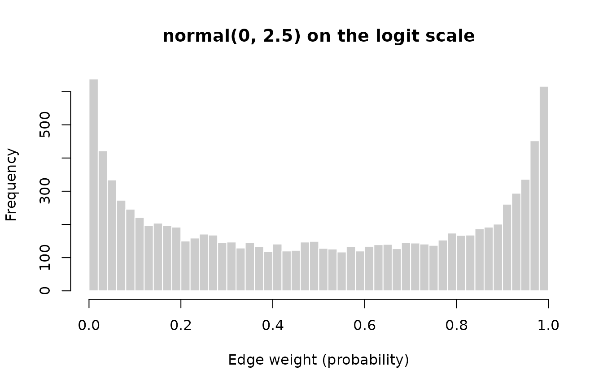

``` r

edge_logit <- rnorm(10000, mean = 0, sd = 1)
hist(plogis(edge_logit), breaks = 50, main = "normal(0, 1) on the logit scale",
     xlab = "Edge weight (probability)", col = "grey80", border = "white")
```

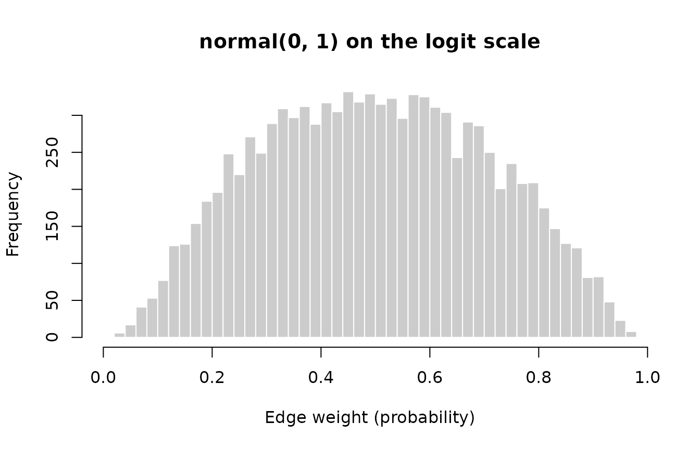

The narrower prior puts more weight on intermediate probabilities and
less near 0 and 1. Neither is correct in general. If most dyads in a
population are seen together rarely, a prior centred below 0 on the
logit scale may describe the system better than either.

## Plotting priors with `prior_check()`

[`prior_check()`](https://bisonr.org/reference/prior_check.md) plots the
density of each prior in a list. The edge prior is shown on the natural
scale (probability for binary models, rate per unit of effort for count
models), and the other priors are shown on the scale on which they are
defined. For the default binary priors, the edge prior has most of its
density near 0 and 1, as in the histogram above:

``` r

prior_check(get_default_priors("binary"), "binary")
```

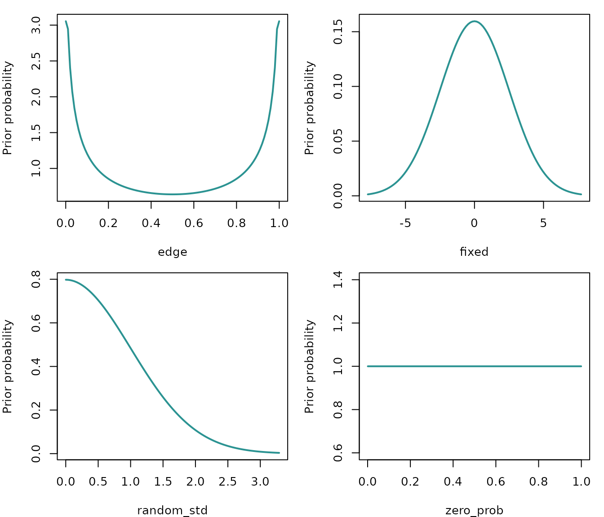

For count models:

``` r

prior_check(get_default_priors("count"), "count")
```

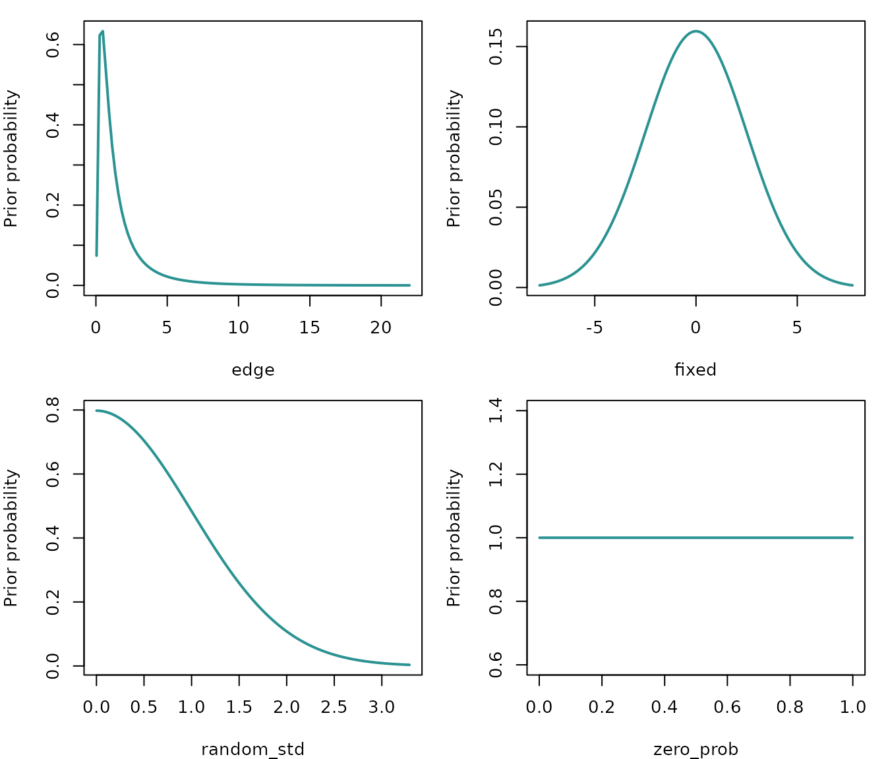

For conjugate models the edge prior is already on the natural scale:

``` r

prior_check(list(edge = "beta(1, 4)"), "binary_conjugate")
```

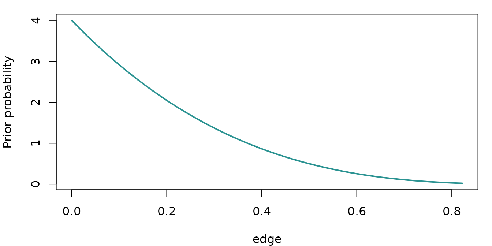

[`prior_check()`](https://bisonr.org/reference/prior_check.md) shows
each prior on its own. It does not show what the priors imply together,
for example when an edge weight and a fixed effect are added on the link
scale. Prior predictive checks address this.

## Prior predictive checks

A prior predictive check simulates data from the model using only the
priors, ignoring the observed events. The simulated data can then be
compared with what is plausible for the study system.
[`prior_predictive_check()`](https://bisonr.org/reference/prior_predictive_check.md)
takes the same formula, data, model type and priors as
[`bison_model()`](https://bisonr.org/reference/bison_model.md). Only the
dyads, the observation effort and any predictors are taken from the
data. Other arguments are passed on to
[`bison_model()`](https://bisonr.org/reference/bison_model.md) and from
there to Stan: here `seed` makes the results reproducible and
`show_messages = FALSE` hides the sampler’s progress messages.

The examples below use simulated aggregated data, with one row per dyad:

``` r

sim_data <- simulate_bison_model("binary", aggregated = TRUE, max_obs = 20)
df <- sim_data$df_sim
head(df)
#>   node_1_id node_2_id event effort    age_diff    age_1    age_2 duration
#> 1         1         2     5     12 -5.00907131 17.45685 22.46592       12
#> 2         1         3     5     11 -0.09738967 17.45685 17.55424       11
#> 3         1         4     5     13 -5.73579606 17.45685 23.19264       13
#> 4         1         5     2      3 -0.23941922 17.45685 17.69627        3
#> 5         1         6     6     17 -6.44982679 17.45685 23.90667       17
#> 6         1         7     6     18 -3.97442557 17.45685 21.43127       18
```

With `plot_type = "density"`, the plot shows the distribution of event
rates across dyads (here, the proportion of sampling periods in which
each dyad was seen together) in 20 datasets simulated from the priors:

``` r

priors <- get_default_priors("binary")
prior_predictive_check(
  (event | effort) ~ dyad(node_1_id, node_2_id),
  data = df,
  model_type = "binary",
  priors = priors,
  plot_type = "density",
  num_draws = 20,
  seed = 1,
  show_messages = FALSE
)
```

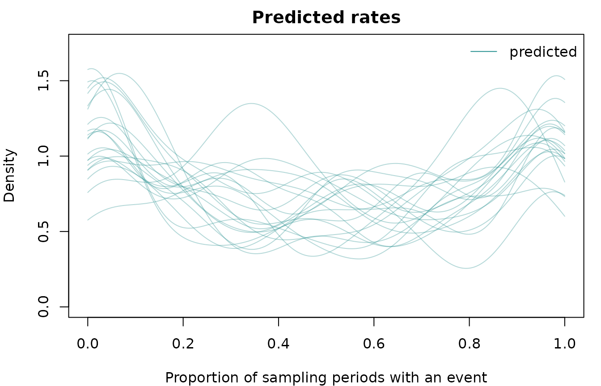

With `plot_type = "stats"`, the plot shows histograms of four summary
statistics across the simulated datasets: the proportion of dyads with
no events, and the mean, standard deviation and maximum of the event
rates:

``` r

prior_predictive_check(
  (event | effort) ~ dyad(node_1_id, node_2_id),
  data = df,
  model_type = "binary",
  priors = priors,
  plot_type = "stats",
  num_draws = 20,
  seed = 1,
  show_messages = FALSE
)
```

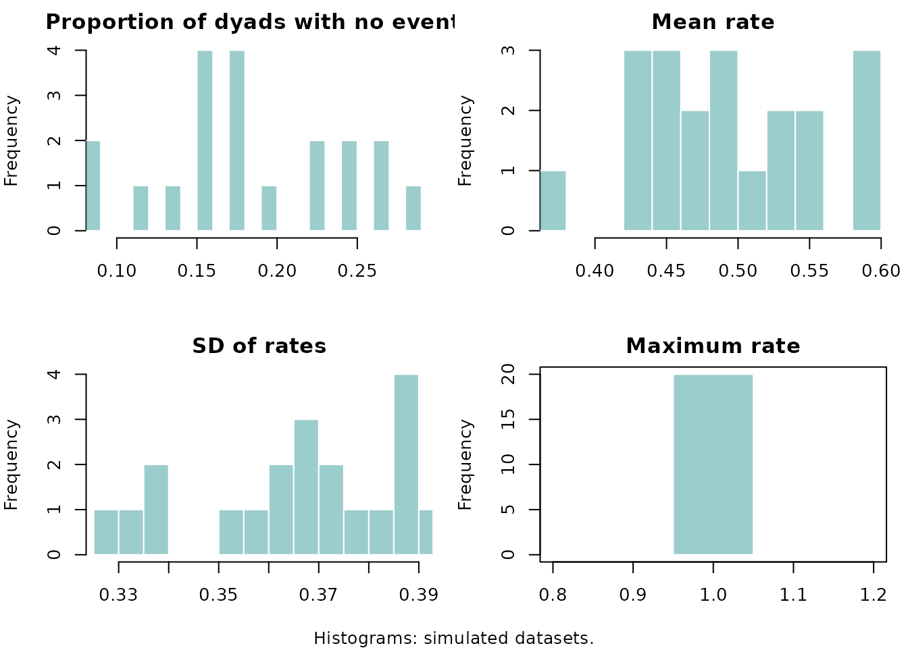

Under the default prior, the simulated rates cover the whole range from
0 to 1, with more dyads near 0 and 1 than near the middle. The mean rate
of the simulated datasets is between about 0.4 and 0.6, and in every one
of the 20 simulated datasets at least one dyad has an event in every
sampling period (a maximum rate of 1).

The observed data are not shown in prior predictive checks. The question
is whether the simulated datasets cover the range of data that could
plausibly be observed, not whether they match the data at hand. Choosing
a prior so that the prior predictions match the observed data uses the
data twice.

### Changing the edge prior

Suppose that previous studies of the population suggest that most dyads
are seen together in a small proportion of sampling periods. A prior
such as `normal(-2, 1)` on the logit scale describes this. Its median is
`plogis(-2)`, about 0.12:

``` r

priors_low <- get_default_priors("binary")
priors_low$edge <- "normal(-2, 1)"
prior_predictive_check(
  (event | effort) ~ dyad(node_1_id, node_2_id),
  data = df,
  model_type = "binary",
  priors = priors_low,
  plot_type = "density",
  num_draws = 20,
  seed = 1,
  show_messages = FALSE
)
```

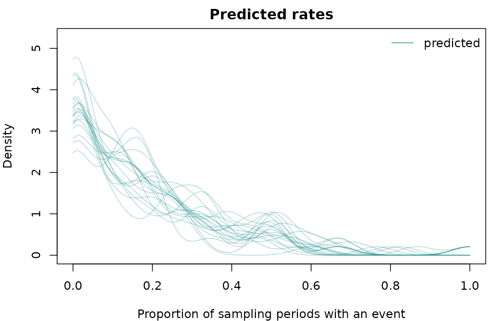

``` r

prior_predictive_check(
  (event | effort) ~ dyad(node_1_id, node_2_id),
  data = df,
  model_type = "binary",
  priors = priors_low,
  plot_type = "stats",
  num_draws = 20,
  seed = 1,
  show_messages = FALSE
)
```

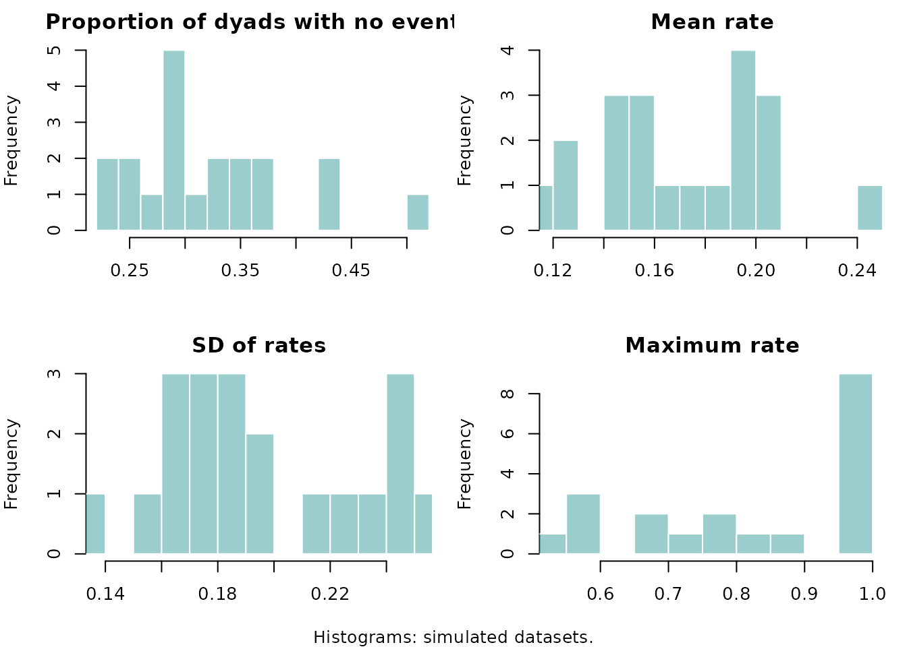

With this prior, most simulated dyads have rates below 0.4. The mean
rate of the simulated datasets is between about 0.1 and 0.2, between
about a quarter and a half of the dyads have no events, and the maximum
rate is below 1 in most of the simulated datasets.

If this matches what is known about the population, the new prior may be
more appropriate than the default. If it does not, for example in a
population where some pairs are almost always together, it may exclude
plausible values. The default prior allows a wider range of outcomes, at
the cost of putting weight on rates that may be implausible for a given
system.

The same checks can be run for conjugate models, which are faster
because no sampling is needed:

``` r

prior_predictive_check(
  (event | effort) ~ dyad(node_1_id, node_2_id),
  data = df,
  model_type = "binary_conjugate",
  priors = list(edge = "beta(1, 4)"),
  plot_type = "density"
)
```

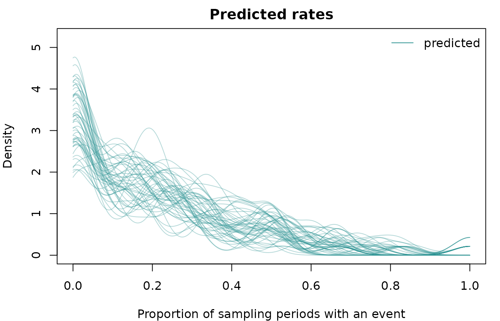

## Priors and sparsely observed dyads

The effect of the prior on an edge weight depends on how much the dyad
was observed. A dyad observed in many sampling periods has a posterior
(the distribution of its edge weight after the data are taken into
account) that is mostly determined by the data. A dyad observed only
once or twice has a posterior that is mostly determined by the prior.

To show this, the same data are fitted with conjugate models using two
different priors: `beta(1, 1)`, which is uniform over probabilities, and
`beta(1, 9)`, which has a mean of 0.1.

``` r

fit_flat <- bison_model(
  (event | effort) ~ dyad(node_1_id, node_2_id),
  data = df,
  model_type = "binary_conjugate",
  priors = list(edge = "beta(1, 1)")
)
fit_low <- bison_model(
  (event | effort) ~ dyad(node_1_id, node_2_id),
  data = df,
  model_type = "binary_conjugate",
  priors = list(edge = "beta(1, 9)")
)
```

The rows of `df` are in the same order as the dyads in the edge lists,
so the two sets of estimates can be placed side by side with the
observation effort:

``` r

edges_flat <- get_edgelist(fit_flat)
edges_low <- get_edgelist(fit_low)
comparison <- data.frame(
  dyad = paste(edges_flat$node_1, edges_flat$node_2, sep = "-"),
  events = df$event,
  effort = df$effort,
  median_flat = edges_flat$median,
  median_low = edges_low$median
)
comparison$difference <- comparison$median_flat - comparison$median_low
```

The dyads with the least and the most observation effort are:

``` r

comparison <- comparison[order(comparison$effort), ]
head(comparison, 5)
#>    dyad events effort median_flat median_low difference
#> 14  2-7      1      1       0.705      0.161      0.544
#> 22  3-8      0      2       0.210      0.060      0.150
#> 25  4-5      2      2       0.791      0.233      0.558
#> 40  7-8      1      2       0.493      0.152      0.341
#> 4   1-5      2      3       0.617      0.214      0.403
tail(comparison, 5)
#>    dyad events effort median_flat median_low difference
#> 16  2-9     11     18       0.601      0.426      0.175
#> 17 2-10     16     18       0.860      0.608      0.252
#> 10  2-3     15     19       0.771      0.555      0.216
#> 36  6-7     12     19       0.624      0.445      0.179
#> 37  6-8      8     19       0.427      0.307      0.120
```

For the dyad observed in a single sampling period, the posterior median
is 0.70 with the uniform prior and 0.16 with `beta(1, 9)`. For the most
observed dyads the medians still differ, but by less. The plot below
shows the difference for every dyad:

``` r

plot(comparison$effort, comparison$difference,
     xlab = "Observation effort (sampling periods)",
     ylab = "Difference in posterior median",
     pch = 19, col = "grey30")
abline(h = 0, lty = 2)
```

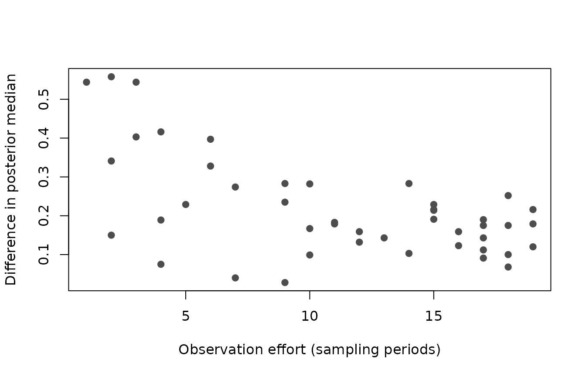

The differences are largest for the dyads with the least observation
effort, and decrease as effort increases. The difference also depends on
the data: the dyad `3-8`, observed in 2 periods with no events, has a
smaller difference than other dyads with similar effort, because its
data agree more closely with the `beta(1, 9)` prior. In this dataset the
differences do not disappear even for the most observed dyads. The
`beta(1, 9)` prior is fairly strong (it carries about as much
information as 10 sampling periods), and most of the dyads in the tables
above were seen together in far more than 10% of their sampling periods.

In most datasets some dyads are observed much less than others. The
choice of prior matters most for these dyads, and for any analysis that
depends on them. This has two practical consequences:

- Results that depend on sparsely observed dyads should be checked for
  sensitivity to the prior, by refitting the model with other plausible
  priors and comparing the results.
- Network metrics and regressions that combine many edge weights can be
  affected by the prior if many dyads are sparsely observed, even when
  the difference for each dyad is small.

## Summary

- [`get_default_priors()`](https://bisonr.org/reference/get_default_priors.md)
  gives a starting point, not a recommendation for every study.
- Priors in binary and count models are on the logit or log scale.
  Transforming draws from the prior, or running a prior predictive
  check, shows what they imply on the natural scale.
- [`prior_check()`](https://bisonr.org/reference/prior_check.md) shows
  each prior on its own.
  [`prior_predictive_check()`](https://bisonr.org/reference/prior_predictive_check.md)
  shows the data implied by all the priors together.
- The prior has the most influence on dyads with little observation
  effort. Checking the sensitivity of the results to the prior is most
  important when many dyads are sparsely observed.
